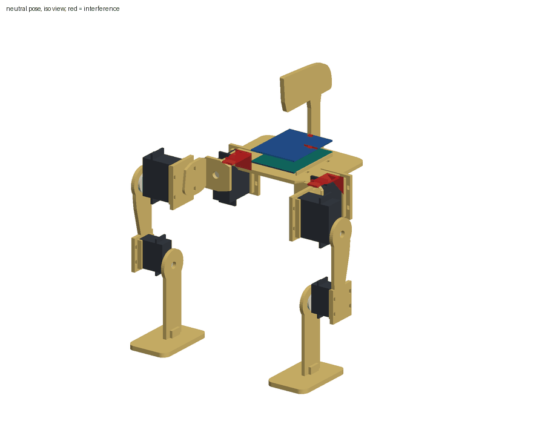
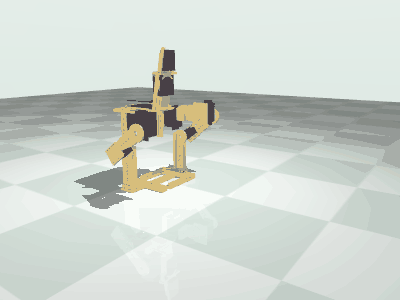

# Microduck on Braccio servos and an Arduino UNO Q: simulation to real

A small printed biped, checked digitally before anything is printed:
assembled from its STL files and a model of the servos, tested for fit and
balance, described as URDF and MJCF, emulated in MuJoCo, and given the
firmware and tools to play the same joint commands on the real robot.

> **Status: verified in simulation only.** The robot has never been
> assembled or powered. The parts have not been printed as a set. The UNO Q
> sketch has not been built or flashed. Dimensions the makers do not publish
> are assumed and listed in [docs/assembly.md](docs/assembly.md).

## The robot

A Microduck-style biped rebuilt around the six servos of a stock TinkerKit
Braccio kit. Four SR431 servos at the hips (two on the torso for hip roll,
one on each yoke for hip pitch), two SR311 servos at the far end of the
thighs for knee pitch, shins with fixed feet, an Arduino UNO Q and the
Braccio shield strapped to a deck, a camera board in a mount at the front
edge of the deck, servos held by cable ties. Seven printed parts and seven
fit-test pieces. The torso, thighs, shins and feet carry pin holes and studs
compatible with LEGO Technic and System elements, for decoration. LEGO,
Technic, Mindstorms and SPIKE are trademarks of the LEGO Group, which does
not sponsor or endorse this. There is no head: the torso carries the camera mount
instead, with presets for the AI-Thinker ESP32-CAM (the default), the
Espressif ESP-EYE and the ESP32-S3-EYE. See [docs/camera.md](docs/camera.md).

Six actuated joints: left and right hip roll, hip pitch, knee pitch. No yaw,
no ankles.

For comparison, Pollen Robotics' Microduck has five joints per leg (hip yaw,
roll, pitch, knee, ankle) and four in the neck and head, weighs about 800 g
and stands about 25 cm tall. This one has three per leg, weighs about 500 g
by the model and stands 262 mm.

## What the digital assembly test found

Full report with pictures: [docs/assembly.md](docs/assembly.md). Numbers:
[reports/assembly.json](reports/assembly.json).

- **Interference.** None at the neutral pose. As first drawn each hip roll
  servo ran 2 mm into the deck and its ear went through it (1055 mm3); the
  cradles now hang 2.5 mm lower and the deck corner is cut away for the ear,
  which leaves 0.5 mm under the deck and 0.75 mm beside the assumed ear. The
  neck that the UNO Q ran into is gone with the head.
- **Camera mount.** The ESP32-CAM stands between two posts with 0.5 mm each
  side, 1.1 mm ahead of the UNO Q. The lens looks the way the toes point,
  10 degrees below level, 226 mm above the floor at the stand pose. A cone
  of 40 degrees half angle in front of it is clear at the neutral and stand
  poses; a thigh swung more than 21 degrees forward comes into it.
- **Other controllers.** The deck has torso variants for a Raspberry Pi Zero
  2 W, a full-size Raspberry Pi and the LEGO 51515 hub. As blocks of their
  mass they clear the print and the camera, and the robot still balances at
  a stand pose in each case: the heavier the controller, the further back
  the thighs go (38, 42 and 50 degrees; 63 with an EV3 brick of an assumed
  300 g, which has no torso of its own). The static stand margin stays near
  37 mm. Geometry and static balance only; none was simulated. Raspberry Pi
  is a trademark of Raspberry Pi Ltd.
- **Turning head, an option.** A second torso carries a 9 g servo under a tab
  at the deck front; it turns the camera 75 degrees each way between printed
  stops, and tilt is set by hand on one screw. It meets nothing, costs the
  legs no travel inside their limits and leaves the stand margin at 36.7 mm or
  more at either stop. It is geometry only, not in the simulation or the
  joint commands. The owner's M5Stack 360 servos are continuous rotation:
  [docs/head.md](docs/head.md) says what that means.
- **Cable ties.** Each cradle has four slot pairs. The two away from the
  shaft end give two tie paths over the case clear of the shaft and horn on
  all six cradles (assumed shaft position and horn size). As first drawn
  there were two pairs and one of them was in line with the shaft.
- **Fits.** Every case sits between its rails with 0.5 mm a side, fully on
  its plate; all tie slots are open; all six horn screw holes are on their
  shaft axes with a free path for a screwdriver. The board has 0.52 mm to
  each deck rail.
- **Joint sweeps.** Hip pitch turns a full half turn each way without
  contact. Hip roll is free from -55 to +180 degrees on the left (mirror on
  the right): inward, the shins meet. The knee is free from -137 to +115
  degrees. With 3 degrees of margin and the servos' 180 degrees of travel the
  limits are hip roll -52 to +90, hip pitch and knee -90 to +90.
- **Pin holes and studs.** 23 pin holes in pads of beam thickness and 40
  studs. Every hole is open for a 4.8 mm pin over 7.8 mm, at least 24 mm
  from a joint axis; none cost any joint range. At the stand pose, static
  balance carries about 400 g of decoration on the rear of the deck before
  the margin is gone; 100 g there leaves 23 mm of the 37 mm.
- **Mass.** 502 g: servos 302 g (published), printed parts 136 g (PLA at 60
  percent of solid, assumed), board 30 g and shield 25 g (assumed), camera
  10 g (published). 593 g if printed solid.
- **Balance.** With the legs straight down the centre of mass is 6.6 mm
  behind the heels: it falls backward. With the thighs swung 42 degrees back
  and the knees turned to keep the soles level it is 37 mm inside the support
  polygon. That is the stand pose. On one foot it is 62 mm outside, and still
  38 mm outside with the stance hip rolled 30 degrees. It cannot stand on one
  foot.
- **An open choice.** The design does not say which face of the thigh meets
  the hip horn. Both were checked. With the horn on the rail face the feet
  are 172 mm apart; on the flat face, 320 mm. The description uses the rail
  face.

## What the simulation did

Full results: [docs/simulation.md](docs/simulation.md). Numbers:
[reports/sim.json](reports/sim.json).

- **It stands.** Ten seconds at the stand pose, peak tilt 0.2 degrees. The
  hip pitch servos need 0.09 N m of their 1.2 N m, the knees 0.02 of 0.30.
- **Straight legs fall.** At the neutral pose it tips backward in 0.4 s, as
  the assembly test predicted.
- **The gait shuffles.** The open-loop weight shift and step keeps the robot
  up for the whole run and moves it 45 mm in 11 s. Both feet stay on the
  floor the whole time. The best of 54 parameter sets inside the speed limit
  manages 110 mm in 11 s (10 mm/s). None fell. With no ankle and feet 172 mm
  apart the weight never gets onto one foot, so there is no step.
- **Watchdog.** Commands cut in mid gait: the controller holds and the robot
  stays up. Relaxed instead, it falls in 0.3 s.

What the simulation suggests changing is listed at the end of
[docs/simulation.md](docs/simulation.md). Those are suggestions; the parts
are the owner's and were not edited.

## Simulation to real

One line format carries joint angles in degrees to the simulator and to the
board. A calibration table per servo (shield channel, zero, direction) and
the joint limits from the assembly test turn them into pulses. The firmware's
control core (soft limits, speed limit, watchdog, one-joint calibration) is
plain C++ that is also compiled for the host and compared, line for line,
with the Python controller that drives the simulator.

    python scripts/play.py trajectories/stand.csv              simulator
    python scripts/virtual_robot.py                            the simulator behind the board's socket
    python scripts/play.py trajectories/gait.csv --tcp 127.0.0.1:8766
    python scripts/play.py trajectories/stand.csv --tcp <uno-q>:8766 --real

Hardware links open only with `--real`. Steps, the command set and what was
reused from unoq-braccio-sketchbot: [docs/sim-to-real.md](docs/sim-to-real.md).
Power: [docs/power.md](docs/power.md). Six stalled servos can ask for about
10 A (assumed stall currents; the maker publishes none) against the kit's
5 V 4 A supply, and the UNO Q needs its own 5 V 3 A.

## Layout

| Path | What |
|---|---|
| `stl/` | the printable parts of the biped as generated, with a manifest |
| `config/` | bought-part data with sources, placement assumptions, calibration, gait |
| `microduck/` | model, assembly test, renderer, description generator, simulator, protocol, player |
| `scripts/` | fetch the STLs, run each stage, regenerate everything, play, calibrate, virtual robot |
| `reports/` | generated: assembly and simulation results as JSON |
| `robot/` | generated: URDF, MJCF, joint table, viewer model |
| `trajectories/` | generated: stand and gait as CSV |
| `app_lab/microduck_agent/` | the UNO Q app: sketch for the microcontroller, relay for the Linux side |
| `docs/` | generated reports, pictures, sim-to-real steps, power, how to regenerate |
| `site/` | the GitHub Pages site |
| `tests/` | headless pytest suite |

## Running it

    python -m venv .venv
    .venv/Scripts/python -m pip install -r requirements-dev.txt
    .venv/Scripts/python -m pytest
    .venv/Scripts/python scripts/play.py trajectories/gait.csv

Everything runs from what is committed, the printable STLs in `stl/`
included. To regenerate after changing the design or a configuration file:

    python scripts/regenerate.py --design-dir /path/to/microduck-braccio-unoq

See [docs/regenerate.md](docs/regenerate.md).

## The printable parts and where their shape comes from

The printable parts are flat plates with servo cradles, horn blanks and a
board deck. The design's generator took the convex outline of each of 15
Microduck meshes in one projection as the starting silhouette of a plate; no
surface, joint or mechanism of those meshes is in the parts, and the result
does not look like the original (see the pictures in
[docs/assembly.md](docs/assembly.md)). The idea of a small duck-like biped is
owed to the [Microduck by Pollen Robotics](https://github.com/pollen-robotics/microduck_rl).

The generated STLs are in `stl/`, listed in `stl/manifest.json` with what
each is, its size, checksum and the design commit it came from. They are the
files the assembly test read. `scripts/fetch_stls.py` copies them from the
local design directory after its generator has run. None has been printed.

## Unverified

- Physical fit of anything: no part has been printed against a servo or a
  camera board.
- The pin holes and studs: no printed one has been tried with a real pin,
  beam or brick. Their nominal dimensions are from secondary sources.
- The other controllers: the masses of the Raspberry Pi boards, the hub's
  battery and the EV3 brick are estimates, and the full-size Pi's hole
  pattern and the EV3's size are not from their makers' pages.
- The turning head: the servo body, shaft position and horn height are
  assumed from SG90 data sheets, the adapter hole pattern is a guess to be
  measured, and no firmware drives it.
- The camera boards: only the ESP32-CAM outline and mass and the ESP32-S3-EYE
  outline are the makers' figures. Lens, button, connector and pin positions,
  board thickness and the other masses are assumed or scaled from pictures.
- The camera firmware on an ESP32-CAM: see [docs/camera.md](docs/camera.md).
- Every assumed dimension: servo ears, shaft position, horn size, board and
  shield mass, print density and infill.
- Holding torque, backlash, tie slip, flex of the 4 mm plates.
- Floor friction and the contact model, on which the shuffle depends.
- Servo direction and zero in the calibration table.
- The sketch: not built, not flashed. `Serial` as the header UART, relax by
  zero duty and the `String` Bridge function are to be checked at first build.
- Stall currents, and how the Braccio shield shares power with the UNO Q.

## Publishing

1. Create the repository `eoinjordan/microduck-braccio-unoq-sim` on GitHub and
   push `main`.
2. In the repository settings, under Pages, set the source to GitHub Actions.
3. Run the "Publish Site" workflow, or push a change under `site/`. The site
   appears at https://eoinjordan.github.io/microduck-braccio-unoq-sim/.

## Licence

MIT for the code and documentation, see [LICENSE](LICENSE). Third-party
material and sources: [NOTICE](NOTICE).
