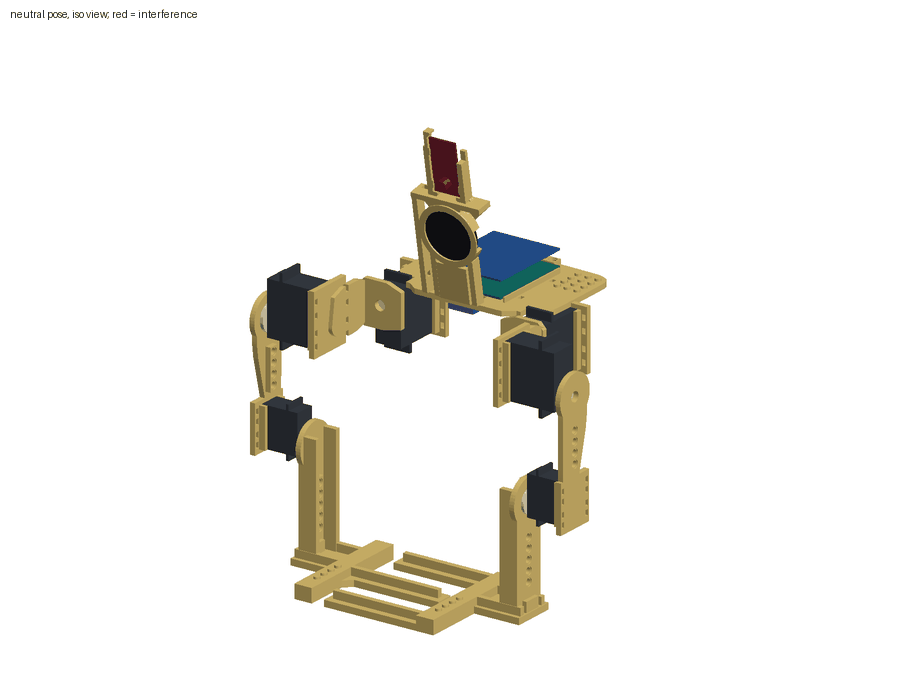
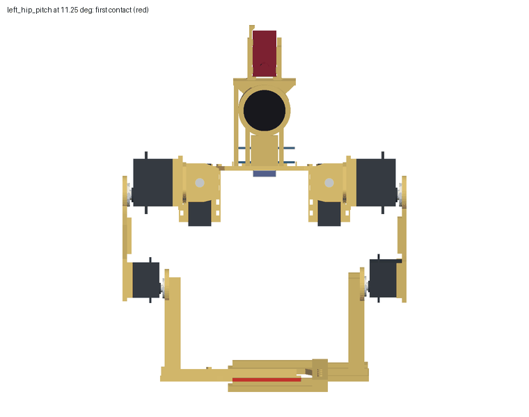
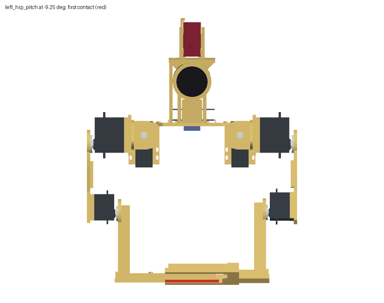
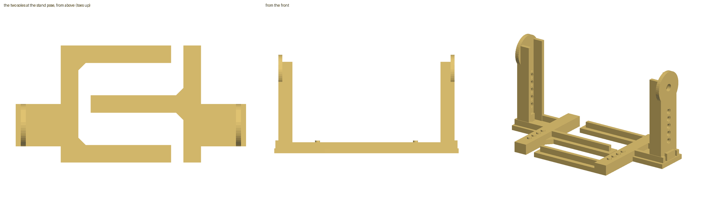
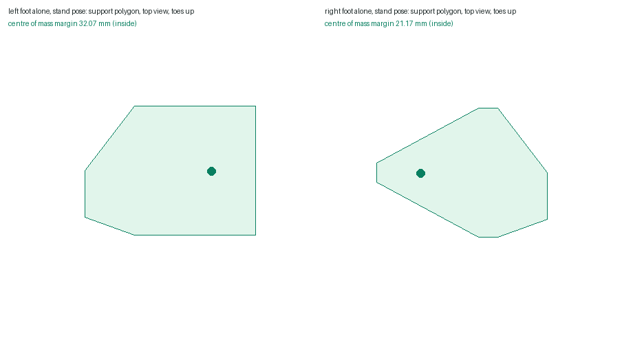

# Digital assembly test

Generated by `scripts/run_assembly.py` from the seven printable STLs, the parametric servo and board models and
`config/`. Do not edit by hand. The numbers are also in `reports/assembly.json`.

Status: geometry only. Nothing here has been printed, assembled or powered.

## Findings

- **ok**: Each cradle has 4 tie slot pairs; on every cradle at least 2 of the tie paths cross the case clear of the output shaft and horn (the pairs at the shaft end do not, and are for a servo lying the other way round). This depends on the assumed shaft position and horn size.
- **ok**: Every servo case fits between its rails with 0.5 mm each side, sits fully on its plate, and all tie slots are open.
- **ok**: All six horn screw holes are on their shaft axes and a screwdriver has a free path to each at the neutral pose.
- **ok**: The Espressif ESP-EYE V2.1 stands in its mount with 0.5 mm each side and 0.3 mm of play under the snap lips, on the corner seats, overlapping the print by 0.0 mm3. The mount is 5.06 mm from the UNO Q and 5.34 mm from the space kept for the shield and its plugs.
- **ok**: The lens looks along +x, the way the toes point, 10.0 degrees below level, 244.79 mm above the floor at the stand pose. A cone of 40.0 degrees half angle in front of it is clear at the neutral and stand poses. A leg comes into the cone with left_hip_pitch between -90.0 and -15.0 degrees; right_hip_pitch between -90.0 and -15.0 degrees (one joint moved, the others at the stand or neutral pose).
- **ok**: 23 pin holes and 32 studs compatible with LEGO Technic and System elements: every hole is open for a 4.8 mm pin over 7.8 mm with wall all round, none is nearer than 14.78 mm to a joint axis or 2.71 mm to another part at the neutral pose, and none is in the camera's clear cone. Whether a real pin or brick holds in a printed one is not known.
- **balance**: Legs straight down: the centre of mass is 2.75 mm outside the support polygon of the two feet (behind the heels); it falls backward.
- **ok**: With the thighs swung back 52.0 degrees and the knees turned the other way to keep the soles level, the centre of mass is 46.7 mm inside the polygon. This is the stand pose.
- **ok**: On one foot the centre of mass is inside the sole at the stand pose: 32.07 mm on the left foot alone and 21.17 mm on the right, with the other foot level with it. The soles reach across the centre line, so no weight shift is needed. This is static and rigid: the fingers, the shin plate and the servos give under the load.

## Assumptions

The design directory does not say how each servo lies in its cradle or which face of a printed blank
meets a horn. These choices were made here (`config/assembly.json`):

- frame: x forward (the way the toes point and the camera looks), y left, z up. The left leg is the one built from the mirrored yoke, on the torso cradle at y = +57.
- servo_in_cradle: Case bottom on the plate, long sides between the rails, centred along the rails, output shaft away from the plate.
- roll_servo_flip: true puts the hip roll shaft at the upper end of the torso cradle.
- pitch_servo_flip: true puts the hip pitch shaft at the lower end of the yoke cradle.
- knee_servo_flip: false puts the knee shaft at the far (distal) end of the thigh.
- horn_side: The printed blank sits on the outer face of the horn, so the horn screw is reached through the 8 mm hole from the far side.
- yoke_face: The roll horn meets the yoke face at yoke z = 0; the wall and the pitch cradle extend forward from it.
- thigh_face: 'rail' puts the hip horn on the face that carries the rails, so the knee servo lies beside the hip pitch servo and the foot is nearer the body. 'flat' puts it on the flat face, stacking thigh, knee servo and shin outward. Both are checked; this value picks the one the robot description uses.
- shin_face: The shin blank is symmetric; the face towards the knee servo meets the horn and the foot points +x.
- neutral: Thighs straight down, shins vertical, soles level, horns at mid travel.
- camera: The camera board stands in the mount at the front edge of the deck, lower edge on the corner seats, back face on the ledges, lens towards +x. The numbers repeat CAMERA, CAM_BACK_X, CAM_BASE_Z and CAM_TILT of build.py in the design directory; a test compares them with the parameters.json the generator writes.
- feet: 'comb' soles have fingers that cross the centre line between the fingers of the other sole; 'flat' is the plate as first drawn. FEET in build.py chooses the same. Joint limits are taken from sweeps that leave contact between the two shin parts out, because whether the soles meet depends on both legs together; the feet section of the report says how far the legs may move against each other.
- face: The default head is the round display as the eyes with the camera board above it ('eyes_above'); 'eyes_below' puts the camera under the display. FACE and CAMERA in build.py choose the same. Where the display, the camera board and the battery are is read from the parameters.json the generator writes. Without a face the camera stands alone in the fixed mount, placed by the numbers under 'camera'.
- front: Forward is the way the toes point: each foot plate reaches 46.5 mm ahead of the shin and 28.5 mm behind it (build.py moves it 9 mm towards +x), and the design README says toes forward. The hip roll cradles open towards +x, so the hips and legs stand ahead of the deck by construction.
- board: UNO Q long side along x, centred between the deck rails, on spacers; Braccio shield stacked on top.

Dimensions the makers do not publish, and the values assumed for them:

| item | quantity | assumed value | why |
|---|---|---|---|
| SR431 | height_is_case_only | True | the page gives one height; taken as the case without the output spline |
| SR431 | shaft_from_end_mm | 10.25 | half the case width, as on standard-size servos; not published |
| SR431 | ear_overhang_mm | 6.5 | typical mounting ear of a standard-size servo; not published |
| SR431 | ear_thickness_mm | 2.5 | typical; not published |
| SR431 | ear_bottom_height_mm | 27.0 | about 0.68 of the case height; not published |
| SR431 | boss_radius_mm | 6.5 | output bearing boss; not published |
| SR431 | boss_height_mm | 1.5 | not published |
| SR431 | horn_radius_mm | 10.5 | round horn of about 21 mm; the kit's horn is not dimensioned by the maker |
| SR431 | horn_thickness_mm | 2.5 | not published |
| SR431 | horn_hub_radius_mm | 4.5 | not published |
| SR431 | horn_face_above_case_mm | 5.5 | case top to the outer face of the horn, where the printed blank sits; not published |
| SR431 | stall_current_a | 2.0 | the maker publishes no stall current; typical for an analog servo of this torque at 5 V |
| SR431 | armature_kgm2 | 0.003 | reflected rotor inertia for the simulation; not published |
| SR311 | height_is_case_only | True | the page gives one height; taken as the case without the output spline |
| SR311 | shaft_from_end_mm | 8.25 | half the case width; not published |
| SR311 | ear_overhang_mm | 4.5 | typical mounting ear of a mini servo; not published |
| SR311 | ear_thickness_mm | 2.0 | typical; not published |
| SR311 | ear_bottom_height_mm | 19.5 | about 0.68 of the case height; not published |
| SR311 | boss_radius_mm | 5.0 | not published |
| SR311 | boss_height_mm | 1.2 | not published |
| SR311 | horn_radius_mm | 9.0 | round horn of about 18 mm; not dimensioned by the maker |
| SR311 | horn_thickness_mm | 2.0 | not published |
| SR311 | horn_hub_radius_mm | 3.5 | not published |
| SR311 | horn_face_above_case_mm | 4.5 | case top to the outer face of the horn; not published |
| SR311 | stall_current_a | 1.0 | the maker publishes no stall current; typical for a mini analog servo at 5 V |
| SR311 | armature_kgm2 | 0.001 | reflected rotor inertia for the simulation; not published |
| Arduino UNO Q | pcb_thickness_mm | 1.6 | standard board thickness; not in the datasheet text |
| Arduino UNO Q | mass_g | 30.0 | the datasheet gives no mass; estimate for a populated UNO-format board |
| Arduino UNO Q | spacer_mm | 2.5 | insulating spacers the design README asks for; must exceed the 2 mm bottom-side parts |
| Braccio shield | mass_g | 25.0 | not published; estimate for the shield with headers and jack |
| Braccio shield | pcb_gap_mm | 11.0 | stacking header pitch between board and shield; not published |
| Braccio shield | stack_height_mm | 26.0 | top of the servo plugs above the UNO Q board top; not published |
| print | material | PLA | the design README names no material |
| print | density_g_cm3 | 1.24 | typical PLA filament data sheet value; PETG is about 1.27 |
| print | solid_fraction | 0.6 | 4 mm plates with two perimeters and 0.8 mm skins at 20 percent infill are mostly shell |
| driver | screwdriver_radius_mm | 3.0 | shank of a small cross-head driver for the horn screw |
| driver | screwdriver_length_mm | 80.0 | free length needed in front of the access hole |
| Espressif ESP-EYE V2.1 | length_mm | 41.0 | reseller figure; Espressif publishes none |
| Espressif ESP-EYE V2.1 | width_mm | 21.0 | reseller figure; Espressif publishes none |
| Espressif ESP-EYE V2.1 | mass_g | 8.0 | not published; estimate, tolerance 3 g |
| Espressif ESP-EYE V2.1 | pcb_thickness_mm | 1.6 | not published |
| Espressif ESP-EYE V2.1 | lens_centre_above_lower_edge_mm | 9.0 | scaled from Espressif's photograph: 9 mm from the camera end, centred; tolerance 1 mm |
| Espressif ESP-EYE V2.1 | lens_front_above_board_mm | 6.5 | not published, tolerance 1.5 mm |
| Espressif ESP-EYE V2.1 | lens_diameter_mm | 8.0 | module body about 7.7 mm square in the photograph |
| Espressif ESP-EYE V2.1 | boot_and_reset_above_lower_edge_mm | 15.5 | scaled from the photograph: on the camera face, 1.6 mm from each long edge; tolerance 1 mm |
| Espressif ESP-EYE V2.1 | side_button_above_lower_edge_mm | 31.75 | scaled from the photograph: 29.5 to 34 mm, on the long edge at the robot's left as mounted; tolerance 1 mm |
| Espressif ESP-EYE V2.1 | microphone_above_lower_edge_mm | 39.0 | scaled from the photograph: camera face, centred, at the USB end |
| Espressif ESP-EYE V2.1 | picture_is_upright_with_usb_down | True | the board's lettering reads upright with the connector down; taken as the sensor's upright, not confirmed on a board |
| camera | clear_cone_half_angle_deg | 40.0 | covers 66.5 degrees whether that figure is the diagonal or the horizontal field of a 4:3 sensor (39.3 degrees to the corner in the second case) |

Published dimensions and their sources:

| item | source |
|---|---|
| SR431 and SR311 servos, supply | https://store-usa.arduino.cc/products/tinkerkit-braccio-robot |
| Arduino UNO Q outline and power | https://docs.arduino.cc/resources/datasheets/ABX00162-datasheet.pdf |
| Braccio shield outline | https://store-usa.arduino.cc/products/tinkerkit-braccio-robot |
| Espressif ESP-EYE V2.1 | https://github.com/espressif/esp-who/blob/master/docs/en/get-started/ESP-EYE_Getting_Started_Guide.md |

## The two thigh mountings

|  | rail face | flat face |
|---|---|---|
| overall width (mm) | 250.0 | 332.2 |
| foot centre to foot centre (mm) | 59.8 | 208.2 |
| one-foot margin at the stand pose (mm) | 32.07 | -41.46 |
| left hip roll free range (deg) | [-3.0, 180.0] | [-57.5, 180.0] |
| left knee free range (deg) | [-18.0, 111.5] | [-7.5, 7.5] |

Everything below is for the `rail` mounting, which the robot description uses.

## Size

Bounding box at the neutral pose: 198.0 x 250.0 x 314.25 mm (length, width, height). Soles at z = -185.9 mm in the torso frame.

| joint | axis point in the torso frame (mm) |
|---|---|
| left_hip_roll | [49.0, 57.0, -10.75] |
| left_hip_pitch | [89.0, 121.0, -21.5] |
| left_knee | [89.0, 87.9, -103.9] |
| right_hip_roll | [49.0, -57.0, -10.75] |
| right_hip_pitch | [89.0, -121.0, -21.5] |
| right_knee | [89.0, -87.9, -103.9] |

## Interference at the neutral pose

None.

## Joint sweeps

One joint at a time from the neutral pose, others at zero, until a part that moves with the joint meets one that
does not. 180 means a full half turn without contact. Limits are the free range less 3.0 degrees where a collision ends it, intersected with +/-90 degrees of servo travel about neutral.

The two soles interleave, so one leg moved alone soon brings its sole against the other. Whether the soles meet
depends on both legs, which a limit per joint cannot say: the limits are taken from the sweep with contact between
the two shin parts left out, and the section on the soles below says how far the legs may move against each other.

| joint | collision free, everything (deg) | collision free, soles left out (deg) | first contact, negative | first contact, positive | limit used (deg) |
|---|---|---|---|---|---|
| left_hip_roll | [-3.0, 180.0] | [-38.75, 180.0] | left_shin_print / right_shin_print | none | [-35.0, 90.0] |
| left_hip_pitch | [-9.0, 11.0] | [-180.0, 65.75] | left_shin_print / right_shin_print | left_shin_print / right_shin_print | [-90.0, 62.0] |
| left_knee | [-18.0, 111.5] | [-154.25, 111.5] | left_shin_print / right_shin_print | left_shin_print / left_roll_servo | [-90.0, 90.0] |
| right_hip_roll | [-180.0, 3.0] | [-180.0, 35.0] | none | right_shin_print / left_shin_print | [-90.0, 32.0] |
| right_hip_pitch | [-11.0, 9.0] | [-180.0, 65.75] | right_shin_print / left_shin_print | right_shin_print / left_shin_print | [-90.0, 62.0] |
| right_knee | [-154.25, 18.0] | [-154.25, 111.5] | right_shin_print / right_yoke_print | right_shin_print / left_shin_print | [-90.0, 90.0] |

## The two soles

Feet preset: `comb`. From the stand pose, in steps of one degree, until the two shin parts overlap.
60 means no contact within 60 degrees.

| movement | free range (deg) | note |
|---|---|---|
| gap between the two shin parts at the stand pose (mm) | 9.8 | overlap 0.0 mm3 |
| gap at the neutral pose (mm) | 9.8 | overlap 0.0 mm3 |
| left hip roll alone | -3.0 to 60.0 | positive rolls the leg outward |
| left hip pitch alone | -60.0 to 13.0 | the foot swings and tilts |
| left knee alone | -18.0 to 60.0 |  |
| both hips rolled the same way | -60.0 to 50.0 | as in a weight shift |
| right sole slid forward or backward on the floor (mm) | 26.0 back, 26.0 forward | how far one foot may lead the other with both soles down |
| right sole slid sideways on the floor (mm) | 9.5 towards the left sole, 60.0 away | 60 means none within 60 mm |
| left foot lifted, sole level (hip pitch +t, knee -2t) | -60.0 to 60.0 |  |

## Servos in their cradles

| servo | model | rail clearance each side (mm) | seated on plate | tie slots open | ties clear of shaft | overlap with its printed part (mm3) |
|---|---|---|---|---|---|---|
| left_roll_servo | SR431 | 0.5 | 1.0 | 8/8 | 2/4 | -0.0 |
| left_pitch_servo | SR431 | 0.5 | 1.0 | 8/8 | 2/4 | 0.0 |
| left_knee_servo | SR311 | 0.5 | 1.0 | 8/8 | 2/4 | 0.0 |
| right_roll_servo | SR431 | 0.5 | 1.0 | 8/8 | 2/4 | -0.0 |
| right_pitch_servo | SR431 | 0.5 | 1.0 | 8/8 | 2/4 | 0.0 |
| right_knee_servo | SR311 | 0.5 | 1.0 | 8/8 | 2/4 | 0.0 |

## Horn blanks

| joint | hole on shaft axis | blank solid under the horn | driver path clear | driver comes from |
|---|---|---|---|---|
| left_hip_roll | True | 1.0 | True | [1.0, 0.0, 0.0] |
| left_hip_pitch | True | 1.0 | True | [0.0, 1.0, 0.0] |
| left_knee | True | 1.0 | True | [-0.0, -1.0, 0.0] |
| right_hip_roll | True | 1.0 | True | [1.0, 0.0, 0.0] |
| right_hip_pitch | True | 1.0 | True | [0.0, -1.0, 0.0] |
| right_knee | True | 1.0 | True | [-0.0, 1.0, 0.0] |

The blank is placed on the shaft axis by construction, so the hole check confirms the model and the STL agree; it does not
measure a print. The horn itself is not dimensioned by the maker.

## UNO Q on the deck

| check | value |
|---|---|
| board outline (mm) | [68.58, 53.34] |
| clearance to each deck rail (mm) | 0.52 |
| rail height above the board underside (mm) | 1.3 |
| overlap with the torso, board centred (mm3) | 0.0 |
| overlap with the torso, shield (mm3) | 0.0 |
| forward shift that clears both (mm) | 0.0 |
| overhang past the deck front after the shift (mm) | 0.0 |

## Face: round display and camera

The default head carries a Seeed Studio Round Display for XIAO in a ring at the deck front, screen forward as the
eyes, and a camera board on the same head above or below it. A LiPo cell for the display is strapped under the deck
front. The assembly, description and simulation use `eyes_above_esp_eye`. The display is drawn as a disc with
a block for the XIAO behind it; its diameter, thickness and mass are assumed (see `config/hardware.json`).

| face and camera | torso file | interference at neutral | display overlap with print (mm3) | lens (mm) | lens above the floor at stand (mm) | top of the head above the deck (mm) | cone clear at neutral and stand | thigh angles in the cone, others at stand (deg) | total mass (g) | centre of mass at neutral (mm) | legs straight: margin (mm) | stand: thighs back (deg) | stand margin (mm) |
|---|---|---|---|---|---|---|---|---|---|---|---|---|---|
| eyes_above_esp_eye | 01_torso_unoq_eyes_above_esp_eye.stl | 0 | 0.0 | [64.5, 0.0, 90.56] | 244.79 | 124.35 | True | [-90.0, -15.0] | 561.6 | [56.25, -0.03, -36.13] | -2.75 | 52.0 | 46.7 |
| eyes_below_esp_eye | 01_torso_unoq_eyes_below_esp_eye.stl | 0 | 0.0 | [54.4, 0.0, 39.03] | 193.26 | 119.57 | True | [-90.0, 6.0] | 558.2 | [56.31, 0.04, -36.24] | -2.69 | 52.0 | 46.67 |
| eyes_above_esp32cam | 01_torso_unoq_eyes_above_esp32cam.stl | 0 | 0.0 | [68.41, 0.0, 112.72] | 266.95 | 123.85 | True | [-90.0, -21.0] | 564.5 | [56.26, -0.03, -35.4] | -2.74 | 52.0 | 46.8 |
| eyes_below_esp32cam | 01_torso_unoq_eyes_below_esp32cam.stl | 0 | 0.0 | [58.31, 0.0, 61.19] | 215.42 | 119.07 | True | [-90.0, -3.0] | 560.5 | [56.28, 0.05, -35.86] | -2.72 | 52.0 | 46.7 |

The display stack turned round (`stack_camera_forward`: XIAO Sense camera forward, screen to the rear), on the fixed
head, with the lens taken on the display axis:

| check | value |
|---|---|
| neutral_interferences | none |
| display_overlap_with_print_mm3 | 0.0 |
| display_to_unoq_mm | 30.97 |
| display_to_stack_envelope_mm | 17.99 |
| lens_mm | [71.51, 0.0, 50.23] |
| lens_height_above_floor_at_stand_mm | 204.46 |
| cone_blocked_at_neutral | none |
| cone_blocked_at_stand | none |
| hip_pitch_in_cone_from_stand_deg | [-90.0, -3.0] |
| total_g | 549.8 |
| com_neutral_mm | [56.56, 0.05, -39.06] |
| neutral_margin_mm | -2.44 |
| stand_thigh_swing_deg | 52.0 |
| stand_margin_mm | 46.69 |

The same heads on the turning platform (pan servo, hand-set tilt). The battery stays strapped under the deck, so its
lead to the display crosses the pan joint and needs a loop for the travel; the lead is not modelled.

| head on the platform | pan travel to the stops (deg) | tilt free range (deg) | interference at neutral | new interference at the stand pose, pan at either stop or centre | head mass with servo (g) | total mass (g) | stand margin at the stops and centre (mm) | parts in the clear cone straight ahead |
|---|---|---|---|---|---|---|---|---|
| eyes_above_esp_eye | [-75.25, 75.25] | [-12.5, 12.5] | 0 | 0 | 53.7 | 583.3 | [46.75, 45.9, 46.61] | none |
| eyes_below_esp_eye | [-75.25, 75.25] | [-12.5, 12.5] | 0 | 0 | 50.2 | 579.8 | [46.81, 46.07, 46.79] | none |
| stack_camera_forward | [-75.25, 75.25] | [-12.5, 12.5] | 0 | 0 | 41.9 | 571.5 | [46.94, 46.35, 46.94] | none |

## Camera mount

The torso has no head or neck. Two posts at the front edge of the deck hold a camera board by its long edges,
lens forward. Forward is the way the toes point: the foot plates reach 64.0 mm ahead of the shin and 30.0 mm behind it. The hip cradles open
towards +x, so the hips stand ahead of the deck and the mount looks out between the legs.

| check | value |
|---|---|
| camera preset | esp_eye (Espressif ESP-EYE V2.1) |
| board as modelled: width, length, thickness (mm) | [21.0, 41.0, 1.6] |
| board mass (g) | 8.0 |
| clearance to each post (mm) | 0.5 |
| play towards the snap lips (mm) | 0.3 |
| play towards the back ledges (mm) | 0.0 |
| lower edge on the corner seats | True |
| play upwards to the catch over the upper edge (mm) | 1.04 |
| overlap of board and print (mm3) | 0.0 |
| mount to UNO Q (mm) | 5.06 |
| mount to Braccio shield (mm) | 7.25 |
| mount to the space kept for shield plugs (mm) | 5.34 |
| camera board to the space kept for shield plugs (mm) | 53.19 |
| lens front in the torso frame (mm) | [64.5, 0.0, 90.56] |
| tilt below level (deg) | 10.0 |
| lens above the floor at the stand pose (mm) | 244.79 |
| clear cone, half angle (deg) | 40.0 |
| parts in the cone at neutral | none |
| parts in the cone at the stand pose | none |

Joint angles inside the limits at which a leg is in the cone, one joint moved at a time:

| joint | others at neutral (deg) | others at the stand pose (deg) |
|---|---|---|
| left_hip_roll | never | never |
| left_hip_pitch | [-90.0, -39.0] | [-90.0, -15.0] |
| left_knee | never | never |
| right_hip_roll | never | never |
| right_hip_pitch | [-90.0, -39.0] | [-90.0, -15.0] |
| right_knee | never | never |

The camera presets alone in the fixed mount, without the display, each with its own torso file, checked in short form:

| preset | board (mm) | each side (mm) | under the lips (mm) | up to the catch (mm) | on the seats | overlap with print (mm3) | mount to UNO Q (mm) | cone clear at neutral and stand | total mass (g) | centre of mass at neutral (mm) | stand margin (mm) |
|---|---|---|---|---|---|---|---|---|---|---|---|
| esp32cam | [27.0, 40.5, 1.6] | 0.5 | 0.3 | 1.03 | True | 0.0 | 1.06 | True | 534.1 | [56.71, 0.05, -40.92] | 46.97 |
| esp32_s3_eye | [30.0, 60.0, 1.6] | 0.5 | 0.3 | 1.04 | True | 0.0 | 1.06 | True | 547.6 | [56.66, 0.04, -37.98] | 46.73 |
| esp_eye alone in the fixed mount | [21.0, 41.0, 1.6] | 0.5 | 0.3 | 1.04 | True | 0.0 | 1.06 | True | 531.6 | [56.74, 0.05, -41.41] | 46.98 |

The board is a plain plate with a lens barrel. Its connectors, buttons, pins and wires are not modelled; where they are
and what is assumed about them is in `config/hardware.json` and the design README.

## Other controllers on the deck

The biped's deck with another controller in place of the UNO Q and Braccio shield, each as one block of the stated
mass on its torso variant, camera mount unchanged. Assembly and static balance only: none was simulated, and what
would drive the six servos from each is not part of this. Outlines and masses, with what is published and what is
assumed, are in `config/hardware.json` under `controllers`.

| controller | torso file | block mass (g) | overlap with the print (mm3) | gap to the camera board (mm) | interference at neutral | total mass (g) | centre of mass at neutral (mm) | legs straight: margin (mm) | stand pose: thighs back (deg) | stand margin (mm) | hip pitch holding torque / limit |
|---|---|---|---|---|---|---|---|---|---|---|---|
| unoq with Braccio shield | 01_torso_unoq_eyes_above_esp_eye.stl | 55.0 | 0.0 | 53.19 | 0 | 561.6 | [56.25, -0.03, -36.13] | -2.75 | 52.0 | 46.7 | see the simulation |
| pi_zero_2w | 01_torso_pi_zero_2w_cam_esp_eye.stl | 20.0 | 0.0 | 13.18 | 0 | 496.3 | [60.78, 0.05, -45.11] | 1.78 | 49.0 | 46.81 | 0.06 |
| pi | 01_torso_pi_cam_esp_eye.stl | 55.0 | 0.0 | 17.06 | 0 | 530.8 | [56.86, 0.04, -40.96] | -2.14 | 53.0 | 46.93 | 0.073 |
| hub51515 | 01_torso_hub51515_cam_esp_eye.stl | 133.0 | 0.0 | 18.86 | 0 | 609.3 | [49.07, 0.04, -32.1] | -9.93 | 62.0 | 46.84 | 0.102 |
| ev3 | 01_torso_hub51515_cam_esp_eye.stl (not made for it) | 300.0 | 0.0 | 10.86 | 0 | 776.3 | [37.31, 0.03, -16.98] | -21.69 | 62.0 | 38.52 | 0.167 |

The hip pitch torque is the static moment of everything above the hips about the hip pitch axis at the stand pose,
shared by two servos, against the SR431's published 4.8 V torque.

## Turning head (option)

An optional head in place of the fixed mount: a 9 g SG90-class servo hangs by its ears in a tab at the deck front and
turns a platform; the camera cradle tilts on one M3 screw and is set by hand. Printed from `01_torso_unoq_pan_head.stl`,
`head_pan_platform.stl` and `head_tilt_cradle_<camera>.stl`. It is not part of the robot description or the simulation:
the URDF, the MJCF and the joint commands are for the fixed mount. Servo body, shaft position and horn height are
assumed (see the design README); nothing has been fitted.

| check | value |
|---|---|
| camera preset | esp_eye |
| pan travel between the printed stops (deg) | [-75.25, 75.25] |
| stopped by | head_platform_print / torso_print |
| tilt set to (deg below level) | 10.0 |
| tilt free range about level (deg, positive is down) | [-12.5, 12.5] |
| tilt stopped by | head_cradle_print / head_platform_print, head_cradle_print / head_platform_print |
| interference at the neutral pose | 0 |
| left hip roll, hip pitch, knee free range with the head on (deg) | [[-38.75, 130.25], [-180.0, 65.75], [-150.5, 111.5]] |
| mass of the head with its servo and camera (g) | 27.6 |
| total mass (g) | 548.7 |
| centre of mass at neutral (mm) | [57.18, 0.05, -39.43] |
| margin with legs straight (mm) | -1.82 |

| at the stand pose, pan (deg) | new interference | parts in the clear cone | centre of mass (mm) | stand margin (mm) | lens (mm) |
|---|---|---|---|---|---|
| -75.25 | 0 | right_yoke_print, right_pitch_servo, right_thigh_print, right_pitch_horn | [41.19, -0.13, -31.7] | 46.87 | [62.02, -13.37, 54.91] |
| 0.0 | 0 | none | [41.35, 0.05, -31.7] | 46.72 | [72.33, 0.0, 54.91] |
| 75.25 | 0 | left_yoke_print, left_pitch_servo, left_thigh_print, left_pitch_horn | [41.21, 0.24, -31.7] | 46.86 | [62.02, 13.37, 54.91] |

## Pin holes and studs

Attachment features compatible with LEGO Technic and System elements. LEGO, Technic, Mindstorms and SPIKE are
trademarks of the LEGO Group, which does not sponsor or endorse this. Geometry only: no printed hole or stud has been
tried with a real element.

Nominal: pitch 8.0 mm, pin hole 4.8 mm with a counterbore of 6.2 x 0.8 mm at each end, hole length 7.8 mm, stud 4.8 x 1.7 mm. Print allowance: holes 0.2 mm larger, studs 0.05 mm smaller.

| part | pin holes | open for a nominal pin | wall around the hole | hole to nearest joint axis (mm) | hole pad to nearest other part (mm) | studs | present | pointing up at neutral | stud to nearest other part (mm) |
|---|---|---|---|---|---|---|---|---|---|
| left_shin | 5 | True | True | 26.0 to 58.0 | 13.0 to 30.0 | 4 | True | True | 15.62 to 27.58 |
| left_thigh | 4 | True | True | 24.0 to 40.0 | 7.35 to 16.23 | 0 | True | True | - |
| right_shin | 5 | True | True | 26.0 to 58.0 | 13.0 to 30.0 | 4 | True | True | 15.73 to 29.2 |
| right_thigh | 4 | True | True | 24.0 to 40.0 | 7.35 to 16.23 | 0 | True | True | - |
| torso | 5 | True | True | 43.54 to 58.85 | 2.71 to 2.71 | 24 | True | True | 10.98 to 27.02 |

Features inside the camera's clear cone at the neutral pose: 0.
The joint sweeps above were run with the pads and studs in place.

### How much decoration the stand pose carries

Extra mass placed at one spot, robot at the stand pose on two feet. Static balance only: the mass at which the centre of
mass reaches the edge of the support polygon. Servo torque, walking and the stiffness of the plates are not in it, and
the gait was not rerun with added mass.

| where | margin with 50 g (mm) | with 100 g (mm) | with 200 g (mm) | mass that uses up the margin (g) |
|---|---|---|---|---|
| at the camera, on the mount | 45.36 | 43.71 | 41.07 | more than 3000 |
| on the rear pin holes of the deck | 40.02 | 34.34 | 25.23 | 748.0 |
| on the deck studs, shared between both sides | 41.41 | 36.91 | 29.69 | 1452.0 |
| on the thigh pin holes, shared between both thighs | 45.67 | 44.3 | 42.08 | more than 3000 |
| on the shin pin holes, shared between both shins | 45.34 | 44.18 | 42.32 | more than 3000 |
| on the foot studs, shared between both feet | 46.54 | 45.89 | 44.86 | more than 3000 |

The margin with nothing added is 46.7 mm.

## Mass and centre of mass

Total 561.6 g: servos 302.0 g, printed parts 173.1 g (PLA at 1.24 g/cm3, 60 percent of solid; 677.1 g in total if printed solid), board 30.0 g and shield 25.0 g (both assumed), camera 8.0 g, display with its XIAO 15.0 g and battery 8.5 g (both assumed).
Centre of mass at the neutral pose: [56.25, -0.03, -36.13] mm in the torso frame.

| link | mass (g) | centre of mass in the link frame (mm) |
|---|---|---|
| torso | 265.7 | [18.7, -0.17, 0.52] |
| left_hip | 73.9 | [37.58, 34.69, -0.05] |
| left_thigh | 36.6 | [0.15, -10.3, -66.3] |
| left_shin | 40.0 | [9.04, -35.38, -62.72] |
| right_hip | 73.9 | [37.58, -34.69, -0.05] |
| right_thigh | 36.6 | [-0.15, 10.3, -66.3] |
| right_shin | 34.9 | [7.88, 28.49, -60.46] |

## Balance

| case | margin (mm) | inside the support polygon |
|---|---|---|
| two feet, legs straight down | -2.75 | False |
| two feet, stand pose (thighs back 52.0 deg) | 46.7 | True |
| left foot alone, stand pose | 32.07 | True |
| right foot alone, stand pose | 21.17 | True |
| one foot, best with stance hip roll within 30 deg | 43.6 | True |

Margin is the distance from the ground projection of the centre of mass to the nearest edge of the support polygon;
negative means outside. The stand pose keeps the shins vertical and the soles level: hip pitch = t, knee = -t.

Stand pose joint angles (deg): {'left_hip_roll': 0.0, 'left_hip_pitch': 52.0, 'left_knee': -52.0, 'right_hip_roll': 0.0, 'right_hip_pitch': 52.0, 'right_knee': -52.0}

Parts that interfere at the stand pose and not at neutral: 0.

