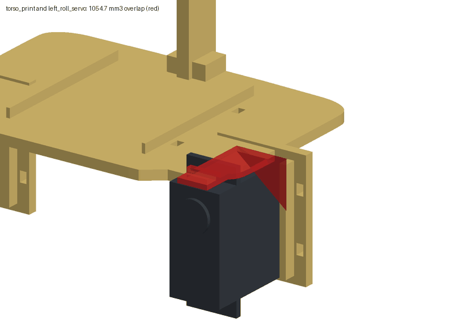
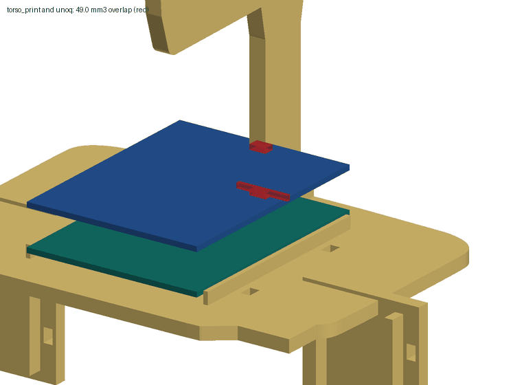

# Digital assembly test

Generated by `scripts/run_assembly.py` from the seven printable STLs, the parametric servo model and
`config/`. Do not edit by hand. The numbers are also in `reports/assembly.json`.

Status: geometry only. Nothing here has been printed, assembled or powered.

## Findings

- **interference**: left_roll_servo overlaps the torso deck by 1054.7 mm3 at its centred position in the cradle: the case end and the upper mounting ear run 4.0 mm into the 4 mm deck plate (z 0.0 to 4.0 mm).
- **interference**: right_roll_servo overlaps the torso deck by 1054.7 mm3 at its centred position in the cradle: the case end and the upper mounting ear run 4.0 mm into the 4 mm deck plate (z 0.0 to 4.0 mm).
- **interference**: The UNO Q centred between the deck rails overlaps the neck root by 49.0 mm3 (3.29 mm along x). Moving the board 3.25 mm forward clears it and keeps it on the deck.
- **interference**: The Braccio shield above the board overlaps the neck by 26.3 mm3 at the same position.
- **fit**: On all 6 cradles one of the two cable ties crosses the output shaft: the slot pair at 10.92 mm from the cradle centre is in line with the shaft at 10.75 mm (SR431; depends on the assumed shaft position). Only the tie at the far end can go over the case.
- **ok**: Every servo case fits between its rails with 0.5 mm each side, sits fully on its plate, and all tie slots are open.
- **ok**: All six horn screw holes are on their shaft axes and a screwdriver has a free path to each at the neutral pose.
- **balance**: Legs straight down: the centre of mass is 8.77 mm outside the support polygon of the two feet (behind the heels); it falls backward.
- **ok**: With the thighs swung back 45.0 degrees and the knees turned the other way to keep the soles level, the centre of mass is 37.3 mm inside the polygon. This is the stand pose.
- **balance**: On one foot the centre of mass is 61.91 mm outside the foot at the stand pose and still 38.42 mm outside with the stance hip rolled up to 30 degrees: there is no ankle, so hip roll tilts the body instead of shifting it. It only comes over the foot with the stance hip rolled 77.0 degrees, which lays the body on its side.

## Assumptions

The design directory does not say how each servo lies in its cradle or which face of a printed blank
meets a horn. These choices were made here (`config/assembly.json`):

- frame: x forward (toes, head), y left, z up. The left leg is the one built from the mirrored yoke, on the torso cradle at y = +57.
- servo_in_cradle: Case bottom on the plate, long sides between the rails, centred along the rails, output shaft away from the plate.
- roll_servo_flip: true puts the hip roll shaft at the upper end of the torso cradle.
- pitch_servo_flip: true puts the hip pitch shaft at the lower end of the yoke cradle.
- knee_servo_flip: false puts the knee shaft at the far (distal) end of the thigh.
- horn_side: The printed blank sits on the outer face of the horn, so the horn screw is reached through the 8 mm hole from the far side.
- yoke_face: The roll horn meets the yoke face at yoke z = 0; the wall and the pitch cradle extend forward from it.
- thigh_face: 'rail' puts the hip horn on the face that carries the rails, so the knee servo lies beside the hip pitch servo and the foot is nearer the body. 'flat' puts it on the flat face, stacking thigh, knee servo and shin outward. Both are checked; this value picks the one the robot description uses.
- shin_face: The shin blank is symmetric; the face towards the knee servo meets the horn and the foot points +x.
- neutral: Thighs straight down, shins vertical, soles level, horns at mid travel.
- board: UNO Q long side along x, centred between the deck rails, on spacers; Braccio shield stacked on top.

Dimensions the makers do not publish, and the values assumed for them:

| item | quantity | assumed value | why |
|---|---|---|---|
| SR431 | height_is_case_only | True | the page gives one height; taken as the case without the output spline |
| SR431 | shaft_from_end_mm | 10.25 | half the case width, as on standard-size servos; not published |
| SR431 | ear_overhang_mm | 6.5 | typical mounting ear of a standard-size servo; not published |
| SR431 | ear_thickness_mm | 2.5 | typical; not published |
| SR431 | ear_bottom_height_mm | 27.0 | about 0.68 of the case height; not published |
| SR431 | boss_radius_mm | 6.5 | output bearing boss; not published |
| SR431 | boss_height_mm | 1.5 | not published |
| SR431 | horn_radius_mm | 10.5 | round horn of about 21 mm; the kit's horn is not dimensioned by the maker |
| SR431 | horn_thickness_mm | 2.5 | not published |
| SR431 | horn_hub_radius_mm | 4.5 | not published |
| SR431 | horn_face_above_case_mm | 5.5 | case top to the outer face of the horn, where the printed blank sits; not published |
| SR431 | stall_current_a | 2.0 | the maker publishes no stall current; typical for an analog servo of this torque at 5 V |
| SR431 | armature_kgm2 | 0.003 | reflected rotor inertia for the simulation; not published |
| SR311 | height_is_case_only | True | the page gives one height; taken as the case without the output spline |
| SR311 | shaft_from_end_mm | 8.25 | half the case width; not published |
| SR311 | ear_overhang_mm | 4.5 | typical mounting ear of a mini servo; not published |
| SR311 | ear_thickness_mm | 2.0 | typical; not published |
| SR311 | ear_bottom_height_mm | 19.5 | about 0.68 of the case height; not published |
| SR311 | boss_radius_mm | 5.0 | not published |
| SR311 | boss_height_mm | 1.2 | not published |
| SR311 | horn_radius_mm | 9.0 | round horn of about 18 mm; not dimensioned by the maker |
| SR311 | horn_thickness_mm | 2.0 | not published |
| SR311 | horn_hub_radius_mm | 3.5 | not published |
| SR311 | horn_face_above_case_mm | 4.5 | case top to the outer face of the horn; not published |
| SR311 | stall_current_a | 1.0 | the maker publishes no stall current; typical for a mini analog servo at 5 V |
| SR311 | armature_kgm2 | 0.001 | reflected rotor inertia for the simulation; not published |
| Arduino UNO Q | pcb_thickness_mm | 1.6 | standard board thickness; not in the datasheet text |
| Arduino UNO Q | mass_g | 30.0 | the datasheet gives no mass; estimate for a populated UNO-format board |
| Arduino UNO Q | spacer_mm | 2.5 | insulating spacers the design README asks for; must exceed the 2 mm bottom-side parts |
| Braccio shield | mass_g | 25.0 | not published; estimate for the shield with headers and jack |
| Braccio shield | pcb_gap_mm | 11.0 | stacking header pitch between board and shield; not published |
| Braccio shield | stack_height_mm | 26.0 | top of the servo plugs above the UNO Q board top; not published |
| print | material | PLA | the design README names no material |
| print | density_g_cm3 | 1.24 | typical PLA filament data sheet value; PETG is about 1.27 |
| print | solid_fraction | 0.6 | 4 mm plates with two perimeters and 0.8 mm skins at 20 percent infill are mostly shell |
| driver | screwdriver_radius_mm | 3.0 | shank of a small cross-head driver for the horn screw |
| driver | screwdriver_length_mm | 80.0 | free length needed in front of the access hole |

Published dimensions and their sources:

| item | source |
|---|---|
| SR431 and SR311 servos, supply | https://store-usa.arduino.cc/products/tinkerkit-braccio-robot |
| Arduino UNO Q outline and power | https://docs.arduino.cc/resources/datasheets/ABX00162-datasheet.pdf |
| Braccio shield outline | https://store-usa.arduino.cc/products/tinkerkit-braccio-robot |

## The two thigh mountings

|  | rail face | flat face |
|---|---|---|
| overall width (mm) | 250.0 | 368.2 |
| foot centre to foot centre (mm) | 172.83 | 321.23 |
| one-foot margin at the stand pose (mm) | -61.91 | -136.11 |
| left hip roll free range (deg) | [-55.0, 180.0] | [-91.5, 180.0] |
| left knee free range (deg) | [-137.25, 115.25] | [-180.0, 180.0] |

Everything below is for the `rail` mounting, which the robot description uses.

## Size

Bounding box at the neutral pose: 203.0 x 250.0 x 283.4 mm (length, width, height). Soles at z = -183.4 mm in the torso frame.

| joint | axis point in the torso frame (mm) |
|---|---|
| left_hip_roll | [49.0, 57.0, -8.25] |
| left_hip_pitch | [89.0, 121.0, -19.0] |
| left_knee | [89.0, 87.9, -101.4] |
| right_hip_roll | [49.0, -57.0, -8.25] |
| right_hip_pitch | [89.0, -121.0, -19.0] |
| right_knee | [89.0, -87.9, -101.4] |

## Interference at the neutral pose

| part | part | overlap (mm3) | depth (mm) | box min (mm) | box max (mm) |
|---|---|---|---|---|---|
| torso_print | left_roll_servo | 1054.7 | 4.0 | [4.0, 46.75, 0.0] | [39.0, 62.43, 4.0] |
| torso_print | right_roll_servo | 1054.7 | 4.0 | [4.0, -62.43, 0.0] | [39.0, -46.75, 4.0] |
| torso_print | unoq | 49.0 | 1.6 | [-34.29, -8.0, 6.5] | [-31.0, 8.0, 8.1] |
| torso_print | braccio_shield | 26.3 | 1.6 | [-34.29, -2.5, 19.1] | [-31.0, 2.5, 20.7] |

## Joint sweeps

One joint at a time from the neutral pose, others at zero, until a part that moves with the joint meets one that
does not. 180 means a full half turn without contact. Limits are the free range less 3.0 degrees where a collision ends it, intersected with +/-90 degrees of servo travel about neutral.

| joint | collision free (deg) | first contact, negative | first contact, positive | limit used (deg) |
|---|---|---|---|---|
| left_hip_roll | [-55.0, 180.0] | left_shin_print / right_shin_print | none | [-52.0, 90.0] |
| left_hip_pitch | [-180.0, 180.0] | none | none | [-90.0, 90.0] |
| left_knee | [-137.25, 115.25] | left_shin_print / left_yoke_print | left_shin_print / left_roll_servo | [-90.0, 90.0] |
| right_hip_roll | [-180.0, 55.0] | none | right_shin_print / left_shin_print | [-90.0, 52.0] |
| right_hip_pitch | [-180.0, 180.0] | none | none | [-90.0, 90.0] |
| right_knee | [-137.25, 115.25] | right_shin_print / right_yoke_print | right_shin_print / right_roll_servo | [-90.0, 90.0] |

## Servos in their cradles

| servo | model | rail clearance each side (mm) | seated on plate | tie slots open | ties clear of shaft | overlap with its printed part (mm3) |
|---|---|---|---|---|---|---|
| left_roll_servo | SR431 | 0.5 | 1.0 | 4/4 | 1/2 | 1054.7 |
| left_pitch_servo | SR431 | 0.5 | 1.0 | 4/4 | 1/2 | 0.0 |
| left_knee_servo | SR311 | 0.5 | 1.0 | 4/4 | 1/2 | 0.0 |
| right_roll_servo | SR431 | 0.5 | 1.0 | 4/4 | 1/2 | 1054.7 |
| right_pitch_servo | SR431 | 0.5 | 1.0 | 4/4 | 1/2 | 0.0 |
| right_knee_servo | SR311 | 0.5 | 1.0 | 4/4 | 1/2 | 0.0 |

## Horn blanks

| joint | hole on shaft axis | blank solid under the horn | driver path clear | driver comes from |
|---|---|---|---|---|
| left_hip_roll | True | 1.0 | True | [1.0, 0.0, 0.0] |
| left_hip_pitch | True | 1.0 | True | [0.0, 1.0, 0.0] |
| left_knee | True | 1.0 | True | [-0.0, -1.0, 0.0] |
| right_hip_roll | True | 1.0 | True | [1.0, 0.0, 0.0] |
| right_hip_pitch | True | 1.0 | True | [0.0, -1.0, 0.0] |
| right_knee | True | 1.0 | True | [-0.0, 1.0, 0.0] |

The blank is placed on the shaft axis by construction, so the hole check confirms the model and the STL agree; it does not
measure a print. The horn itself is not dimensioned by the maker.

## UNO Q on the deck

| check | value |
|---|---|
| board outline (mm) | [68.58, 53.34] |
| clearance to each deck rail (mm) | 0.52 |
| rail height above the board underside (mm) | 1.3 |
| overlap with the torso, board centred (mm3) | 49.0 |
| overlap with the torso, shield (mm3) | 26.3 |
| forward shift that clears both (mm) | 3.25 |
| overhang past the deck front after the shift (mm) | 0.0 |
| lowest torso material above the stack, after the shift (mm) | 25.95 |

## Mass and centre of mass

Total 501.0 g: servos 302.0 g, printed parts 144.0 g (PLA at 1.24 g/cm3, 60 percent of solid; 597.0 g in total if printed solid), board 30.0 g and shield 25.0 g (both assumed).
Centre of mass at the neutral pose: [51.73, -0.0, -30.4] mm in the torso frame.

| link | mass (g) | centre of mass in the link frame (mm) |
|---|---|---|
| torso | 237.3 | [10.83, -0.0, -3.47] |
| left_hip | 74.1 | [37.58, 34.64, -0.05] |
| left_thigh | 36.5 | [0.15, -10.27, -66.5] |
| left_shin | 21.2 | [5.51, -2.0, -61.91] |
| right_hip | 74.1 | [37.58, -34.64, -0.05] |
| right_thigh | 36.5 | [-0.15, 10.27, -66.5] |
| right_shin | 21.2 | [5.51, 2.0, -61.91] |

## Balance

| case | margin (mm) | inside the support polygon |
|---|---|---|
| two feet, legs straight down | -8.77 | False |
| two feet, stand pose (thighs back 45.0 deg) | 37.3 | True |
| one foot, stand pose | -61.91 | False |
| one foot, best with stance hip roll within 30 deg | -38.42 | False |

Margin is the distance from the ground projection of the centre of mass to the nearest edge of the support polygon;
negative means outside. The stand pose keeps the shins vertical and the soles level: hip pitch = t, knee = -t.

Stand pose joint angles (deg): {'left_hip_roll': 0.0, 'left_hip_pitch': 45.0, 'left_knee': -45.0, 'right_hip_roll': 0.0, 'right_hip_pitch': 45.0, 'right_knee': -45.0}

Parts that interfere at the stand pose and not at neutral: 0.

