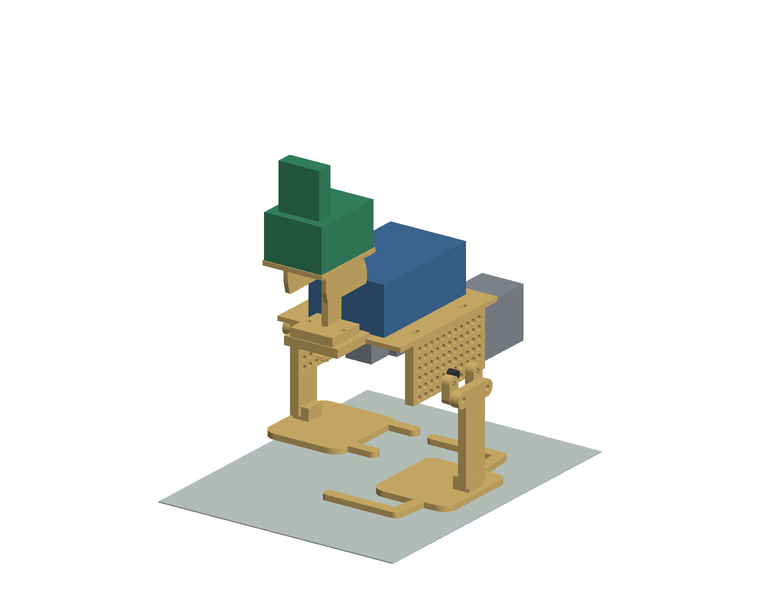
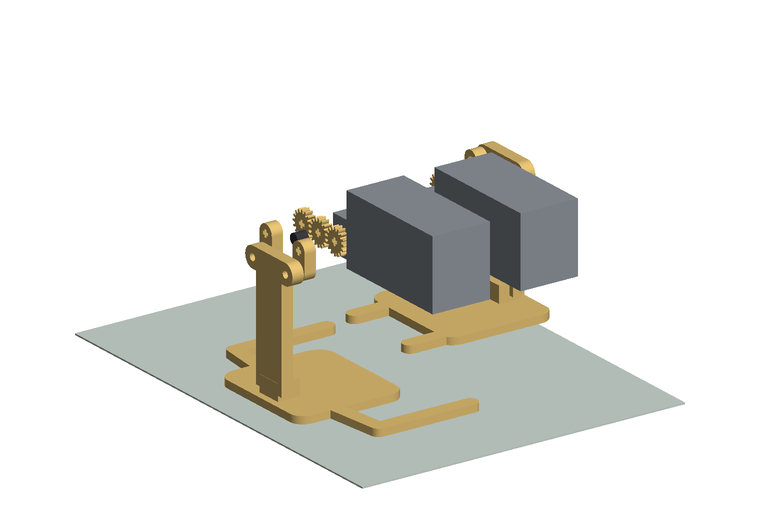
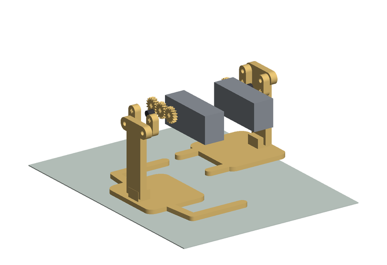
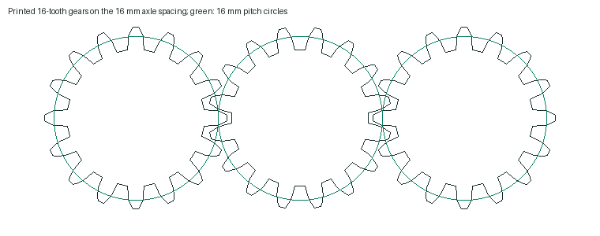
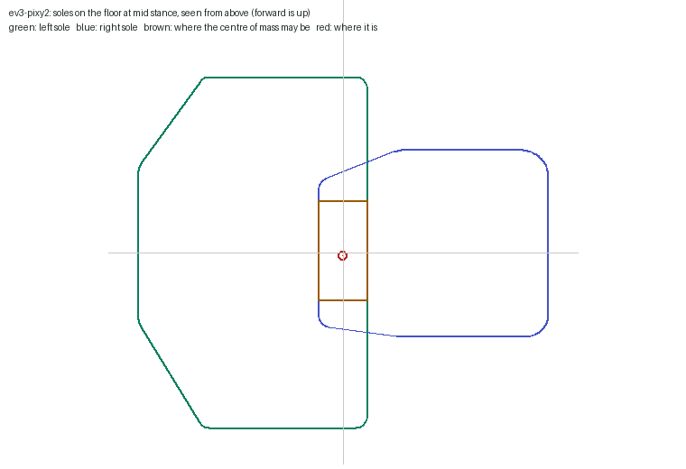
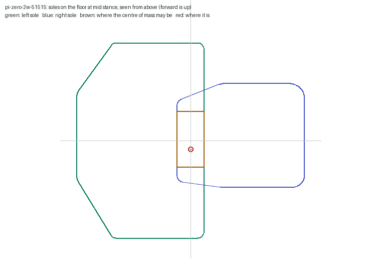
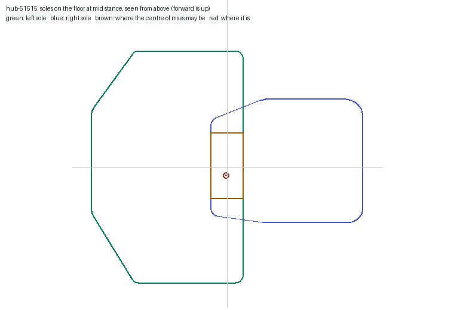
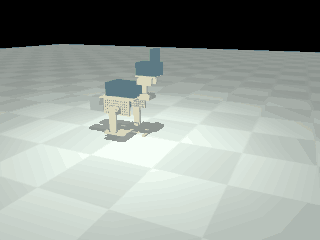
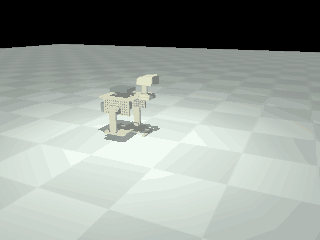
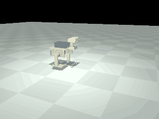

# Two LEGO-motor crank walkers: assembly test and simulation

Generated by `python -m walkers.report` from `reports/lego/assembly.json` and `reports/lego/sim.json`. Edit the generator, not this file.

> **Status: analysed and simulated only.** Nothing here has been printed, assembled or powered. No walking controller has run on hardware. Dimensions and masses the makers do not publish are assumed and listed below.

Three walkers of the owner's design that share one mechanism and differ in what drives and controls them:

| Build | Controller | Motors | Camera | Printed parts |
|---|---|---|---|---|
| `ev3-pixy2` | EV3 brick strapped to the deck | two EV3 large motors, ports B and C | Pixy2 | `stl/lego/ev3-pixy2/` |
| `pi-zero-2w-51515` | Raspberry Pi Zero 2 W with the Build HAT | two 51515 medium angular motors, ports A and B | Camera Module 2 | `stl/lego/pi-zero-2w-51515/` |
| `hub-51515` | Robot Inventor 51515 hub strapped to the deck | two 51515 medium angular motors, hub ports A and B | none; a plate with pin holes | `stl/lego/hub-51515/` |

## The mechanism

Each side panel carries three parallel axles 16 mm apart on the 8 mm Technic grid. Inside the panel a 16-tooth gear sits on each; the middle one idles, so the two outer axles turn the same way at the same speed. Outside the panel each outer axle carries a crank of 12 mm radius. The leg is pinned to the two crank tips, 32 mm apart, so it does not rotate: every point of it moves on a 12 mm circle and the flat sole stays level. The two legs are half a turn apart. The lower foot carries the robot and moves back 24 mm under it while the other swings forward 24 mm above the floor, so one crank turn moves the robot 48 mm. One motor per side drives the rear axle directly.

The feet overlap under the body: each sole has two fingers that reach 10.5 mm past the centreline, the left foot's at 70 mm fore and aft, the right foot's at 27 mm, so they pass each other.

## Parts and facts

`maker` is the maker's own published figure, `third-party` a parts catalogue or reseller, `assumed` a value nobody publishes with the reason it was chosen. Source: `walkers/config/components.json`.

| Part | Item | Value | From | Source or reason |
|---|---|---|---|---|
| EV3 Intelligent Brick 45500 | size mm | 110 x 71 x 44 | third-party | https://www.brickowl.com/catalog/860665 (BrickOwl catalogue, 14 x 9 x 4.67 studs. LEGO publishes no outer dimensions. With the rechargeable pack the brick is deeper (LEGO: 'slightly larger'); not modelled.) |
| EV3 Intelligent Brick 45500 | mass bare g | 210 | assumed | LEGO publishes no mass. Retailer listings give 206 to 215 g and may include packaging. |
| EV3 Intelligent Brick 45500 | mass six aa g | 138 | assumed | six alkaline AA cells at 23 g each, a typical cell data sheet value |
| EV3 Intelligent Brick 45500 | mass rechargeable pack g | 100 | assumed | 45501 pack, 7.4 V lithium ion; no published mass found |
| EV3 Intelligent Brick 45500 | supply | six AA cells or the 7.4 V rechargeable pack | maker | https://www.ub.uzh.ch/dam/jcr:5ca1d1a6-aad5-479e-8946-d868d1c12ee2/ev3-user-guide-EN.pdf (LEGO EV3 user guide, mirror) |
| EV3 Intelligent Brick 45500 | mounting holes | not found | assumed | no drawing of the pin holes found; the design straps the brick instead of pinning it |
| EV3 Large Servo Motor 45502 | size mm | 108 x 39 x 47 | third-party | https://www.brickowl.com/catalog/lego-medium-stone-gray-mindstorms-ev3-large-motor-95658 (13.5 x 5 x 5 studs) |
| EV3 Large Servo Motor 45502 | mass g | 76 | assumed | LEGO publishes none. 76 g is quoted in a third-party book; a reseller lists 82 g with packaging. |
| EV3 Large Servo Motor 45502 | no load rpm | 165 | maker | https://www.ub.uzh.ch/dam/jcr:5ca1d1a6-aad5-479e-8946-d868d1c12ee2/ev3-user-guide-EN.pdf (user guide: 'runs at 160-170 rpm'; the middle is used as the no-load speed) |
| EV3 Large Servo Motor 45502 | running torque nm | 0.2 | maker | https://www.ub.uzh.ch/dam/jcr:5ca1d1a6-aad5-479e-8946-d868d1c12ee2/ev3-user-guide-EN.pdf ('running torque of 20 Ncm') |
| EV3 Large Servo Motor 45502 | stall torque nm | 0.4 | maker | https://www.ub.uzh.ch/dam/jcr:5ca1d1a6-aad5-479e-8946-d868d1c12ee2/ev3-user-guide-EN.pdf ('stall torque of 40 Ncm') |
| EV3 Large Servo Motor 45502 | rated max deg s | 1050 | third-party | https://sites.google.com/site/ev3devpython/learn-ev3-python/using-motors (ev3dev figure, 175 rpm) |
| EV3 Large Servo Motor 45502 | encoder | 1 degree | maker | https://www.ub.uzh.ch/dam/jcr:5ca1d1a6-aad5-479e-8946-d868d1c12ee2/ev3-user-guide-EN.pdf (the guide states 1-degree resolution for the medium motor; the large motor is taken as the same) |
| EV3 Large Servo Motor 45502 | hole pattern | not found | assumed | no dimensioned drawing found. The output is a cross-axle hole through a hub at one end. Brackets are built around the motor in hand, as the design README says. |
| EV3 Large Servo Motor 45502 | envelope | see envelope | assumed | two boxes inside the catalogue size: a hub 24 x 24 x 24 mm on the output axis and a body 84 x 39 x 47 mm beyond it |
| EV3 Large Servo Motor 45502 | rotor inertia kgm2 | 0.0002 | assumed | reflected rotor and gear inertia at the output, for the simulation |
| EV3 Medium Servo Motor 45503 (optional head pan, not modelled) | size mm | 71 x 24 x 31 | third-party | https://brickowl.com/catalog/269807 |
| EV3 Medium Servo Motor 45503 (optional head pan, not modelled) | mass g | 36 | assumed | LEGO publishes none; 36 g is quoted in a third-party book |
| EV3 Medium Servo Motor 45503 (optional head pan, not modelled) | no load rpm | 245 | maker | https://www.ub.uzh.ch/dam/jcr:5ca1d1a6-aad5-479e-8946-d868d1c12ee2/ev3-user-guide-EN.pdf ('runs at 240-250 rpm') |
| EV3 Medium Servo Motor 45503 (optional head pan, not modelled) | running torque nm | 0.08 | maker | https://www.ub.uzh.ch/dam/jcr:5ca1d1a6-aad5-479e-8946-d868d1c12ee2/ev3-user-guide-EN.pdf |
| EV3 Medium Servo Motor 45503 (optional head pan, not modelled) | stall torque nm | 0.12 | maker | https://www.ub.uzh.ch/dam/jcr:5ca1d1a6-aad5-479e-8946-d868d1c12ee2/ev3-user-guide-EN.pdf |
| Technic Medium Angular Motor (Robot Inventor 51515, element 6299646) | size mm | 72 x 24 x 32 | third-party | https://www.brickowl.com/catalog/436655-64 (9 x 3 x 4 studs) |
| Technic Medium Angular Motor (Robot Inventor 51515, element 6299646) | mass g | 50 | assumed | LEGO publishes none; resellers list 50 g for the SPIKE version, possibly with packaging |
| Technic Medium Angular Motor (Robot Inventor 51515, element 6299646) | no load rpm | 185 | maker | https://cdn.shopify.com/s/files/1/0539/2056/3365/files/SPIKE_Prime_Tech_fact_sheet_Medium_Angular_Motor_45603.pdf (LEGO Education sheet for the SPIKE Prime motor, the same motor in another colour: 185 rpm +/- 15 percent at 7.2 V) |
| Technic Medium Angular Motor (Robot Inventor 51515, element 6299646) | running torque nm | 0.035 | maker | https://cdn.shopify.com/s/files/1/0539/2056/3365/files/SPIKE_Prime_Tech_fact_sheet_Medium_Angular_Motor_45603.pdf (torque at maximum efficiency, 3.5 Ncm at 135 rpm) |
| Technic Medium Angular Motor (Robot Inventor 51515, element 6299646) | stall torque nm | 0.18 | maker | https://cdn.shopify.com/s/files/1/0539/2056/3365/files/SPIKE_Prime_Tech_fact_sheet_Medium_Angular_Motor_45603.pdf (18 Ncm, 800 mA) |
| Technic Medium Angular Motor (Robot Inventor 51515, element 6299646) | encoder | 360 counts per revolution, absolute, +/- 3 degrees | maker | https://cdn.shopify.com/s/files/1/0539/2056/3365/files/SPIKE_Prime_Tech_fact_sheet_Medium_Angular_Motor_45603.pdf |
| Technic Medium Angular Motor (Robot Inventor 51515, element 6299646) | hole pattern | not found | assumed | LEGO states a cross hole on one side and a rotating disc with a cross hole and building interface on the other; no dimensioned drawing found |
| Technic Medium Angular Motor (Robot Inventor 51515, element 6299646) | envelope | see envelope | assumed | one box of the catalogue size with the output axis 16 mm from one end |
| Technic Medium Angular Motor (Robot Inventor 51515, element 6299646) | rotor inertia kgm2 | 0.0001 | assumed | reflected rotor and gear inertia at the output, for the simulation |
| Raspberry Pi Zero 2 W | size mm | 65 x 30 x 1.5 | maker | https://datasheets.raspberrypi.com/rpizero2/raspberry-pi-zero-2-w-product-brief.pdf (65 x 30 mm; holes 3.5 mm from each edge, so 58 x 23 mm centres) |
| Raspberry Pi Zero 2 W | mass g | 10 | third-party | https://www.adafruit.com/product/5291 |
| Raspberry Pi Zero 2 W | header and spacers g | 6 | assumed | soldered 40-pin header, four spacers and screws |
| Raspberry Pi Zero 2 W | supply | 5 V 2.5 A micro USB, or from the Build HAT | maker | https://datasheets.raspberrypi.com/rpizero2/raspberry-pi-zero-2-w-product-brief.pdf |
| Raspberry Pi Build HAT | size mm | 65 x 56.5 x 1.6 | maker | https://datasheets.raspberrypi.com/build-hat/raspberry-pi-build-hat-product-brief.pdf |
| Raspberry Pi Build HAT | mass g | 26 | assumed | not published; a HAT of this size with four connectors and a barrel jack |
| Raspberry Pi Build HAT | spacer mm | 9 | maker | https://www.raspberrypi.com/documentation/accessories/build-hat.html ('Attach 9 mm spacers to the bottom of the board') |
| Raspberry Pi Build HAT | supply | 8 V +/- 10 percent, 48 W, 5.5 x 2.1 mm barrel jack (the product brief says 7.2 V to 8.5 V); it also powers the Raspberry Pi | maker | https://www.raspberrypi.com/documentation/accessories/build-hat.html |
| Raspberry Pi Build HAT | battery | none in the design | assumed | the design README assumes the Build HAT's supported 8 V supply, which is a mains adapter: the robot is tethered. A battery is treated here as optional ballast. |
| Raspberry Pi Build HAT | battery pack g | 190 | assumed | six AA NiMH cells at 28 g in a holder, 7.2 V nominal, inside the brief's range; not tested |
| Raspberry Pi Camera Module 2 | size mm | 25 x 23.9 x 9 | maker | https://www.raspberrypi.com/documentation/accessories/camera.html (holes 2.2 mm on 21 x 12.5 mm centres from the mechanical drawing) |
| Raspberry Pi Camera Module 2 | mass g | 3 | maker | https://www.raspberrypi.com/documentation/accessories/camera.html |
| Pixy2 (Charmed Labs) | size mm | 15 x 38.25 x 42 | maker | https://docs.pixycam.com/wiki/doku.php?id=wiki:v2:dimensions (38.25 x 42 mm board, 15 mm deep) |
| Pixy2 (Charmed Labs) | mass g | 10 | maker | https://docs.pixycam.com/wiki/doku.php?id=wiki:v2:overview |
| Pixy2 (Charmed Labs) | supply | 5 V, 140 mA typical | maker | https://docs.pixycam.com/wiki/doku.php?id=wiki:v2:overview |
| Pixy2 (Charmed Labs) | lego brackets g | 5 | assumed | four small right-angle brackets and fasteners of the LEGO edition |
| Pixy2 pan-tilt kit | size mm | 70 x 54 x 60 | assumed | no drawing published. The base plate carries an Arduino hole pattern, so it is at least Arduino sized; height to the tilt axis estimated. |
| Pixy2 pan-tilt kit | mass g | 60 | assumed | two micro servos, plates and fasteners; not published |
| Technic axles, bushes, pins and bracket beams | axle g per mm | 0.014 | assumed | cross axle section of about 13 mm2 in ABS |
| Technic axles, bushes, pins and bracket beams | hardware per side g | 6 | assumed | three axles, bushes and two pins |
| Technic axles, bushes, pins and bracket beams | motor bracket g | 6 | assumed | two beams and pins per motor; layouts are not designed |
| Technic axles, bushes, pins and bracket beams | bush length mm | 7.8 | assumed | one module |
| Technic axles, bushes, pins and bracket beams | gear 16t | module 1, 16 teeth, 16 mm pitch diameter, 7.8 mm wide | assumed | the Technic gear system uses module 1 with axles on an 8 mm grid; LEGO publishes no gear drawing |
| printing | density g cm3 | 1.24 | assumed | typical PLA data sheet value |
| printing | solid fraction | 0.6 | assumed | same as the biped report: mostly shell at 20 percent infill |
| floor | friction | 0.4 | assumed | printed PLA soles on a hard floor; generic tables give 0.2 to 0.5 for hard plastics. 0.2 and 0.8 are run as sensitivity |
| LEGO Robot Inventor 51515 hub | size mm | 88 x 56 x 32 | maker | https://assets.education.lego.com/v3/assets/blt293eea581807678a/bltf512a371e82f6420/5f8801baf4f4cf0fa39d2feb/techspecs_techniclargehub.pdf (LEGO Education's sheet for the SPIKE Prime hub, the same hardware in another colour) |
| LEGO Robot Inventor 51515 hub | mass bare g | 63 | maker | https://assets.education.lego.com/v3/assets/blt293eea581807678a/bltf512a371e82f6420/5f8801baf4f4cf0fa39d2feb/techspecs_techniclargehub.pdf ('Hub Weight 63 g (without battery)') |
| LEGO Robot Inventor 51515 hub | battery g | 80 | assumed | the 2100 mAh 7.3 V battery; LEGO publishes no mass |
| LEGO Robot Inventor 51515 hub | ports | six LPF2 ports; the walker uses A and B | maker | https://assets.education.lego.com/v3/assets/blt293eea581807678a/bltf512a371e82f6420/5f8801baf4f4cf0fa39d2feb/techspecs_techniclargehub.pdf |
| LEGO Robot Inventor 51515 hub | mounting holes | not found | assumed | no drawing of the hub's pin holes found; the deck straps it between two end stops. Measure the hub before printing. |

Figures looked for and not found: any mass from LEGO for the brick or the motors, the pin-hole patterns of the motors and the brick, Philo's motor measurements (his site refused the request), the Build HAT's mass and per-port current limit, the pan-tilt kit's size and mass.

### Power

- EV3 build: the brick's own cells. Six AA cells are assumed; the 7.4 V rechargeable pack is lighter and makes the brick deeper.
- Pi build: the design README assumes the Build HAT and its supported 8 V supply. That supply is a mains adapter (8 V, 6 A, 48 W, barrel jack), and it powers the Raspberry Pi as well, so as designed the robot walks on a tether. A battery of 7.2 V to 8.5 V on the barrel jack is inside the product brief's range; six NiMH AA cells are assumed as an option and treated as ballast in the balance test. Not tested.

### The Pixy2

The owner has a standard Pixy2 with the pan-tilt kit and a separately bought EV3 cable (stated by the owner; not the LEGO edition).

- The LEGO edition and the standard Pixy2 are the same board. Charmed Labs' developer said any Pixy2 can be used with the EV3 given the LEGO firmware and the cable.
- Two ways to use it. With the LEGO firmware (loaded with PixyMon) the camera works with the EV3 blocks over the LEGO sensor protocol. With the stock firmware it answers on plain I2C, which is what the ev3dev and MicroPython libraries use: Charmed Labs' Python page says to run the stock version and set the interface to I2C, address 0x54.
- The LEGO edition's right-angle brackets are not in the standard hardware bag, so the perforated face of camera_head.stl has nothing to pin to. camera_head_pantilt.stl carries the pan-tilt base plate on a slotted top platform instead. Charmed Labs publish no drawing of the plate, so the 72 x 56 mm platform is an assumption to check against the kit.
- The pan-tilt servos plug into the Pixy2 and are driven by it. The LEGO firmware has no servo command for the EV3 (a forum reply from Charmed Labs). The stock firmware's serial protocol has setServos (packet type 18, two values 0 to 511) and is the same over I2C, so an EV3 running Pybricks or ev3dev could send it as raw I2C. Nobody is documented doing that from an EV3, and the same reply suggests feeding the Pixy2 from USB so the servos have enough power. Treat pan-tilt from the EV3 as untested.

Sources: https://forum.pixycam.com/t/is-pixy-2-compatible-with-mindstorms/5775, https://docs.pixycam.com/wiki/doku.php?id=wiki:v2:python, https://docs.pixycam.com/wiki/doku.php?id=wiki:v2:porting_guide, https://docs.pixycam.com/wiki/doku.php?id=wiki:v2:assembling_pantilt_mechanism, https://docs.pixycam.com/wiki/doku.php?id=wiki:v2:mounting_pixy_with_lego.

## Digital assembly

Frame: x forward, y left, z up, origin on the centre axle midway between the panels. The printed parts are the STLs in `stl/lego/`; bought parts are boxes of their published or assumed size. Overlaps are exact mesh intersections.

### Placements the design leaves open

`ev3-pixy2`:

- Head fixed: pinned through its two holes 32 mm apart to the shelf holes at x = 84, y = +/-16. The optional pan motor under the shelf is not modelled.
- Gears inside each panel with 1 mm to the panel face, all three in one plane.
- Cranks 8 mm outboard of the panel, legs outside the cranks with their inner faces 75 mm from the centreline: 1.2 mm between crank and leg.
- The idler axle is retained by one full bush outboard of the panel; the cranks sweep past its end.
- Motors between the panels, output hub on the rear gear axle (x = -16), body pointing backward, centred 30 mm from the centreline. The README says only: one motor per side on the rear gear axle, held by stock beams.
- Brick flat on the deck, long side fore and aft between the two rows of strap slots, centred at x = 0. The README says only: strapped across the deck through the four slots.
- Pan-tilt kit on the head's top platform with the Pixy2 on its tilt bracket; kit size and mass are assumed.

`pi-zero-2w-51515`:

- Head fixed: pinned through its two holes 32 mm apart to the shelf holes at x = 84, y = +/-16. The optional pan motor under the shelf is not modelled.
- Gears inside each panel with 1 mm to the panel face, all three in one plane.
- Cranks 8 mm outboard of the panel, legs outside the cranks with their inner faces 75 mm from the centreline: 1.2 mm between crank and leg.
- The idler axle is retained by one full bush outboard of the panel; the cranks sweep past its end.
- Motors between the panels, output hub on the rear gear axle (x = -16), body pointing backward, centred 31 mm from the centreline. The README says only: one motor per side on the rear gear axle, held by stock beams.
- Pi Zero 2 W on the four bosses, header along the left edge, Build HAT on 9 mm spacers above it overhanging 26.5 mm to the right. Which way round the Pi sits is not stated in the README.
- Camera Module 2 on the forward side of the head's face plate.
- No battery: the Build HAT's supported supply is a mains adapter, so the robot is tethered. The cable is not modelled.

`hub-51515`:

- Head fixed: pinned through its two holes 32 mm apart to the shelf holes at x = 84, y = +/-16. The optional pan motor under the shelf is not modelled.
- Gears inside each panel with 1 mm to the panel face, all three in one plane.
- Cranks 8 mm outboard of the panel, legs outside the cranks with their inner faces 75 mm from the centreline: 1.2 mm between crank and leg.
- The idler axle is retained by one full bush outboard of the panel; the cranks sweep past its end.
- Motors between the panels, output hub on the rear gear axle (x = -16), body pointing backward, centred 31 mm from the centreline. The README says only: one motor per side on the rear gear axle, held by stock beams.
- Hub flat on the deck, long side fore and aft, between the two end stops and under two straps, centred at x = 0. Its pin holes are not published, so it is strapped.
- No camera: the Pixy2 cannot plug into this hub's ports. The head is the plate with a row of seven pin holes for a self-contained camera or a LEGO sensor.

### Interference

- `ev3-pixy2`: 0 overlapping pairs. Checked at rest and at 72 crank phases, 105 pairs per phase: both legs and all four cranks against each other and against chassis, head, left rear gear, left centre gear, left front gear, left idler axle bush, right rear gear, right centre gear, right front gear, right idler axle bush, left motor, right motor, EV3 brick, pan-tilt kit, Pixy2.
- `pi-zero-2w-51515`: 0 overlapping pairs. Checked at rest and at 72 crank phases, 105 pairs per phase: both legs and all four cranks against each other and against chassis, head, left rear gear, left centre gear, left front gear, left idler axle bush, right rear gear, right centre gear, right front gear, right idler axle bush, left motor, right motor, Pi Zero 2 W, Build HAT, Camera Module 2.
- `hub-51515`: 0 overlapping pairs. Checked at rest and at 72 crank phases, 93 pairs per phase: both legs and all four cranks against each other and against chassis, head, left rear gear, left centre gear, left front gear, left idler axle bush, right rear gear, right centre gear, right front gear, right idler axle bush, left motor, right motor, 51515 hub.

The floor is included: the lowest fixed part is 72.0 mm (`ev3-pixy2`) and 68.0 mm (`pi-zero-2w-51515`) and 68.0 mm (`hub-51515`) above it at the lowest point of the walk.

Smallest gaps over the cycle:

| Pair | `ev3-pixy2` (mm) | `pi-zero-2w-51515` (mm) | `hub-51515` (mm) |
|---|---|---|---|
| left leg to right leg | 4.01 | 4.01 | 4.01 |
| left leg to chassis | 17.0 | 17.0 | 17.0 |
| right leg to chassis | 17.0 | 17.0 | 17.0 |
| left leg to left motor | 25.5 | 32.0 | 32.0 |
| right leg to right motor | 25.5 | 32.0 | 32.0 |
| left rear crank to left idler axle bush | 0.2 | 0.2 | 0.2 |
| left front crank to left idler axle bush | 0.2 | 0.2 | 0.2 |
| left rear crank to left leg | 1.2 | 1.2 | 1.2 |
| left rear crank to chassis | 8.0 | 8.0 | 8.0 |
| lowest fixed part above the floor | 72.0 | 68.0 | 68.0 |

The tight one is the idler axle. The cranks sweep across its outboard end, 8 mm from the panel. A full bush there is 7.8 mm long and leaves 0.2 mm. Use a half bush, or stop the axle flush and retain it from inside.

### Gear mesh

Measured from `gear_16t_print_6.stl`: 16 teeth, tip radius 8.9 mm, root radius 6.7 mm, tooth 1.377 mm thick on the 16 mm pitch circle, circular pitch 3.1416 mm. That is module 1, the Technic pitch, and two 16-tooth gears of module 1 belong 16 mm apart: the axle spacing, with 0 mm of error. Turned through one tooth in mesh the printed gears overlap by 0.0 mm3. Backlash is 0.387 mm per mesh (2.77 degrees), so the two cranks of a side can differ by 5.54 degrees through the two meshes. The leg ties the cranks together everywhere except where they lie along the pivot row, which is where the feet change over; the gears carry them through there. Tip to root clearance 0.4 mm. A stock 16-tooth gear has the same pitch and is 7.8 mm wide against the printed 5 mm, as the design README notes.

### Mass and centre of mass

`ev3-pixy2`: 811.5 g (print 217.5 g, technic 24.0 g, motor 152.0 g, controller 348.0 g, camera 70.0 g); 956.6 g if printed solid. Size 240 x 175 x 293.8 mm. Centre of mass at x -1.3, y 0.3, z 42.4 mm, 138.4 mm above the floor.

| Item | Mass (g) | From | At x, y, z (mm) |
|---|---|---|---|
| chassis | 94.8 | volume x density x solid fraction (assumed) | 8.3, -0.0, 28.7 |
| head | 32.9 | volume x density x solid fraction (assumed) | 85.6, 0.0, 89.0 |
| left leg | 43.2 | volume x density x solid fraction (assumed) | 1.6, 57.6, -77.8 |
| left rear gear | 0.6 | volume x density x solid fraction (assumed) | -16.0, 46.7, 0.0 |
| left centre gear | 0.6 | volume x density x solid fraction (assumed) | 0.0, 46.7, 0.0 |
| left front gear | 0.6 | volume x density x solid fraction (assumed) | 16.0, 46.7, 0.0 |
| left rear crank | 1.3 | volume x density x solid fraction (assumed) | -16.0, 69.9, -5.9 |
| left front crank | 1.3 | volume x density x solid fraction (assumed) | 16.0, 69.9, -5.9 |
| left axles, bushes and pins | 6.0 | assumed | 0.0, 62.0, 0.0 |
| right leg | 37.8 | volume x density x solid fraction (assumed) | 2.2, -59.3, -51.6 |
| right rear gear | 0.6 | volume x density x solid fraction (assumed) | -16.0, -46.7, 0.0 |
| right centre gear | 0.6 | volume x density x solid fraction (assumed) | 0.0, -46.7, 0.0 |
| right front gear | 0.6 | volume x density x solid fraction (assumed) | 16.0, -46.7, 0.0 |
| right rear crank | 1.3 | volume x density x solid fraction (assumed) | -16.0, -69.9, 5.9 |
| right front crank | 1.3 | volume x density x solid fraction (assumed) | 16.0, -69.9, 5.9 |
| right axles, bushes and pins | 6.0 | assumed | 0.0, -62.0, 0.0 |
| left motor | 76 | assumed | -70.0, 30.0, 11.5 |
| left motor bracket | 6.0 | assumed | -70.0, 30.0, 11.5 |
| right motor | 76 | assumed | -70.0, -30.0, 11.5 |
| right motor bracket | 6.0 | assumed | -70.0, -30.0, 11.5 |
| EV3 brick | 348.0 | assumed (six AA) | 0.0, 0.0, 64.0 |
| pan-tilt kit | 60.0 | assumed | 92.0, 0.0, 135.8 |
| Pixy2 | 10.0 | maker | 111.5, 0.0, 176.8 |

`pi-zero-2w-51515`: 377.9 g (print 208.9 g, technic 24.0 g, motor 100.0 g, controller 42.0 g, camera 3.0 g); 517.2 g if printed solid. Size 195 x 175 x 211.8 mm. Centre of mass at x -6.8, y -0.3, z 5.3 mm, 101.3 mm above the floor.

| Item | Mass (g) | From | At x, y, z (mm) |
|---|---|---|---|
| chassis | 95.6 | volume x density x solid fraction (assumed) | 8.3, -0.0, 28.9 |
| head | 23.4 | volume x density x solid fraction (assumed) | 84.1, 0.0, 78.2 |
| left leg | 43.2 | volume x density x solid fraction (assumed) | 1.6, 57.6, -77.8 |
| left rear gear | 0.6 | volume x density x solid fraction (assumed) | -16.0, 46.7, 0.0 |
| left centre gear | 0.6 | volume x density x solid fraction (assumed) | 0.0, 46.7, 0.0 |
| left front gear | 0.6 | volume x density x solid fraction (assumed) | 16.0, 46.7, 0.0 |
| left rear crank | 1.3 | volume x density x solid fraction (assumed) | -16.0, 69.9, -5.9 |
| left front crank | 1.3 | volume x density x solid fraction (assumed) | 16.0, 69.9, -5.9 |
| left axles, bushes and pins | 6.0 | assumed | 0.0, 62.0, 0.0 |
| right leg | 37.8 | volume x density x solid fraction (assumed) | 2.2, -59.3, -51.6 |
| right rear gear | 0.6 | volume x density x solid fraction (assumed) | -16.0, -46.7, 0.0 |
| right centre gear | 0.6 | volume x density x solid fraction (assumed) | 0.0, -46.7, 0.0 |
| right front gear | 0.6 | volume x density x solid fraction (assumed) | 16.0, -46.7, 0.0 |
| right rear crank | 1.3 | volume x density x solid fraction (assumed) | -16.0, -69.9, 5.9 |
| right front crank | 1.3 | volume x density x solid fraction (assumed) | 16.0, -69.9, 5.9 |
| right axles, bushes and pins | 6.0 | assumed | 0.0, -62.0, 0.0 |
| left motor | 50 | assumed | -52.0, 31.0, 0.0 |
| left motor bracket | 6.0 | assumed | -52.0, 31.0, 0.0 |
| right motor | 50 | assumed | -52.0, -31.0, 0.0 |
| right motor bracket | 6.0 | assumed | -52.0, -31.0, 0.0 |
| Pi Zero 2 W | 16.0 | third-party, header assumed | 0.0, 0.0, 47.8 |
| Build HAT | 26.0 | assumed | 0.0, -13.2, 63.5 |
| Camera Module 2 | 3.0 | maker | 115.5, 0.0, 100.8 |

`hub-51515`: 478.4 g (print 211.4 g, technic 24.0 g, motor 100.0 g, controller 143.0 g); 619.3 g if printed solid. Size 190.8 x 175 x 211.8 mm. Centre of mass at x -5.4, y 0.5, z 16.4 mm, 112.4 mm above the floor.

| Item | Mass (g) | From | At x, y, z (mm) |
|---|---|---|---|
| chassis | 95.2 | volume x density x solid fraction (assumed) | 8.3, 0.0, 28.8 |
| head | 26.3 | volume x density x solid fraction (assumed) | 87.3, -0.0, 80.7 |
| left leg | 43.2 | volume x density x solid fraction (assumed) | 1.6, 57.6, -77.8 |
| left rear gear | 0.6 | volume x density x solid fraction (assumed) | -16.0, 46.7, 0.0 |
| left centre gear | 0.6 | volume x density x solid fraction (assumed) | 0.0, 46.7, 0.0 |
| left front gear | 0.6 | volume x density x solid fraction (assumed) | 16.0, 46.7, 0.0 |
| left rear crank | 1.3 | volume x density x solid fraction (assumed) | -16.0, 69.9, -5.9 |
| left front crank | 1.3 | volume x density x solid fraction (assumed) | 16.0, 69.9, -5.9 |
| left axles, bushes and pins | 6.0 | assumed | 0.0, 62.0, 0.0 |
| right leg | 37.8 | volume x density x solid fraction (assumed) | 2.2, -59.3, -51.6 |
| right rear gear | 0.6 | volume x density x solid fraction (assumed) | -16.0, -46.7, 0.0 |
| right centre gear | 0.6 | volume x density x solid fraction (assumed) | 0.0, -46.7, 0.0 |
| right front gear | 0.6 | volume x density x solid fraction (assumed) | 16.0, -46.7, 0.0 |
| right rear crank | 1.3 | volume x density x solid fraction (assumed) | -16.0, -69.9, 5.9 |
| right front crank | 1.3 | volume x density x solid fraction (assumed) | 16.0, -69.9, 5.9 |
| right axles, bushes and pins | 6.0 | assumed | 0.0, -62.0, 0.0 |
| left motor | 50 | assumed | -52.0, 31.0, 0.0 |
| left motor bracket | 6.0 | assumed | -52.0, 31.0, 0.0 |
| right motor | 50 | assumed | -52.0, -31.0, 0.0 |
| right motor bracket | 6.0 | assumed | -52.0, -31.0, 0.0 |
| 51515 hub | 143.0 | maker without battery; battery assumed | 0.0, 0.0, 58.0 |

### Balance through the crank cycle

At each phase the lower foot is on the floor (both when level). The robot is statically balanced if the centre of mass is over that foot's outline. The margin is the distance from the centre of mass to the nearest edge.

| Phase (deg) | On the floor | `ev3-pixy2` margin (mm) | `pi-zero-2w-51515` margin (mm) | `hub-51515` margin (mm) |
|---|---|---|---|---|
| 0 | left and right | 61.7 | 56.4 | 57.7 |
| 15 | left | 10.8 | 10.2 | 11.0 |
| 30 | left | 10.8 | 10.2 | 11.0 |
| 45 | left | 10.8 | 10.2 | 11.0 |
| 60 | left | 10.8 | 10.2 | 11.0 |
| 75 | left | 10.8 | 10.2 | 11.0 |
| 90 | left | 10.8 | 10.2 | 11.0 |
| 105 | left | 10.8 | 10.2 | 11.0 |
| 120 | left | 10.8 | 10.2 | 11.0 |
| 135 | left | 10.8 | 10.2 | 11.0 |
| 150 | left | 10.8 | 10.2 | 11.0 |
| 165 | left | 10.8 | 10.2 | 11.0 |
| 180 | left and right | 64.4 | 65.7 | 67.2 |
| 195 | right | 10.2 | 10.8 | 10.0 |
| 210 | right | 10.2 | 10.8 | 10.0 |
| 225 | right | 10.2 | 10.8 | 10.0 |
| 240 | right | 10.2 | 10.8 | 10.0 |
| 255 | right | 10.2 | 10.8 | 10.0 |
| 270 | right | 10.2 | 10.8 | 10.0 |
| 285 | right | 10.2 | 10.8 | 10.0 |
| 300 | right | 10.2 | 10.8 | 10.0 |
| 315 | right | 10.2 | 10.8 | 10.0 |
| 330 | right | 10.2 | 10.8 | 10.0 |
| 345 | right | 10.2 | 10.8 | 10.0 |

`ev3-pixy2`: balanced at every phase, smallest margin 10.2 mm at 185 degrees. A tilt of 4.2 degrees uses it up. For the centre of mass to stay over the stance foot at every phase it must lie between x -20.5 and 22 mm and between y -10.5 and 10.5 mm.

- motors rear, pantilt: 811.5 g, centre of mass x -1.3 mm, smallest margin 10.2 mm.
- motors rear, bracket: 750.0 g, centre of mass x -8.4 mm, smallest margin 10.2 mm.
- motors forward, pantilt: 811.5 g, centre of mass x 20.5 mm, smallest margin 1.8 mm.
- motors forward, bracket: 750.0 g, centre of mass x 15.3 mm, smallest margin 6.6 mm.

**Where the brick must sit.** The brick is 348 g of 811.5 g. With the motors pointing backward, its centre may be anywhere from x -45 to 55 mm before the robot tips; from -33 to 42 mm keeps 5 mm; from -21 to 29 mm keeps the full 10.2 mm, which the sideways reach of the finger tips sets. The deck holds it between -10 and 10 mm without overhang, so centred on the deck is right and no ballast is needed. Sideways it must be centred: 10 mm off centre uses 4 mm of the 10 mm. With the motors pointing forward instead the margin is 1.8 mm: do not.

With the rechargeable pack (773.5 g in all) the margin is 10.2 mm.

`pi-zero-2w-51515`: balanced at every phase, smallest margin 10.2 mm at 5 degrees. A tilt of 5.8 degrees uses it up. For the centre of mass to stay over the stance foot at every phase it must lie between x -20.5 and 22.5 mm and between y -10.5 and 10.5 mm.

- motors rear: 377.9 g, centre of mass x -6.8 mm, smallest margin 10.2 mm.
- motors forward: 377.9 g, centre of mass x 14.5 mm, smallest margin 7.4 mm.

**Ballast.** None is needed. If a 190 g battery pack is added between the panels it may sit from x -48 to 80 mm; at x 0 the robot is 567.9 g with a margin of 10.3 mm.

`hub-51515`: balanced at every phase, smallest margin 10.0 mm at 185 degrees. A tilt of 5.1 degrees uses it up. For the centre of mass to stay over the stance foot at every phase it must lie between x -20.5 and 22 mm and between y -10.5 and 10.5 mm.

- motors rear: 478.4 g, centre of mass x -5.4 mm, smallest margin 10.0 mm.
- motors forward: 478.4 g, centre of mass x 11.5 mm, smallest margin 10.0 mm.

**Where the hub must sit.** The hub is 143 g of 478.4 g. With the motors pointing backward, its centre may be anywhere from x -50 to 80 mm before the robot tips, and from -17 to 56 mm keeps the full 10.0 mm. The end stops hold it at x 0, which is inside that range, so no ballast is needed. Sideways it must be centred. With the motors pointing forward the margin is 10.0 mm.

So a crank walker with two flat interleaving feet does stand on one foot at a time, because each foot reaches under the centre of mass. The reach is the limit: 10.5 mm past the centreline, about 4 to 6 degrees of lean. Longer fingers would buy margin directly.

## Simulation

One MJCF model per build, written by `python -m walkers.mjcf` from the same placement data (`robot/lego/<build>.xml`). The chassis with everything fixed to it is one free body. On each side the rear crank is a hinge driven by the motor, the leg hangs from the rear crank tip on a second hinge, and the front crank is a third hinge. Two equality constraints close the loop: a connect constraint pins the front crank tip to the leg, and a joint constraint holds the front crank at the rear crank's angle, which is what the three gears do. Without the gear constraint the linkage is free to fold at its two change points. Backlash is not modelled. The soles are convex pieces of the real outline; feet touch only the floor and the step.

Motors: a torque source behind a controller that advances a crank angle reference at the commanded speed and corrects the error, as the controller sketches do. The torque is clipped to the motor's line from stall torque at rest to zero at no-load speed (LEGO's figures), ratio 1 to the crank. Joint friction 0.004 N m per crank axle (assumed). Floor friction 0.4 (assumed), 1 ms step.

### `ev3-pixy2`

- **Walks.** At 60 rpm it walks 46.7 mm/s in a straight line with 0.2 percent slip, tilt under 0.3 degrees. Peak motor torque 0.285 N m of 0.4 N m stall; mean 0.038 N m.
- **Speed.** Steady up to 90 rpm (70.4 mm/s). At the motor's 165 rpm: 32.6 mm/s, tilt up to 10.25 degrees, heading change -15.3 degrees, no foot on the floor 6 percent of the time.
- **Turning.** right side at 45 rpm: heading 0.1 degrees in 12 s; right side at 30 rpm: heading -0.5 degrees in 12 s; right side at 0 rpm: heading 2.2 degrees in 12 s; right side at -60 rpm: heading -0.3 degrees in 12 s.
- **Slope.** Steepest walked: 6 degrees up, 12 down, 4 with the left side high, 2 with the right side high.
- **Step.** Highest step climbed: 0 mm.
- **Phase.** Phase error between the sides tolerated: 45 degrees.

Straight ahead, both sides in phase opposition, 10 s:

| Crank rpm | Ideal (mm/s) | Speed (mm/s) | Slip | Max tilt (deg) | Heading change (deg) | No foot down | Peak torque (N m) | Fell |
|---|---|---|---|---|---|---|---|---|
| 15 | 12.0 | 11.5 | 0.016 | 0.1 | -0.1 | 0.001 | 0.124 | no |
| 30 | 24.0 | 23.1 | 0.013 | 0.17 | 0.0 | 0.001 | 0.161 | no |
| 45 | 36.0 | 34.8 | 0.008 | 0.22 | 0.2 | 0.001 | 0.213 | no |
| 60 | 48.0 | 46.7 | 0.002 | 0.3 | 0.5 | 0.001 | 0.285 | no |
| 75 | 60.0 | 58.6 | -0.002 | 0.43 | 1.3 | 0.001 | 0.33 | no |
| 90 | 72.0 | 70.4 | -0.003 | 0.89 | 3.1 | 0.003 | 0.349 | no |
| 105 | 84.0 | 87.2 | -0.065 | 2.68 | -19.2 | 0.032 | 0.352 | no |
| 120 | 96.0 | 91.9 | 0.019 | 19.77 | -25.0 | 0.105 | 0.4 | no |
| 135 | 108.0 | 64.9 | 0.383 | 14.16 | -102.9 | 0.148 | 0.354 | no |
| 150 | 120.0 | 28.3 | 0.756 | 24.86 | 263.9 | 0.156 | 0.332 | no |
| 165 | 132.0 | 32.6 | 0.741 | 10.25 | -15.3 | 0.062 | 0.28 | no |

Floor friction at 60 rpm: 0.8: 46.6 mm/s, slip 0.005; 0.4: 46.7 mm/s, slip 0.002; 0.2: 46.8 mm/s, slip 0.0; 0.1: 46.8 mm/s, slip 0.001; 0.05: 44.9 mm/s, slip 0.04.

Different speeds on the two sides (left at 60 rpm, 12 s):

| Right rpm | Forward (m) | Sideways (m) | Heading change (deg) | Max tilt (deg) | Fell |
|---|---|---|---|---|---|
| 45 | 0.3026 | 0.0001 | 0.1 | 0.22 | no |
| 30 | 0.2361 | -0.001 | -0.5 | 0.23 | no |
| 0 | -0.0055 | -0.0001 | 2.2 | 0.11 | no |
| -60 | -0.0135 | 0.0003 | -0.3 | 0.23 | no |

Starting from rest with no ramp: tilt 0.29 degrees, peak torque 0.346 N m. Stopping from 60 rpm in mid stance: coasts 0.0 mm, tilt 0.13 degrees; at the changeover: 0.4 mm, 0.12 degrees. It stays up in both.

Slopes at 60 rpm (steepest walked, then what happened one step steeper):

- uphill: 6 degrees; at 8: fell backward.
- downhill: 12 degrees; at 14: speed 62.7 mm/s, tilt 23.28 degrees.
- left side high: 4 degrees; at 6: speed 27.2 mm/s, tilt 24.79 degrees.
- right side high: 2 degrees; at 4: fell forward.

Step: highest climbed 0 mm. At 2 mm: fell to the right.

Phase error between the sides (right side offset from half a turn), 60 rpm:

| Error (deg) | Speed (mm/s) | Max tilt (deg) | Fell |
|---|---|---|---|
| 0 | 46.7 | 0.3 | no |
| 5 | 46.7 | 0.29 | no |
| 10 | 46.6 | 0.3 | no |
| 20 | 46.1 | 0.31 | no |
| 30 | 45.1 | 0.32 | no |
| 45 | 43.0 | 0.35 | no |
| 60 | 40.3 | 0.3 | no |
| 90 | 32.6 | 0.24 | no |
| 120 | 22.7 | 0.15 | no |
| 150 | 11.1 | 0.12 | no |
| 180 | -1.2 | 0.05 | no |

### `pi-zero-2w-51515`

- **Walks.** At 60 rpm it walks 46.7 mm/s in a straight line with 0.3 percent slip, tilt under 0.17 degrees. Peak motor torque 0.158 N m of 0.18 N m stall; mean 0.02 N m.
- **Speed.** Steady up to 90 rpm (70.3 mm/s). At the motor's 185 rpm: 26.5 mm/s, tilt up to 2.79 degrees, heading change 6.7 degrees, no foot on the floor 4 percent of the time.
- **Turning.** right side at 45 rpm: heading 0.0 degrees in 12 s; right side at 30 rpm: heading -0.2 degrees in 12 s; right side at 0 rpm: heading 1.0 degrees in 12 s; right side at -60 rpm: heading 0.0 degrees in 12 s.
- **Slope.** Steepest walked: 6 degrees up, 14 down, 4 with the left side high, 4 with the right side high.
- **Step.** Highest step climbed: 2 mm.
- **Phase.** Phase error between the sides tolerated: 45 degrees.

Straight ahead, both sides in phase opposition, 10 s:

| Crank rpm | Ideal (mm/s) | Speed (mm/s) | Slip | Max tilt (deg) | Heading change (deg) | No foot down | Peak torque (N m) | Fell |
|---|---|---|---|---|---|---|---|---|
| 15 | 12.0 | 11.5 | 0.015 | 0.07 | 0.0 | 0.001 | 0.071 | no |
| 30 | 24.0 | 23.1 | 0.012 | 0.09 | 0.1 | 0.001 | 0.129 | no |
| 45 | 36.0 | 34.8 | 0.007 | 0.15 | 0.1 | 0.001 | 0.17 | no |
| 60 | 48.0 | 46.7 | 0.003 | 0.17 | 0.1 | 0.001 | 0.158 | no |
| 75 | 60.0 | 58.6 | -0.001 | 0.31 | 0.5 | 0.001 | 0.15 | no |
| 90 | 72.0 | 70.3 | -0.001 | 0.61 | 1.1 | 0.001 | 0.151 | no |
| 105 | 84.0 | 77.5 | 0.054 | 18.36 | 43.8 | 0.22 | 0.165 | no |
| 120 | 96.0 | 98.9 | -0.056 | 2.25 | -12.7 | 0.03 | 0.122 | no |
| 135 | 108.0 | 111.8 | -0.062 | 3.19 | -9.8 | 0.035 | 0.167 | no |
| 150 | 120.0 | 131.1 | -0.121 | 13.83 | 15.0 | 0.274 | 0.13 | no |
| 185 | 148.0 | 26.5 | 0.794 | 2.79 | 6.7 | 0.039 | 0.116 | no |

Floor friction at 60 rpm: 0.8: 46.7 mm/s, slip 0.003; 0.4: 46.7 mm/s, slip 0.003; 0.2: 46.7 mm/s, slip 0.003; 0.1: 46.7 mm/s, slip 0.003; 0.05: 44.9 mm/s, slip 0.042.

Different speeds on the two sides (left at 60 rpm, 12 s):

| Right rpm | Forward (m) | Sideways (m) | Heading change (deg) | Max tilt (deg) | Fell |
|---|---|---|---|---|---|
| 45 | 0.303 | 0.0 | 0.0 | 0.17 | no |
| 30 | 0.2372 | -0.0003 | -0.2 | 0.1 | no |
| 0 | -0.0082 | -0.0002 | 1.0 | 0.04 | no |
| -60 | -0.0124 | 0.0 | 0.0 | 0.12 | no |

Starting from rest with no ramp: tilt 0.25 degrees, peak torque 0.18 N m. Stopping from 60 rpm in mid stance: coasts 0.0 mm, tilt 0.21 degrees; at the changeover: 0.6 mm, 0.04 degrees. It stays up in both.

Slopes at 60 rpm (steepest walked, then what happened one step steeper):

- uphill: 6 degrees; at 8: fell to the right.
- downhill: 14 degrees; at 16: speed 47.5 mm/s, tilt 16.53 degrees.
- left side high: 4 degrees; at 6: speed 41.5 mm/s, tilt 17.47 degrees.
- right side high: 4 degrees; at 6: speed 41.4 mm/s, tilt 16.98 degrees.

Step: highest climbed 2 mm. At 4 mm: fell backward.

Phase error between the sides (right side offset from half a turn), 60 rpm:

| Error (deg) | Speed (mm/s) | Max tilt (deg) | Fell |
|---|---|---|---|
| 0 | 46.7 | 0.17 | no |
| 5 | 46.6 | 0.18 | no |
| 10 | 46.5 | 0.19 | no |
| 20 | 46.0 | 0.26 | no |
| 30 | 45.1 | 0.25 | no |
| 45 | 43.1 | 0.25 | no |
| 60 | 40.4 | 0.21 | no |
| 90 | 32.7 | 0.17 | no |
| 120 | 22.8 | 0.06 | no |
| 150 | 11.2 | 0.04 | no |
| 180 | -1.2 | 0.02 | no |

### `hub-51515`

- **Walks.** At 60 rpm it walks 46.8 mm/s in a straight line with 0.0 percent slip, tilt under 0.22 degrees. Peak motor torque 0.168 N m of 0.18 N m stall; mean 0.024 N m.
- **Speed.** Steady up to 90 rpm (70.4 mm/s). At the motor's 185 rpm: 39.3 mm/s, tilt up to 12.14 degrees, heading change 4.7 degrees, no foot on the floor 9 percent of the time.
- **Turning.** right side at 45 rpm: heading 0.1 degrees in 12 s; right side at 30 rpm: heading -0.4 degrees in 12 s; right side at 0 rpm: heading 1.4 degrees in 12 s; right side at -60 rpm: heading 0.0 degrees in 12 s.
- **Slope.** Steepest walked: 4 degrees up, 14 down, 4 with the left side high, 4 with the right side high.
- **Step.** Highest step climbed: 0 mm.
- **Phase.** Phase error between the sides tolerated: 45 degrees.

Straight ahead, both sides in phase opposition, 10 s:

| Crank rpm | Ideal (mm/s) | Speed (mm/s) | Slip | Max tilt (deg) | Heading change (deg) | No foot down | Peak torque (N m) | Fell |
|---|---|---|---|---|---|---|---|---|
| 15 | 12.0 | 11.5 | 0.016 | 0.08 | -0.0 | 0.001 | 0.084 | no |
| 30 | 24.0 | 23.1 | 0.013 | 0.12 | 0.1 | 0.001 | 0.169 | no |
| 45 | 36.0 | 34.8 | 0.007 | 0.16 | 0.1 | 0.001 | 0.174 | no |
| 60 | 48.0 | 46.8 | 0.0 | 0.22 | 0.5 | 0.001 | 0.168 | no |
| 75 | 60.0 | 58.5 | -0.0 | 0.3 | 0.4 | 0.001 | 0.161 | no |
| 90 | 72.0 | 70.4 | -0.002 | 0.67 | 1.8 | 0.005 | 0.164 | no |
| 105 | 84.0 | 77.8 | 0.05 | 22.69 | 4.0 | 0.227 | 0.18 | no |
| 120 | 96.0 | 102.2 | -0.092 | 2.27 | -6.5 | 0.029 | 0.159 | no |
| 135 | 108.0 | 110.7 | -0.052 | 13.23 | 18.7 | 0.041 | 0.18 | no |
| 150 | 120.0 | 83.3 | 0.284 | 12.36 | 17.8 | 0.251 | 0.168 | no |
| 185 | 148.0 | 39.3 | 0.688 | 12.14 | 4.7 | 0.088 | 0.15 | no |

Floor friction at 60 rpm: 0.8: 46.7 mm/s, slip 0.003; 0.4: 46.8 mm/s, slip 0.0; 0.2: 46.9 mm/s, slip -0.001; 0.1: 46.8 mm/s, slip -0.0; 0.05: 45.7 mm/s, slip 0.025.

Different speeds on the two sides (left at 60 rpm, 12 s):

| Right rpm | Forward (m) | Sideways (m) | Heading change (deg) | Max tilt (deg) | Fell |
|---|---|---|---|---|---|
| 45 | 0.3031 | 0.0003 | 0.1 | 0.16 | no |
| 30 | 0.2372 | -0.0008 | -0.4 | 0.18 | no |
| 0 | -0.0076 | 0.0 | 1.4 | 0.06 | no |
| -60 | -0.0127 | 0.0 | 0.0 | 0.16 | no |

Starting from rest with no ramp: tilt 0.21 degrees, peak torque 0.18 N m. Stopping from 60 rpm in mid stance: coasts 0.0 mm, tilt 0.06 degrees; at the changeover: 0.6 mm, 0.05 degrees. It stays up in both.

Slopes at 60 rpm (steepest walked, then what happened one step steeper):

- uphill: 4 degrees; at 6: speed 42.0 mm/s, tilt 22.86 degrees.
- downhill: 14 degrees; at 16: speed 52.7 mm/s, tilt 18.38 degrees.
- left side high: 4 degrees; at 6: speed 38.6 mm/s, tilt 18.34 degrees.
- right side high: 4 degrees; at 6: speed 32.2 mm/s, tilt 21.15 degrees.

Step: highest climbed 0 mm. At 2 mm: fell to the right.

Phase error between the sides (right side offset from half a turn), 60 rpm:

| Error (deg) | Speed (mm/s) | Max tilt (deg) | Fell |
|---|---|---|---|
| 0 | 46.8 | 0.22 | no |
| 5 | 46.8 | 0.24 | no |
| 10 | 46.6 | 0.24 | no |
| 20 | 46.0 | 0.25 | no |
| 30 | 45.1 | 0.3 | no |
| 45 | 43.0 | 0.28 | no |
| 60 | 40.3 | 0.26 | no |
| 90 | 32.7 | 0.17 | no |
| 120 | 22.7 | 0.09 | no |
| 150 | 11.2 | 0.06 | no |
| 180 | -1.2 | 0.03 | no |

### What the simulation says

- **It walks.** At moderate crank speeds both builds walk straight at the kinematic speed with almost no slip. The feet change over when their speed relative to the body is zero, so the walk asks little of the floor: friction down to 0.1 makes no difference.
- **There is a speed limit, and it is the bounce.** The body drops and is caught twice per turn. Above about 90 rpm the feet leave the floor, the heading wanders and the tilt grows. The motors' full speed is not usable.
- **It cannot steer.** A leg on parallel cranks only translates. A foot on the floor moves the body straight forward or back; it cannot turn it. With different speeds on the two sides the legs drift through every phase relation and the robot slows without turning. Steering needs something this design does not have: a way to turn a foot or the body on it.
- **It tips sideways easily.** The lateral margin is the 10.5 mm the finger tips reach past the centreline. A cross slope of a few degrees or a step of a few millimetres under one edge of a foot is enough.
- **Phase errors cost speed, not balance.** The walk slows as the sides leave phase opposition and stops when they are in phase, where both feet are always down and the robot only bobs. Holding the phase within about 20 degrees keeps 98 percent of the speed. Encoders of 1 degree are ample; the homing pose matters more.

## Controller sketches

Both are documentation with code: syntax-checked by the tests, never run on hardware.

The programs are in `programs/`, listed in `programs/index.json`, in the languages the owner's Mindstorms Robot Creator generates for each family.

- `programs/ev3/crank-walker/walker_pybricks.py` and `walker_ev3dev.py`: large motors on ports B (left) and C (right), as the design README says; port A is the optional head motor. The EV3 encoders are relative, so the phase is set by hand at the start (left foot down, right foot up, press the centre button). The Pybricks program then tracks one angle reference on both motors with `track_target`, the right 180 degrees ahead; the ev3dev program trims the right side's speed by the phase error.
- `programs/hub51515/crank-walker/walker_pybricks.py` and `walker_lego_python.py`: medium angular motors on hub ports A (left) and B (right). These motors have absolute encoders, so both programs home themselves to two stored zero angles. The stock Python one uses only `start`, `stop`, `get_position` and `get_degrees_counted`; `run_to_position` and the button and light-matrix calls are left out because their arguments could not be confirmed from a LEGO reference.
- `programs/pi/crank-walker/walker_buildhat.py`: the `buildhat` library, motors on Build HAT ports A and B; it homes with `run_to_position` and trims the right side's speed by the phase error.

Loading: Mindstorms Robot Creator (https://eoinjordan.github.io/mindstorms-robot-creator/) takes any of the LEGO programs in its editor under 'Custom (edit below)'. For a 51515 hub on Pybricks firmware it sends the editor's text to the hub over Bluetooth and runs it. For stock firmware it saves an .lms project to open in the LEGO MINDSTORMS app. For the EV3 it saves a .py file, which goes to the brick with the Pybricks or ev3dev tools. Each program is compiled to bytecode by the tests; the vendor modules are not installed here, so the imports are not resolved.

## Printing

The STLs are in `stl/lego/` with `stl/lego/manifest.json` (purpose, quantity, triangle count, volume, bounding box, SHA-256 and the design commit of each): 54 files, 10.55 MB. Print the fit coupon first.

The `wheeled` folder belongs to the wheeled variants: see docs/wheeled-variants.md.

| File | Print | Purpose | Volume (cm3) | Box (mm) |
|---|---|---|---|---|
| `stl/lego/ev3-pixy2/chassis.stl` | 1 | deck with strap slots for the brick, two side panels with the axle row, forward shelf for the head | 127.37 | 168 x 116 x 57.8 |
| `stl/lego/ev3-pixy2/camera_head.stl` | 1 | head with a perforated face for the Pixy2 LEGO edition brackets; print this or camera_head_pantilt, not both | 35.36 | 59.8 x 56 x 70 |
| `stl/lego/ev3-pixy2/camera_head_pantilt.stl` | 0 | head with a slotted top platform for the base plate of the Pixy2 pan-tilt kit; alternative to camera_head | 44.21 | 72 x 56 x 70 |
| `stl/lego/ev3-pixy2/left_leg.stl` | 1 | left leg and foot, fingers at +/-70 mm | 58.0 | 150 x 98 x 91 |
| `stl/lego/ev3-pixy2/right_leg.stl` | 1 | right leg and foot, fingers at +/-27 mm | 50.79 | 80 x 98 x 91 |
| `stl/lego/ev3-pixy2/crank_print_4.stl` | 4 | crank, 12 mm radius, cross-axle bore and pin bore | 1.73 | 24 x 12 x 7.8 |
| `stl/lego/ev3-pixy2/gear_16t_print_6.stl` | 6 | 16-tooth module 1 spur gear, 5 mm thick, cross-axle bore | 0.85 | 17.8 x 17.8 x 5 |
| `stl/lego/ev3-pixy2/fit_coupon.stl` | 1 | fit test: cross-axle hole, 4.95 mm pin hole, 5.35 mm bearing hole; print first | 3.29 | 40 x 12 x 7.8 |
| `stl/lego/pi-zero-2w-51515/chassis.stl` | 1 | deck with four M2.5 bosses on 58 x 23 mm centres, two side panels with the axle row, forward shelf for the head | 128.55 | 168 x 116 x 59 |
| `stl/lego/pi-zero-2w-51515/camera_head.stl` | 1 | head with a 21 x 12.5 mm M2 pattern for the Camera Module 2 | 31.46 | 56 x 40 x 70 |
| `stl/lego/pi-zero-2w-51515/left_leg.stl` | 1 | left leg and foot, fingers at +/-70 mm | 58.0 | 150 x 98 x 91 |
| `stl/lego/pi-zero-2w-51515/right_leg.stl` | 1 | right leg and foot, fingers at +/-27 mm | 50.79 | 80 x 98 x 91 |
| `stl/lego/pi-zero-2w-51515/crank_print_4.stl` | 4 | crank, 12 mm radius, cross-axle bore and pin bore | 1.73 | 24 x 12 x 7.8 |
| `stl/lego/pi-zero-2w-51515/gear_16t_print_6.stl` | 6 | 16-tooth module 1 spur gear, 5 mm thick, cross-axle bore | 0.85 | 17.8 x 17.8 x 5 |
| `stl/lego/pi-zero-2w-51515/fit_coupon.stl` | 1 | fit test: cross-axle hole, 4.95 mm pin hole, 5.35 mm bearing hole; print first | 3.29 | 40 x 12 x 7.8 |
| `stl/lego/hub-51515/chassis.stl` | 1 | deck with strap slots and end stops for the 51515 hub, two side panels with the axle row, forward shelf for the head | 127.94 | 168 x 116 x 57.9 |
| `stl/lego/hub-51515/camera_head.stl` | 1 | head with a row of seven pin holes for a self-contained camera or a LEGO sensor | 35.36 | 59.8 x 56 x 70 |
| `stl/lego/hub-51515/left_leg.stl` | 1 | left leg and foot, fingers at +/-70 mm | 58.0 | 150 x 98 x 91 |
| `stl/lego/hub-51515/right_leg.stl` | 1 | right leg and foot, fingers at +/-27 mm | 50.79 | 80 x 98 x 91 |
| `stl/lego/hub-51515/crank_print_4.stl` | 4 | crank, 12 mm radius, cross-axle bore and pin bore | 1.73 | 24 x 12 x 7.8 |
| `stl/lego/hub-51515/gear_16t_print_6.stl` | 6 | 16-tooth module 1 spur gear, 5 mm thick, cross-axle bore | 0.85 | 17.8 x 17.8 x 5 |
| `stl/lego/hub-51515/fit_coupon.stl` | 1 | fit test: cross-axle hole, 4.95 mm pin hole, 5.35 mm bearing hole; print first | 3.29 | 40 x 12 x 7.8 |
| `stl/lego/wheeled/post_d43.stl` | 1 | support post for the 43.2 mm wheel class: two pins up into the shelf holes, socket for a tip | 5.52 | 16 x 24 x 35.6 |
| `stl/lego/wheeled/post_d56.stl` | 1 | support post for the 56 mm wheel class: two pins up into the shelf holes, socket for a tip | 6.44 | 16 x 24 x 42 |
| `stl/lego/wheeled/post_d65.stl` | 1 | support post for the 65 mm wheel class: two pins up into the shelf holes, socket for a tip | 7.09 | 16 x 24 x 46.5 |
| `stl/lego/wheeled/tip_skid.stl` | 1 | drag skid tip for the support post | 4.28 | 25.28 x 25.28 x 29.99 |
| `stl/lego/wheeled/tip_ball_16p5.stl` | 1 | snap-in cup tip for a LEGO 16.5 mm ball (part 54821) | 5.31 | 21.7 x 21.7 x 24.21 |
| `stl/lego/wheeled/tip_ball_12p7.stl` | 1 | snap-in cup tip for a 12.7 mm steel ball | 4.47 | 17.9 x 17.9 x 25.54 |
| `stl/lego/wheeled/tip_idler_fork.stl` | 1 | fork tip carrying the printed idler on a Technic axle | 2.13 | 12 x 15 x 25.49 |
| `stl/lego/wheeled/idler_hub.stl` | 1 | hub of the 19 mm idler, free on a Technic axle | 1.12 | 16 x 16 x 8 |
| `stl/lego/wheeled/idler_tyre_tpu.stl` | 1 | tyre of the idler | 0.23 | 19 x 19 x 3.2 |
| `stl/lego/wheeled/wheel_solid_cross_d43.stl` | 2 | one-piece wheel, Technic cross-axle bore; one 38 x 3 mm O-ring, rolls on 44.8 mm | 10.92 | 42.76 x 42.76 x 14 |
| `stl/lego/wheeled/wheel_band_cross_d43.stl` | 2 | one-piece wheel, Technic cross-axle bore; groove 7 mm wide for a rubber band up to 6 mm wide | 9.63 | 42.2 x 42.2 x 14 |
| `stl/lego/wheeled/hub_tpu_cross_d43.stl` | 2 | rigid hub for the TPU tyre, Technic cross-axle bore | 8.01 | 37.2 x 37.2 x 14 |
| `stl/lego/wheeled/wheel_solid_cross_d56.stl` | 2 | one-piece wheel, Technic cross-axle bore; one 50 x 3 mm O-ring, rolls on 57.0 mm | 15.52 | 55 x 55 x 14 |
| `stl/lego/wheeled/wheel_band_cross_d56.stl` | 2 | one-piece wheel, Technic cross-axle bore; groove 7 mm wide for a rubber band up to 6 mm wide | 13.96 | 55 x 55 x 14 |
| `stl/lego/wheeled/hub_tpu_cross_d56.stl` | 2 | rigid hub for the TPU tyre, Technic cross-axle bore | 11.98 | 50 x 50 x 14 |
| `stl/lego/wheeled/wheel_solid_tt_d65.stl` | 2 | one-piece wheel, TT double-flat shaft bore with retaining screw; two 58 x 3 mm O-rings, rolls on 65.2 mm | 22.08 | 63.16 x 63.16 x 18 |
| `stl/lego/wheeled/wheel_band_tt_d65.stl` | 2 | one-piece wheel, TT double-flat shaft bore with retaining screw; groove 7 mm wide for a rubber band up to 6 mm wide | 21.28 | 64 x 64 x 18 |
| `stl/lego/wheeled/hub_tpu_tt_d65.stl` | 2 | rigid hub for the TPU tyre, TT double-flat shaft bore with retaining screw | 18.49 | 59 x 59 x 18 |
| `stl/lego/wheeled/wheel_solid_horn_d56.stl` | 2 | one-piece wheel, plain face to screw to a servo horn; one 50 x 3 mm O-ring, rolls on 57.0 mm | 17.85 | 55 x 55 x 14 |
| `stl/lego/wheeled/wheel_band_horn_d56.stl` | 2 | one-piece wheel, plain face to screw to a servo horn; groove 7 mm wide for a rubber band up to 6 mm wide | 16.29 | 55 x 55 x 14 |
| `stl/lego/wheeled/hub_tpu_horn_d56.stl` | 2 | rigid hub for the TPU tyre, plain face to screw to a servo horn | 14.32 | 50 x 50 x 14 |
| `stl/lego/wheeled/tyre_tpu_d43.stl` | 2 | tyre, 43.2 mm outside, 4 mm thick, 2 percent stretch, keyed | 4.3 | 43.2 x 43.2 x 9.2 |
| `stl/lego/wheeled/tyre_tpu_d56.stl` | 2 | tyre, 56 mm outside, 4 mm thick, 2 percent stretch, keyed | 6.09 | 56 x 56 x 9.2 |
| `stl/lego/wheeled/tyre_tpu_d65.stl` | 2 | tyre, 65 mm outside, 4 mm thick, 2 percent stretch, keyed | 10.61 | 65 x 65 x 13.2 |
| `stl/lego/wheeled/tt_cradle_print_2.stl` | 2 | cradle for a yellow TT gear motor on the outside of a side panel | 12.45 | 60 x 24 x 9.5 |
| `stl/lego/wheeled/servo_cradle_print_2.stl` | 2 | cradle for a 9 g 360-degree servo on the outside of a side panel | 12.88 | 48 x 24 x 16.5 |
| `stl/lego/wheeled/driver_plate.stl` | 1 | generic slotted plate for a small motor driver board | 7.88 | 64 x 40 x 7.8 |
| `stl/lego/wheeled/fit_bore_cross.stl` | 1 | fit test: cross-axle wheel bore | 1.11 | 16 x 16 x 6 |
| `stl/lego/wheeled/fit_bore_tt.stl` | 1 | fit test: TT double-flat shaft pocket and screw hole | 2.18 | 16 x 16 x 12 |
| `stl/lego/wheeled/fit_bore_horn.stl` | 1 | fit test: horn face centre hole | 1.22 | 24 x 24 x 3 |
| `stl/lego/wheeled/fit_tt_cradle.stl` | 1 | fit test: TT motor hole pattern, 2 mm slice of the cradle | 2.62 | 60 x 24 x 2 |
| `stl/lego/wheeled/fit_servo_cradle.stl` | 1 | fit test: servo window and ear holes, 2 mm slice of the cradle | 1.56 | 48 x 24 x 2 |

The legs, soles, neck and head outlines started from the convex outlines of meshes in the same Microduck part pack as the biped's plates (see NOTICE). Those meshes are not in this repository.

## Unverified

- Everything physical. No part has been printed; no axle, pin, gear or motor has been tried in one.
- Every assumed value in the table above, above all the masses LEGO does not publish (brick, motors) and the pan-tilt kit.
- The motor envelopes are boxes inside catalogue sizes. Real motors have pin holes and curves the boxes ignore, and the brackets that hold them are not designed.
- The 0.2 mm between the cranks and the idler axle's bush, and the 1.2 mm between cranks and legs, are nominal; printed parts and bush positions will vary by more than that.
- Gear backlash, axle flex in 5.35 mm printed bearings, and the pins' play are not in the simulation. The legs are held exactly upright there; on the robot they will rock by the play in two pins 32 mm apart.
- Floor friction, and the contact of a flat rigid sole on a real floor that is not flat.
- The motor model: a straight line from stall torque to no-load speed from LEGO's figures, with an ideal controller.
- The controller sketches: syntax-checked, never run. Motor directions and the homing poses are guesses to confirm.
- Pan-tilt from the EV3, and the standard Pixy2 on the LEGO firmware with the owner's cable.
- The Build HAT build on a battery: the design is tethered to the 8 V adapter and the cable's pull is not modelled.

## Regenerating

    python -m walkers.manifest --design-dir /path/to/microduck-lego    copy the STLs, write the manifest
    python -m walkers.assembly        assembly test and pictures (about five minutes)
    python -m walkers.mjcf            MuJoCo models
    python -m walkers.experiments     simulation and recordings (about three minutes)
    python -m walkers.report          this document and reports/variants/summary.json

LEGO, Mindstorms and Technic are trademarks of the LEGO Group, which does not sponsor or endorse this. Raspberry Pi is a trademark of Raspberry Pi Ltd. Pixy2 is a product of Charmed Labs.
