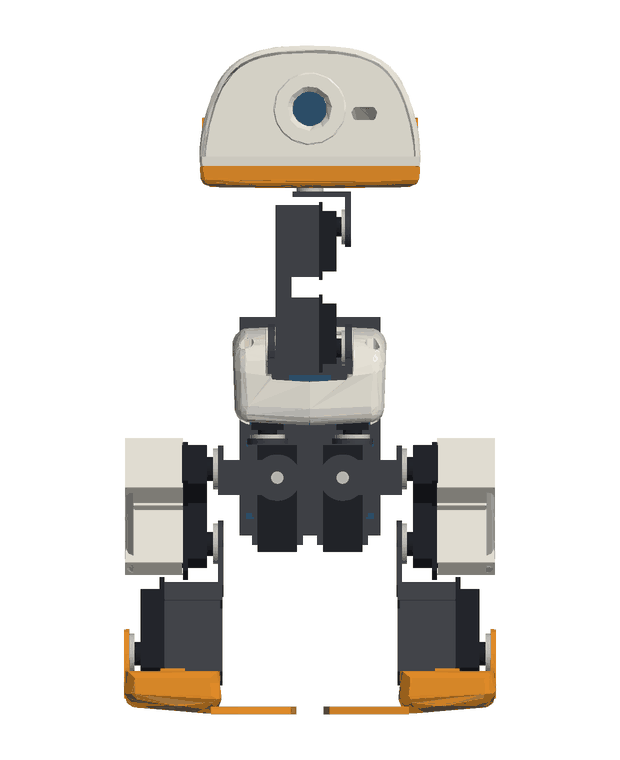
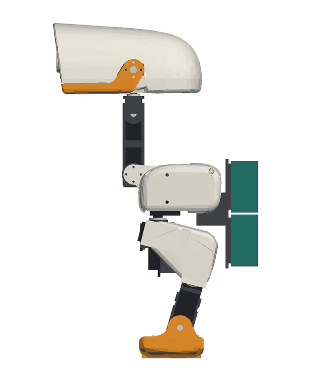
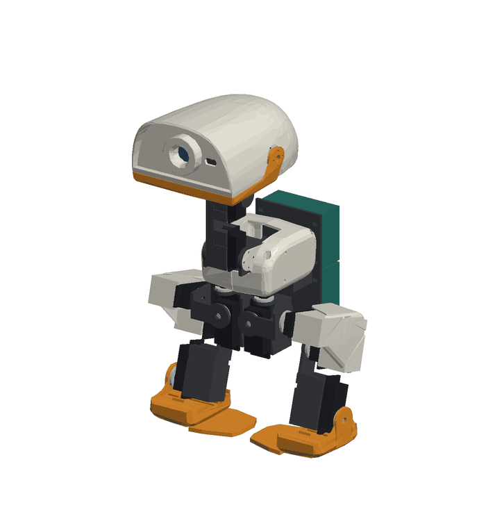
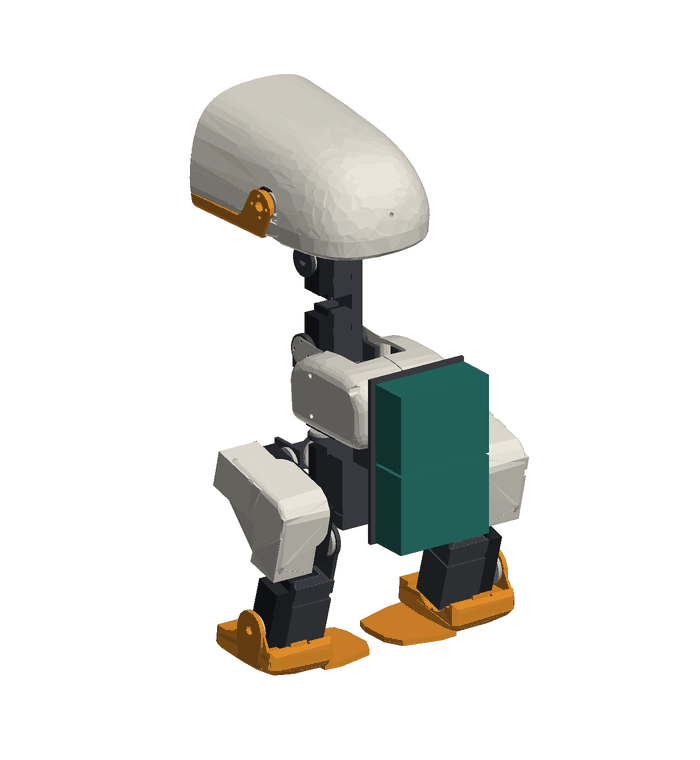
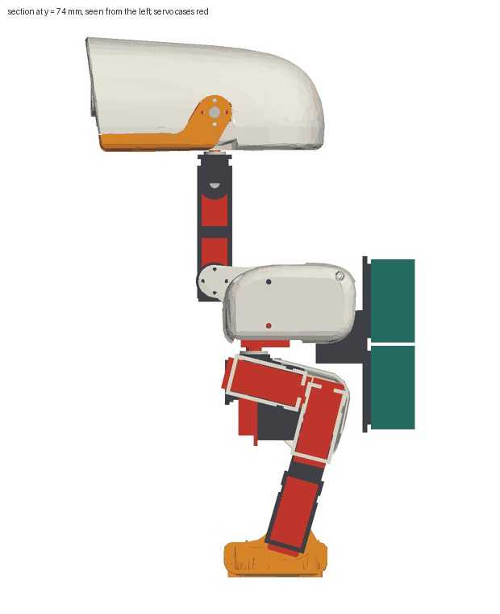
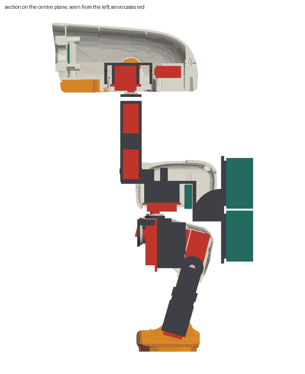
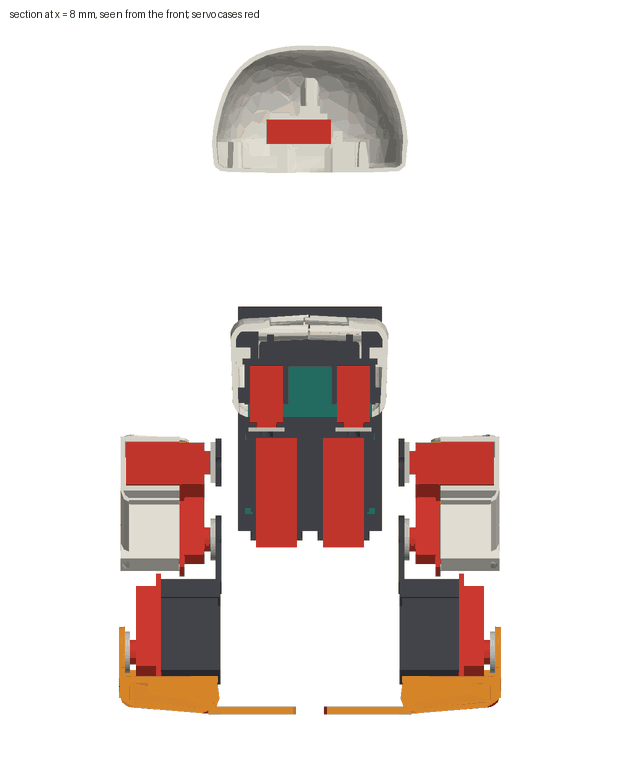
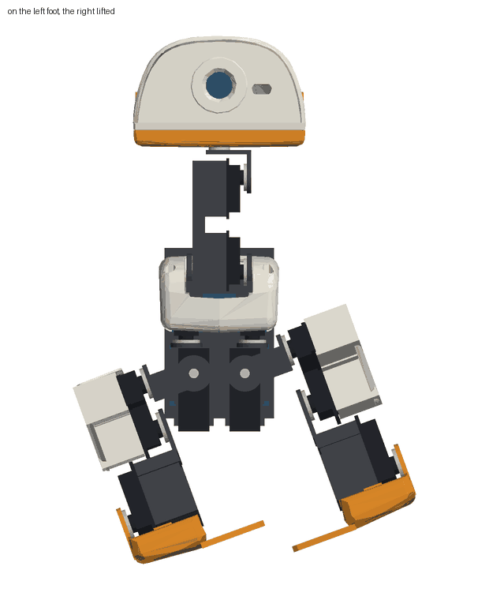

# Biped, Microduck look

Generated by `scripts/run_look.py` from `reports/microduck-look/`. Do not edit by hand.

A second biped beside the plate biped: the shells of Pollen Robotics' Microduck, scaled by 1.25 and re-split for printing, on the servos of two TinkerKit Braccio kits. Fifteen servos at the original's fifteen positions: 8 SR431 and 4 SR311 on the ten leg joints, neck pitch and head pitch, and 3 small position servos on head yaw, head roll and the beak.

The three small servos must be position servos: the M5Stack Servo Kit 180 (9 g, 0 to 180 degrees). The Servo Kit 360 and the servos of a BALA-C turn continuously: a pulse sets their speed, not an angle, so they cannot hold a joint. Without the small servos the head yaw, head roll and beak joints stay as fitted and the other twelve joints work.

Microduck-look parts: CC BY-NC-SA 4.0, adapted from Pollen Robotics' Microduck; not for commercial use. The credit and the list of changes are in `stl/microduck-look/LICENSE`. The code is MIT.

All numbers on this page come from the digital assembly and the simulation. What was assumed is in [status.md](status.md).

 

 

## Size and mass

|  | this build | the original |
|---|---|---|
| scale | 1.25 | 1 |
| height (mm) | 345.0 at the stand pose, 336.1 with every joint at zero | 263.9 in the source meshes |
| width, length (mm) | 192.1, 210.9 |  |
| mass (kg) | 1.2328 | 0.737 in its simulation model; scaled by volume that is 1.439 |
| servos | 8 SR431, 4 SR311, 3 small | 15 Dynamixel XL330 |

Mass by group (g): printed shells 355.4, printed brackets 119.4, servos 631.0, boards and camera 127.0. Wiring is not counted.

## Scale

The original is built round a servo 34 x 20 x 26 mm. An SR431 is 42 x 20.5 x 39.5 mm. At 42 / 34 = 1.235 an SR431 is as long as the original's servo, scaled, and no wider; 1.25 is that rounded up. It is the smallest scale at which the knee and hip pitch servos lie under the thigh cover as the original's do and the ankle servo is the shin, as the original's is. The case is 9 mm deeper along its shaft than the scaled servo, and a leg rolled inward has to clear the hip roll servo, so the thighs stand 6 mm and the feet 8.5 mm further out than scaled. Three axes moved so that the cases, their mounting ears and the parts on them clear each other: hip pitch 4.75 mm forward, hip roll 4.5 mm down and 5 mm inward, ankle 6.5 mm down. A smaller scale needs a smaller leg servo: see the assignments below.

 

The servo cases are red in the sections. Hidden: hip yaw (in the trunk under the body shell), hip pitch and knee (under the thigh cover), head yaw, head roll and beak (in the head). In the open, where the original has its servos in the open: hip roll between the legs, the ankle servo as the shin, the two neck servos. The mounting ears of the hip pitch and knee servos show at the front and under the thigh cover.

## Which servo where

Three assignments on the same printed structure and scale. A servo is asked to hold at most half of its stall torque. The worst case is over standing on two feet, standing with all weight on one foot, the one-foot pose, a step with the hips 12 degrees either way, and the neck and head moved.

| assignment | servos | mass (kg) | one leg (kg) | worst holding torque / limit | joints over the limit |
|---|---|---|---|---|---|
| one kit, lightest | 4 SR431, 2 SR311, 9 small | 0.985 | 0.256 | 3.65 (left_hip_roll) | left_hip_roll, neck_pitch, right_hip_roll |
| two kits, built | 8 SR431, 4 SR311, 3 small | 1.233 | 0.344 | 1.01 (neck_pitch) | neck_pitch |
| two kits, light hips | 6 SR431, 4 SR311, 5 small | 1.127 | 0.309 | 2.16 (left_hip_roll) | left_hip_roll, neck_pitch, right_hip_roll |

- One kit, lightest: the knees and ankles on SR431, hip pitch on SR311, everything else on small servos. The small servos cannot hold hip roll or the neck directly; they would need a printed 3:1 reduction, which leaves 60 degrees of travel and adds backlash where the trunk is balanced.
- Two kits, built: every leg joint and both neck joints on a Braccio servo, no gears. Heaviest, and the only one with every joint inside its limit apart from the neck at the end of its range.
- Two kits, light hips: hip yaw on small servos and hip roll on SR311 saves mass at the hips and leaves two SR431 unused; hip roll is then over its limit whenever the weight is on one foot.

A scale of 1.0, the closest look, needs leg servos no larger than the original's. Of what is in the kits only the SR311 is (31.3 x 16.5 x 28.6 mm), and four of them cannot hold the knees and ankles: the built assignment asks 0.29 N m of an ankle and 0.336 N m of a knee at 1.25, and about 0.4 times that at 1.0 on a lighter robot, against 0.152 N m.

## Joints

| joint | servo | holds (N m) | limit (N m) | ratio | in | range (deg) | original (deg) | part | stopped by |
|---|---|---|---|---|---|---|---|---|---|
| left_hip_yaw | SR311 | 0.034 | 0.152 | 0.22 | on the left foot, other lifted | -9.0 to 30.0 | -25 to 30 | 0.71 | min: left_hip_yaw against right_hip_yaw |
| left_hip_roll | SR431 | 0.347 | 0.598 | 0.58 | stand pose, all weight on the left foot | -3.0 to 22.0 | -22 to 22 | 0.57 | min: left_foot against right_foot |
| left_hip_pitch | SR431 | 0.151 | 0.598 | 0.25 | step, hips +12 deg, left foot | -89.0 to 88.0 | -90 to 90 | 0.98 |  |
| left_knee | SR431 | 0.336 | 0.598 | 0.56 | step, hips +12 deg, left foot | -88.0 to 83.0 | -90 to 90 | 0.95 | max: left_hip_roll against left_shin |
| left_ankle | SR431 | 0.29 | 0.598 | 0.48 | step, hips +12 deg, left foot | -74.0 to 70.0 | -90 to 90 | 0.8 | min: left_shin against left_foot; max: left_shin against left_foot |
| right_hip_yaw | SR311 | 0.034 | 0.152 | 0.22 | on the right foot, other lifted | -30.0 to 9.0 | -30 to 25 | 0.71 | max: left_hip_yaw against right_hip_yaw |
| right_hip_roll | SR431 | 0.345 | 0.598 | 0.58 | stand pose, all weight on the right foot | -22.0 to 3.0 | -22 to 22 | 0.57 | max: left_foot against right_foot |
| right_hip_pitch | SR431 | 0.127 | 0.598 | 0.21 | on the right foot, other lifted | -88.0 to 89.0 | -90 to 90 | 0.98 |  |
| right_knee | SR431 | 0.286 | 0.598 | 0.48 | stand pose, all weight on the right foot | -83.0 to 88.0 | -90 to 90 | 0.95 | min: right_hip_roll against right_shin |
| right_ankle | SR431 | 0.111 | 0.598 | 0.18 | neck 30 deg forward | -70.0 to 74.0 | -90 to 90 | 0.8 | min: right_shin against right_foot; max: right_shin against right_foot |
| neck_pitch | SR311 | 0.154 | 0.152 | 1.01 | neck 30 deg forward | -90.0 to 39.0 | -90 to 60 | 0.86 | max: unoq_stack_1 against head_base |
| head_pitch | SR311 | 0.078 | 0.152 | 0.51 | head 30 deg down | -63.0 to 90.0 | -90 to 90 | 0.85 | min: body_left against head_top |
| head_yaw | M5_180 | 0.012 | 0.079 | 0.15 | on the left foot, other lifted | -90.0 to 90.0 | -170 to 170 | 0.53 |  |
| head_roll | M5_180 | 0.005 | 0.079 | 0.06 | head rolled 25 deg | -25.0 to 25.0 | -25 to 25 | 1.0 |  |
| beak | M5_180 | 0.014 | 0.079 | 0.18 | stand, two feet | 0.0 to 30.0 | 0 to 30 | 1.0 |  |

Ranges are collision-free travel of one joint from the stand pose, less 3 degrees, inside the servo's 180 degrees and the original's range. The beak has no joint in the original's description; 0 to 30 degrees is this build's.

What is lost against the original:

- Head yaw is 180 degrees of the original's 340: the servo's travel.
- Hip yaw outward stops early: the two hip yaw links, each carrying a hip roll servo, meet between the legs.
- One hip rolled inward alone meets the other foot's web after a few degrees. Both hips rolled the same way, as in walking, are free for at least 30.0 degrees each way.
- The neck holds the head 30 degrees forward at its limit; further forward it is over half of stall.
- Speed and feedback: the original's servos report position, speed and load; these do not. Its walking is a learned policy closed over an inertial sensor; this build's walk is open loop.
- No bearings: a joint hangs on its servo shaft, with a pivot screw opposite the horn at the neck, the head roll and the beak only.

## Head and eye

The original's eye is a camera. Default (`EYE = 'camera'`): an Espressif ESP-EYE on its side behind the face plate, lens in the centre of the eye ring. It is the project's default camera, weighs 8 g against 24 g for the display with its cell, and keeps the eye a camera. The picture is turned a quarter and has to be turned back in software. `CAMERA = 'esp32cam'` seats an AI-Thinker ESP32-CAM the same way. Option (`EYE = 'display'`): the Seeed round display as the eye. At this scale the eye ring is 37.5 mm across and the display's glass 40 mm, so one animated eye fills the ring's place; the XIAO behind it then has its camera facing backward, so this option has no forward camera. The generator makes either; the files here are the camera's.

## Feet and balance

The feet are the original's, scaled, with a web of 4 mm plate added under the body, 14 mm apart at the stand pose. The original's soles are 73 mm apart at this scale and its hip roll range is 22 degrees: rolling both hips that far leaves the centre of mass short of the inner edge of a sole. It walks dynamically. Open-loop hobby servos cannot, so the soles are widened inward until the centre of mass can stand over one of them. The webs do not cross the centre line. The trade: seen from the front the feet are wider than the original's and nearly meet.

The pose on one foot below is a static one: the trunk tilted over a flat sole. The legs have no ankle roll, as the original's have none, so the robot cannot move into that pose slowly: while both soles are down a roll of both hips leans the legs and sets the soles on their edges. The simulation shows it (see below). The weight has to be rocked from foot to foot, which is what the gait does. Soles whose fingers cross the centre line, as on the plate biped, would let a foot be lifted with no shift at all; they would not look like the original's feet.

| pose | both hips rolled (deg) | centre of mass inside the support (mm) | lifted sole above the floor (mm) | overlapping parts |
|---|---|---|---|---|
| two feet, stand pose |  | 30.1 |  |  |
| left foot, other lifted | 20.0 | 8.4 | 23.0 | 0 |
| right foot, other lifted | -20.0 | 8.6 | 23.0 | 0 |

Stand pose (deg): left_hip_pitch -14.0, left_knee 2.0, left_ankle 16.0, right_hip_pitch 14.0, right_knee -2.0, right_ankle -16.0. The other joints are at zero.

Gap between the two legs (mm) for the two hip roll angles, other joints at the stand pose; a negative number is an overlap in mm3:

| left (rows), right (columns) | -20.0 | -10.0 | 0.0 | 10.0 | 20.0 |
|---|---|---|---|---|---|
| -20.0 | 7.5 | 4.0 | -445.0 | -3319.0 | -7884.0 |
| -10.0 | 7.5 | 7.5 | -228.0 | -2178.0 | -3308.0 |
| 0.0 | 7.5 | 7.5 | 7.5 | -228.0 | -445.0 |
| 10.0 | 7.5 | 7.5 | 7.5 | 7.5 | 4.0 |
| 20.0 | 7.5 | 7.5 | 7.5 | 7.5 | 7.5 |

## Assembly test

Every printed part, servo, horn and board placed from `stl/microduck-look/parameters.json`. Overlaps above 8 mm3: 0 with every joint at zero, 0 at the stand pose.
Servo cases have 0.5 mm each side in their cups. Boards and camera, nearest printed part or servo at the stand pose: unoq_stack_1 rests on trunk_frame; unoq_stack_2 rests on trunk_frame; servo_driver 0.5 mm from body_left; esp_eye rests on head_face.

## Simulation

`robot/microduck-look/microduck_look.xml`: 1.2328 kg, inertia of each link from its meshes, servos and boards, so a leg carries its 0.344 kg where the servos are. Position servos that reach stall torque at a 4 degree error, commands at 50 Hz, 120 deg/s rate limit, one tick of delay. Parts collide with the floor only.

- Stand, 10 s: stays up, tilt at most 0.65 degrees, load 6.1 N and 5.99 N on the feet, largest torque 0.13 of stall (neck_pitch).
- Neck, head and beak moved while standing: stays up, tilt at most 1.32 degrees, largest torque 0.66 of stall (neck_pitch).
- Both hips rolled slowly towards the left foot, then the other leg bent: it does not come on to one sole: it rests on the edges of both, 5.27 N and 6.83 N, the trunk tilted 3.5 degrees where the pose has 20.0; largest torque 0.08 of stall (left_knee); meshes overlapping in 0 of 19 poses on the way.
- Both hips rolled slowly towards the right foot, then the other leg bent: it does not come on to one sole: it rests on the edges of both, 5.25 N and 6.84 N, the trunk tilted 3.5 degrees where the pose has 20.0; largest torque 0.08 of stall (right_knee); meshes overlapping in 0 of 19 poses on the way.

Walking attempt. The gait of `microduck/gait.py` carried to this joint set (both hips rolled, hips swung with the ankles turned against them, the unloaded leg bent), searched with `microduck/cmaes.py` and scored with `microduck/gaitsearch.gait_score`: seed 1, 25 generations of 14, 1050 runs of 10.0 s, 253.8 s of wall clock. Parameters: {'period_s': 1.72, 'roll_amplitude_deg': 10.2, 'step_amplitude_deg': 1.33, 'lift_deg': 7.84, 'step_phase_deg': 101.67, 'lead_in_s': 1.0}.

It truly steps: 32 swings with a sole wholly off the floor of 31.7 commanded in 30 s, median clearance 3.89 mm, step 4.41 mm, 3.3 mm/s forward, heading change -2.0 degrees, one foot loaded 9 percent of the time.
The commanded poses of one gait cycle put through the exact meshes: 0 of 22 overlap.
The search settled on a stride of 1.33 degrees at the hips, at the small end of what it was allowed (1 to 14): the model lifts each foot in turn and marks time, creeping forward. A longer stride scored worse on the three variations of the model it was tried on. That is the finding: it stands, shifts its weight and lifts its feet; it does not yet walk at a useful speed.

| floor friction | fell | speed (mm/s) | truly steps | swings | clearance (mm) | heading change in 20 s (deg) |
|---|---|---|---|---|---|---|
| 0.4 | no | 3.6 | yes | 20 | 4.33 | -2.2 |
| 0.6 | no | 2.9 | yes | 20 | 4.0 | -3.4 |
| 0.9 | no | 3.2 | yes | 20 | 3.89 | -2.2 |

| joint | peak torque walking (N m) | stall (N m) | peak / stall |
|---|---|---|---|
| left_hip_yaw | 0.033 | 0.304 | 0.11 |
| left_hip_roll | 0.476 | 1.196 | 0.4 |
| left_hip_pitch | 0.185 | 1.196 | 0.15 |
| left_knee | 0.378 | 1.196 | 0.32 |
| left_ankle | 0.151 | 1.196 | 0.13 |
| neck_pitch | 0.044 | 0.304 | 0.15 |
| head_pitch | 0.038 | 0.304 | 0.13 |
| head_yaw | 0.006 | 0.157 | 0.04 |
| head_roll | 0.003 | 0.157 | 0.02 |
| beak | 0.014 | 0.157 | 0.09 |

Supply current while walking, each servo taken to draw in proportion to its torque: board 1 with the driver 1.03 A mean, 1.77 A peak; board 2 0.92 A mean, 1.69 A peak. Each shield has a 4 A supply.

## Signals and power

| joint | servo | driven by | output | UNO Q pin |
|---|---|---|---|---|
| left_hip_yaw | SR311 | board 1 | M1 | 11 |
| left_hip_roll | SR431 | board 1 | M2 | 10 |
| left_hip_pitch | SR431 | board 1 | M3 | 9 |
| left_knee | SR431 | board 1 | M4 | 6 |
| left_ankle | SR431 | board 1 | M5 | 5 |
| right_hip_yaw | SR311 | board 2 | M1 | 11 |
| right_hip_roll | SR431 | board 2 | M2 | 10 |
| right_hip_pitch | SR431 | board 2 | M3 | 9 |
| right_knee | SR431 | board 2 | M4 | 6 |
| right_ankle | SR431 | board 2 | M5 | 5 |
| neck_pitch | SR311 | board 1 | M6 | 3 |
| head_pitch | SR311 | board 2 | M6 | 3 |
| head_yaw | M5_180 | driver | channel 0 |  |
| head_roll | M5_180 | driver | channel 1 |  |
| beak | M5_180 | driver | channel 2 |  |

- Baseline: two UNO Q boards, each under one Braccio shield. The shield's six outputs are the UNO Q pins 11, 10, 9, 6, 5 and 3, the only six PWM pins of the header, so one board cannot drive twelve servos through two shields.
- The two boards have to act as one controller: one link between them (UART on D0 and D1, 3.3 V, crossed, common ground) or both as targets of one host. The control core in this repository handles six joints on one board; fifteen joints on two boards is not written.
- The three small servos are on a 16-channel PCA9685 driver on the first board's I2C (Qwiic connector, 3.3 V logic; the PCA9685 takes 2.3 to 5.5 V logic). Its servo rail is fed with 5 V from the first shield's supply.
- Alternative: one UNO Q and one PCA9685 for all fifteen servos, with the shields used only to distribute 5 V. It saves a board and the link, and needs the twelve Braccio leads on the driver's headers.
- Supply. Stalled demand of all fifteen servos: 22.25 A (12.25 A on the first board with the driver, 10.0 A on the second). The two kit supplies give 8.0 A together, 4 A per shield. They cover standing and the walk above; they do not cover several servos stalled at once. Keep one supply per shield, fuse each, and do not join the two 5 V rails. For margin use a regulated 5 V 10 A supply per shield.
- The camera runs from its own USB supply. With the display as the eye, the display and its XIAO run from their own cell.

## Control

The firmware and the control core in this repository (`microduck/protocol.py` and its C++ twin) drive six joints on one board with soft limits, a speed limit, a watchdog and a leg clearance rule. Firmware for this build is not written. It needs: the joint table of `robot/microduck-look/joints.json` (fifteen joints, ranges, zero and direction per horn), the two boards acting as one controller or one board with a driver for all fifteen, the I2C driver for the three small servos, and a leg rule for the webs, which the table above shows can meet.

## Print list

| file in `stl/microduck-look/` | size as printed (mm) | mass (g) | orientation | supports |
|---|---|---|---|---|
| `body_left.stl` | 101 x 52 x 42 | 19.3 | seam face (the centre plane) on the bed | supports under the upper wall, inside |
| `body_right.stl` | 101 x 52 x 40 | 19.5 | seam face (the centre plane) on the bed | supports under the upper wall, inside |
| `trunk_frame.stl` | 113 x 74 x 112 | 52.7 | back plates on the bed, deck upright | supports under the deck and the cradles |
| `left_ and right_hip_yaw.stl` | 43 x 29 x 55 | 10.0 | horn disc on the bed | supports inside the cradle mouth |
| `left_ and right_hip_roll.stl` | 28 x 43 x 28 | 3.5 | front bar on the bed | none |
| `left_ and right_thigh.stl` | 79 x 60 x 35 | 26.2 | outer face on the bed, cradles open upward | supports under the rounded edge of the cover |
| `left_ and right_shin.stl` | 26 x 84 x 30 | 10.0 | inner plate on the bed, cradle open upward | none |
| `left_ and right_foot.stl` | 66 x 89 x 44 | 46.1 | sole on the bed | supports under the cheek and inside the well |
| `neck.stl` | 22 x 85 x 22 | 11.5 | back wall on the bed, cradles open upward | none |
| `head_pitch_yoke.stl` | 22 x 30 x 29 | 2.4 | top plate on the bed | none |
| `head_yaw_carrier.stl` | 50 x 18 x 22 | 5.8 | upside down: top bar on the bed | none |
| `head_base.stl` | 145 x 114 x 34 | 61.2 | underside on the bed | supports under the rim where it rises at the back |
| `head_top.stl` | 58 x 114 x 153 | 56.1 | front opening on the bed, the head standing on its face | supports inside under the closed rear end only |
| `head_face.stl` | 56 x 110 x 26 | 20.4 | eye ring on the bed, plate level above it | supports under the plate round the ring |
| `beak_jaw.stl` | 85 x 114 x 36 | 29.4 | underside of the pad on the bed | supports under the two cheeks |
| `beak_top.stl` | 40 x 109 x 4 | 4.9 | flat on the bed | none |
| `fit_SR431.stl` | 48 x 26 x 30 | 8.3 | floor on the bed | none |
| `fit_horn_SR431.stl` | 24 x 24 x 3 | 0.9 | flat | none |
| `fit_SR311.stl` | 37 x 22 x 22 | 4.9 | floor on the bed | none |
| `fit_horn_SR311.stl` | 21 x 21 x 3 | 0.7 | flat | none |
| `fit_M5_180.stl` | 29 x 18 x 22 | 3.5 | floor on the bed | none |
| `fit_horn_M5_180.stl` | 17 x 17 x 3 | 0.4 | flat | none |
| `fit_eye_esp_eye.stl` | 28 x 18 x 8 | 1.3 | back on the bed | none |

Print the fit pieces first. The shells keep the source's walls, scaled: about 2.5 mm on the body and head, 1.2 mm on the thigh covers. The files hold 36568 triangles; the source parts they come from hold 168878. They follow the scaled surface to within 0.45 mm (0.7 mm on the soles); texture finer than that is gone.

## Parts

| part | quantity | note |
|---|---|---|
| SR431 servo (TinkerKit Braccio kit) | 8 | hip roll, hip pitch, knee and ankle of each leg; from two kits |
| SR311 servo (TinkerKit Braccio kit) | 4 | hip yaw of each leg, neck pitch, head pitch; from two kits |
| Arduino UNO Q with a Braccio shield | 2 | one per leg: six outputs each; on the back plate, one above the other |
| Braccio kit supply, regulated 5 V 4 A | 2 | one per shield; below the stall demand of six servos: see Power |
| M5Stack Servo Kit 180 (two 9 g position servos per kit) | 2 | to order: head yaw, head roll and beak need three position servos. The Servo Kit 360 and the BALA-C's servos turn continuously and cannot hold a joint |
| 16-channel I2C servo driver board (PCA9685) | 1 | to order unless one of your driver boards is this type: the three small servos; on the first UNO Q's Qwiic connector, 3.3 V logic |
| Servo horn with centre screw (from the kits) | 15 | also the drilling jig for the printed horn plates |
| Horn screws for the printed plates | 30 | two opposed per horn; size to suit your horns: measure |
| Small cable tie | 19 | one round each servo cradle in its groove, four for the two board stacks |
| M3 x 10 screw | 5 | four through the body halves into the frame posts, one through the back of the head; they cut their own thread in the 2.8 mm holes |
| M3 x 16 screw | 3 | pivots opposite a horn: neck (right upright), head roll (front of the carrier), beak (right cheek) |
| Switch in each servo supply, within reach | 2 | a software stop does not cut power |

## What to order

### To match the original exactly

Build the original. Its parts, from Pollen Robotics' and Robotis' pages:

- Fifteen Dynamixel XL330 servos: fourteen joints and the beak (https://github.com/pollen-robotics/microduck). Pollen's files name the XL330 and not the variant. Robotis lists two: XL330-M288-T, 0.52 N m at 5 V, 103 rev/min (https://emanual.robotis.com/docs/en/dxl/x/xl330-m288/), and XL330-M077-T, 0.215 N m at 5 V, 383 rev/min (https://emanual.robotis.com/docs/en/dxl/x/xl330-m077/); both 20 x 34 x 26 mm, 18 g, half-duplex TTL. The original's simulation limits its joints to 0.96 N m, which neither reaches at 5 V; the M288 is the nearer. Ask Pollen which one before ordering.
- A Radxa Zero 3 computer (RK3566, https://docs.radxa.com/en/zero/zero3) driving the servo bus at 1 Mbit/s, two inertial sensors, a camera, a distance sensor and an NP-F battery, as their documents describe (https://github.com/pollen-robotics/microduck). For a bench set-up Robotis' U2D2 joins a computer to the bus (https://emanual.robotis.com/docs/en/parts/interface/u2d2/).
- Printed at scale 1.0 from Pollen's own files, the shells need no enlargement, and their published walking policies and runtime target exactly that hardware. Pollen Robotics also sell the robot.

### From the parts you have

What it matches: the shapes of the body, head, thigh covers and feet at 1.25 times the size; all fifteen servo positions; the ranges in the joint table. What it does not: the size, the mass (about 1.7 times), the width of the feet, the backpack of two boards where the original has a battery, head yaw beyond 90 degrees each way, and the walk, which is open loop and slow where the original's is learned and closed loop.

To order:

- Two M5Stack Servo Kit 180 (https://docs.m5stack.com/en/accessory/servo_kit_180): three position servos are needed, a kit holds two. 1.6 kg cm at 4.8 V, 750 mA stalled.
- One 16-channel PCA9685 servo driver board (https://www.nxp.com/docs/en/data-sheet/PCA9685.pdf; for example https://www.adafruit.com/product/815), unless one of your driver boards is that type.
- Supply: the two kit supplies are enough to stand and to try the walk. For margin, one regulated 5 V 10 A supply per shield, each fused.
- An inertial sensor only if the walk is to be closed loop: a 6-axis I2C breakout at 3.3 V on the UNO Q's second I2C bus. The open-loop gait here does not use one, and the UNO Q's data sheet lists none on the board.
- Fasteners: five M3 x 10 screws, three M3 x 16 screws, about twenty small cable ties. Horns and horn screws come with the servos.

## Files

- `stl/microduck-look/`: the parts, `parameters.json`, `LICENSE`, the pictures.
- `config/microduck-look/build.json`: servos, signal map, supply, parts, sources. `config/microduck-look/gait.json`: the gait found.
- `robot/microduck-look/`: `joints.json`, `microduck_look.xml` (MJCF), `microduck_look.urdf`.
- `reports/microduck-look/`: `assembly.json`, `sim.json`, `summary.json` (the entry the configurator reads).
- `microduck/look/`: model, assembly test, description, simulation, this page. `scripts/run_look.py` runs them.
