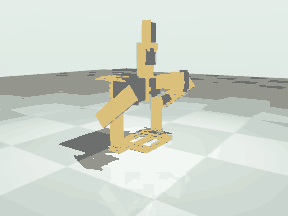
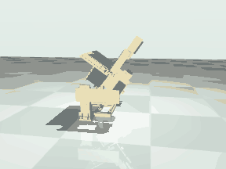
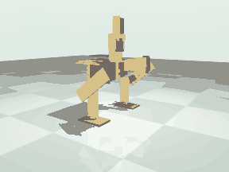

# Motion study: walk, turn, jump, sit

Generated by `scripts/run_motion.py` from `reports/motion.json`. Do not edit by hand.

What the MuJoCo model of the robot does when asked to walk, turn, jump, sit down, stand up, stop and lose power, with the servos, the command path
and the floor modelled as described below. All numbers on this page are simulation results; none has been measured on the robot.
The robot is the one in `robot/microduck.xml`: comb soles and the default head. The same robot with flat soles is run for comparison.

## Result

|  | Comb soles (the robot as built) | Flat soles (comparison) |
|---|---|---|
| mass (kg) | 0.5622 | 0.5375 |
| stands on one foot (slow lift test) | yes | no |
| truly steps | yes | no |
| forward speed (mm/s) | 44.4 | 1.3 |
| one foot loaded, fraction of time | 0.546 | 0.0 |
| median swing clearance (mm) | 3.85 | 0.0 |
| median swing time (s) | 0.1 | 0.0 |
| standing-foot slip per step (mm) | 1.01 | 0.0 |
| walk peak torque / limit | 0.647 | 0.203 |
| heading drift walking straight (deg/s) | 0.81 | 0.0 |
| stays up 120 s | yes | yes |
| falls in the 30 perturbed runs | 0 | 0 |
| perturbed runs that step | 30 | 0 |
| worst peak torque / limit in those runs | 0.696 | 0.25 |
| turning proportional at full forward | no | no |
| yaw rate at turn -1 / 0 / +1, full forward (deg/s) | 0.99 / 0.78 / -4.92 | -0.04 / -0.07 / -0.03 |
| envelope: forward, turn | [0.0, 1.0], [0.0, 0.0] | [-1.0, 1.0], [0.0, 0.0] |
| commands stop in mid gait: stays up | yes | yes |
| power off in mid gait: stays up | yes | no |
| jump | hop | hop |
| flight (s), centre of mass rise in flight (mm) | 0.06, 0.32 | 0.1, 6.07 |
| lands upright | yes | yes |
| sits down and stands up again | yes | yes |
| power off in the squat: holds | yes | yes |
| power off at the stand pose: stays up | yes | no |
| board, battery, display or camera on the floor | no | no |

"Truly steps" means: it stayed up, at least 80 percent of the commanded steps happened with the whole sole 1 mm or more
off the floor for 60 ms or more while the other foot carried the load, left and right in turn, and it went forward.

## What the model includes

Published: servo stall torque and no-load speed at 4.8 V (SR431 1.196 N m, 300 deg/s; SR311 0.304 N m, 429 deg/s),
the 5 V 4 A supply, the masses of the servos. Position servos behind `protocol.Controller` with the soft limits of `robot/joints.json`
and the leg clearance rule. A result obtained by loosening any of this is not shown as a result.

| parameter | value | why |
|---|---|---|
| timestep_s | 0.002 | MuJoCo step; the headline runs are repeated at 0.001 s as a numerical check |
| floor_friction | 0.6 | assumed: printed PLA sole on a table top, as in the first model; sensitivity is reported from 0.3 to 1.0 |
| contact_timeconst_s | 0.005 | assumed: stiff floor contact (MuJoCo solref); the default 0.02 lets a sole sink about 0.3 mm, which is the size of the clearances measured here |
| transport_delay_ms | 20 | assumed: one controller tick for a command line to cross the USB or bridge link and be parsed |
| controller_tick_ms | 20 | the firmware loop (microduck/protocol.py); commands are also rate limited there |
| pwm_latency_ms | 20 | the servo reads one pulse per 50 Hz frame, so a new target is acted on one frame after the controller sets it |
| pulse_resolution_us | 1 | the firmware rounds the pulse width to a whole microsecond, 0.09 degrees |
| deadband_deg | 0.4 | assumed: an 8 microsecond dead band, typical for an analog servo; the maker publishes none |
| backlash_deg | 1.0 | assumed: total gear play at the horn, typical for a plastic or mixed gear train. The feedback potentiometer is on the output shaft, so play adds to the zone in which the servo does not push back: half of it each side |
| full_torque_error_deg | 4.0 | assumed in the first model: the servo reaches stall torque this far outside the dead zone |
| flex_nm_per_rad | {'SR431': 40.0, 'SR311': 12.0} | assumed: series spring between horn and link for the cable-tied case, the plastic horn and the 4 mm plate; about 1.5 degrees at stall torque. Not sensed by the servo |
| flex_damping_nms_per_rad | {'SR431': 0.02, 'SR311': 0.006} | assumed: light damping of that spring |
| supply_current_a | 4.0 | published: the Braccio supply is 5 V 4 A. When the estimated current of the six servos exceeds it all torques are scaled down together. Stall currents are assumed (config/hardware.json) |
| relaxed_friction_nm | 0.02 | assumed in the first model: friction of an unpowered gear train. Rest poses are also checked with zero friction |
| sole_sag_mm | 0.0 | the soles are rigid in the model. The part generator computes 0.5 mm (PLA) to 0.9 mm (PETG) of sag at the centre line with the whole weight on one foot; the series spring per joint is the only compliance here |

The servo is a torque source: zero inside the dead zone (dead band plus half the gear play), then proportional,
saturating at stall torque, with joint damping of stall torque over no-load speed so that speed falls with load.
The firmware's own rate limit is 120.0 deg/s; walking, turning, sitting and standing up stay inside it.
A command sent by the host moves the servo 40 ms later (transport, then one PWM frame). For a motion played open loop that only shifts
the whole motion in time; it matters to anything that closes a loop through the host, such as a gamepad.
The joints are free over the whole servo travel in the model; the soft limits act on the commands, and a relaxed joint runs to its travel stop.
As in the generated model, parts collide with the floor only. The generated collision boxes are bounding boxes of slices of the parts and stand closer
together than the comb soles really do, so leg against leg is not simulated on them: after each run the joint angles the simulation reached are tested
with the clearance rule's boxes and, where those are within the margin, with the exact meshes. A mesh overlap is reported as the legs touching.
Not modelled: flex of the printed parts beyond the one series spring per joint (the soles are rigid), supply voltage sag below the
current limit, servo heating, cable drag, and any mounting error of the horns.

Head: a point mass of 0.0 g at [60.0, 0.0, 80.0] mm in the torso frame is added to the generated torso
(`config/motion.json`). Zero means the torso as generated, which carries the default head. Set it and rerun to see the effect of another head.

## Comb soles (the robot as built)

The robot as generated: comb soles whose fingers cross the centre line.

Mass 0.5622 kg, torso 154.2 mm above the floor at the stand pose. Slow one-foot test (lift a foot, hold 2.5 s): holds on either foot (clearance 1.1 and 1.1 mm).

### Walking

It truly steps. 113 swings with a sole wholly off the floor in 30 s (99 percent of the steps the gait commands), median clearance 3.85 mm for 0.1 s, the swinging foot moving 8.64 mm while the standing foot slips 1.01 mm. One foot carries the load 55 percent of the time, both 45 percent, neither 1 percent. Forward speed 44.4 mm/s, heading drift 0.81 deg/s. Peak torque 0.647 of the limit (margin 0.353). The meshes of the two legs overlapped in 0.0 percent of the ticks; the legs were inside the clearance rule's margin of each other, measured on the angles the joints reached, in 0.0 percent.

Gait of `microduck/gait.py`, parameters `{'period_s': 0.5, 'roll_amplitude_deg': 7.78, 'step_amplitude_deg': 7.56, 'lift_deg': 2.78, 'step_phase_deg': 150.0, 'lead_in_s': 1.0}`.
Search: seed 1, 40 generations of 14, 3360 simulated runs, 449.4 s of wall clock.

| joint | peak torque (N m) | limit (N m) | peak / limit | time at limit | peak speed (deg/s) | limit (deg/s) |
|---|---|---|---|---|---|---|
| left_hip_roll | 0.562 | 1.196 | 0.47 | 0.0 | 97.7 | 300.0 |
| left_hip_pitch | 0.17 | 1.196 | 0.142 | 0.0 | 88.6 | 300.0 |
| left_knee | 0.197 | 0.304 | 0.647 | 0.0 | 147.5 | 428.6 |
| right_hip_roll | 0.552 | 1.196 | 0.461 | 0.0 | 100.6 | 300.0 |
| right_hip_pitch | 0.189 | 1.196 | 0.158 | 0.0 | 94.3 | 300.0 |
| right_knee | 0.193 | 0.304 | 0.635 | 0.0 | 150.7 | 428.6 |

Peak estimated supply current 4.05 A; the 4 A limit was active 0.1 percent of the time.

Long run: stayed up over 120 s, 46.0 mm/s along its path, heading drift 0.97 deg/s (115.0 deg in all: with no steering it walks a curve).
Numerical check at half the time step: stayed up, 45.1 mm/s, 100 percent of steps, clearance 3.74 mm, peak torque 0.603 of the limit.

Robustness: 30 runs of 30 s over floor friction 0.3 to 1.0, mass 0.9 to 1.1 times, and two disturbed starts (1.5 deg tilt, 0.03 m/s push). 0 fell; 30 of 30 stepped by the test above; the leg meshes overlapped in 0 runs; worst peak torque 0.696 of the limit.

| floor friction | runs | fell | stepping | speed (mm/s) | heading change in 30 s (deg) | worst peak torque / limit |
|---|---|---|---|---|---|---|
| 0.3 | 6 | 0 | 6 | 43.5 to 45.3 | 28.6 to 42.9 | 0.664 |
| 0.45 | 6 | 0 | 6 | 40.8 to 45.0 | 25.7 to 61.7 | 0.658 |
| 0.6 | 6 | 0 | 6 | 37.4 to 44.8 | -6.6 to 64.5 | 0.696 |
| 0.8 | 6 | 0 | 6 | 40.9 to 46.9 | -4.9 to 51.2 | 0.682 |
| 1.0 | 6 | 0 | 6 | 41.4 to 47.2 | -35.2 to 52.3 | 0.623 |

Head mass (a point mass added at the head, `config/motion.json`):

| case | mass (kg) | outcome | speed (mm/s) | heading change in 30 s (deg) | steps made | clearance (mm) | peak torque / limit |
|---|---|---|---|---|---|---|---|
| default head | 0.5622 | stayed up | 44.4 | 23.1 | 0.991 | 3.85 | 0.647 |
| 20 g more at the head | 0.5822 | stayed up | 36.2 | 70.7 | 0.965 | 3.75 | 0.711 |
| 32 g more: the heaviest turning head, 57 g at the head | 0.5942 | stayed up | 28.0 | 96.2 | 0.991 | 3.65 | 0.682 |
| 32 g more, 20 mm further forward | 0.5942 | stayed up | 24.2 | 109.7 | 0.974 | 3.64 | 0.705 |
| 32 g more, 30 mm higher | 0.5942 | stayed up | 24.1 | 111.4 | 0.991 | 3.65 | 0.658 |

### Turning, backing and the envelope

There is no yaw joint. The turn input is the control page's: the left step is scaled by forward minus turn and the right by forward plus turn.
Any turn comes from the soles scrubbing on the floor.

Yaw rate (deg/s) at floor friction 0.6, by forward and turn input; a dash is a point that fell, had the leg meshes overlap or was refused at some friction:

| forward (rows), turn (columns) | -1.0 | -0.5 | 0.0 | 0.5 | 1.0 |
|---|---|---|---|---|---|
| -1.0 | 0.69 | - | - | - | - |
| -0.5 | -5.38 | 0.69 | - | - | - |
| 0.0 | - | 0.55 | 0.86 | 4.18 | - |
| 0.5 | - | 0.99 | -3.87 | -4.92 | 3.69 |
| 1.0 | 0.99 | -3.14 | 0.78 | 3.4 | -4.92 |

Forward speed (mm/s) at the same points:

| forward (rows), turn (columns) | -1.0 | -0.5 | 0.0 | 0.5 | 1.0 |
|---|---|---|---|---|---|
| -1.0 | -6.1 | -57.3 | -85.0 | 34.5 | 31.6 |
| -0.5 | 4.2 | -6.1 | -4.5 | 31.6 | 101.2 |
| 0.0 | 98.6 | 1.9 | 0.6 | 5.2 | 41.0 |
| 0.5 | 11.3 | 20.5 | 17.2 | 18.4 | 10.0 |
| 1.0 | 20.5 | 32.8 | 45.2 | 29.9 | 18.4 |

How the yaw rate follows the turn input at full forward:

| floor friction | deg/s per unit of turn | deg/s at zero turn | rises with every step of the input | fit R squared |
|---|---|---|---|---|
| 0.4 | -1.77 | 0.0 | no | 0.204 |
| 0.6 | -1.06 | -0.58 | no | 0.061 |
| 0.9 | 0.22 | -1.33 | no | 0.002 |

Turning is not reliable: full left and full right do not go the right way at every tested friction.
Turning on the spot (forward 0, turn -1 and +1): 14.7 and -6.58 deg/s.

Envelope for the control page: forward [0.0, 1.0], turn [0.0, 0.0]. A point passes if it stayed up at friction [0.4, 0.6, 0.9] for 20 s with the leg meshes apart and no command refused (15 of 25 points passed). The turn range is offered only if full left and full right go the right way at every tested friction; otherwise turning is listed as unavailable and the forward range is the one that passes with the turn input at zero.

### Stop and power off in mid gait

Commands stopped at four points of a step: the watchdog goes to hold after 500 ms and the robot stays up every time.
Pulses stopped (power off) at the same four points: the model stays up every time, sinking 41.5 to 47.9 mm on to the servo travel stops. In 4 of the 4 the pose it sinks to has the two shins or soles overlapping in the meshes (up to 11920.6 mm3): the model lets parts pass through each other, so on the robot the legs meet first and one sole comes down on or against the other. Where it then rests is not predicted.

### Jump

Crouch, then both hips and knees driven as fast as the servos go (firmware rate limit raised to 430 deg/s). Result: a **hop**. Nothing touches the floor for 0.06 s. In that time the centre of mass rises 0.32 mm (it leaves at 0.054 m/s upward) and the soles reach 4.95 mm, most of which is the legs being pulled up under the body. It lands upright, peak tilt 44.26 deg, 12.1 mm forward; leg meshes overlapped: no. By the definition used here a jump needs 0.1 s of flight and the centre of mass rising 10 mm in it; less, with real flight, is a hop.

| joint | peak torque (N m) | limit | time at limit | peak speed (deg/s) | limit | peak / limit |
|---|---|---|---|---|---|---|
| left_hip_pitch | 1.196 | 1.196 | 0.133 | 386.9 | 300.0 | 1.29 |
| left_knee | 0.304 | 0.304 | 0.189 | 322.9 | 428.6 | 0.753 |
| right_hip_pitch | 1.196 | 1.196 | 0.133 | 391.4 | 300.0 | 1.305 |
| right_knee | 0.304 | 0.304 | 0.189 | 327.2 | 428.6 | 0.764 |

The servos ask for 5.68 A at the peak against a 4 A supply; the supply limit was active 7 percent of the push. With the firmware's default 120 deg/s limit the same motion gives: no flight. Upper bound: the hips can lift the body at 0.431 m/s with no load at all, a ballistic rise of 9.5 mm of the centre of mass; under load it is less. With the supply limit removed (not a result, only to show what limits it) the rise in flight is 0.07 mm.

| case | verdict | rise in flight (mm) | soles off (mm) | flight (s) | lands upright |
|---|---|---|---|---|---|
| friction 0.3 | hop | 0.0 | 3.11 | 0.1 | yes |
| friction 0.45 | hop | 0.0 | 3.75 | 0.06 | yes |
| friction 0.6 | hop | 0.32 | 4.95 | 0.06 | yes |
| friction 0.8 | hop | 0.02 | 3.86 | 0.06 | yes |
| friction 1.0 | hop | 0.04 | 4.08 | 0.06 | yes |
| default head | hop | 0.32 | 4.95 | 0.06 | yes |
| 20 g more at the head | hop | 0.77 | 0.68 | 0.06 | yes |
| 32 g more: the heaviest turning head, 57 g at the head | hop | 0.0 | 1.75 | 0.06 | yes |
| 32 g more, 20 mm further forward | hop | 1.73 | 2.23 | 0.08 | yes |
| 32 g more, 30 mm higher | hop | 1.73 | 2.05 | 0.08 | yes |
| half the time step | hop | 1.87 | 4.08 | 0.08 | yes |

### Sit, power off and stand up

Sitting is a squat to the hip pitch limit: hip pitch 62.0, knee -62.0 degrees, soles level, at 40 deg/s. The torso comes down 13.3 mm to 140.6 mm. The limit is there because between about 65 and 75 degrees the top of each shin grazes the torso when the soles are level (up to 13 mm3 of overlap in the meshes).

- Lowering: reached the sit pose; peak torque 0.354 of the limit, peak speed 0.143 of the limit. Straight back up under power: reached the stand pose.
- Pulses stopped in the sit pose: it sinks 37.3 mm and comes to rest at hip pitch 90.2, knee -90.5 degrees, body pitched 0.3 degrees; on the floor: sole; at a servo travel stop: left_hip_pitch, left_knee, right_hip_pitch, right_knee; parts overlapping in the meshes there: none. It holds there. With no joint friction at all: it sinks 37.3 mm and comes to rest at hip pitch 90.2, knee -90.5 degrees, body pitched 0.3 degrees; on the floor: sole; at a servo travel stop: left_hip_pitch, left_knee, right_hip_pitch, right_knee; parts overlapping in the meshes there: none. Shoved at 0.1 m/s forward and back while relaxed: holds, holds.
- Standing up from there (enable, which drives the servos back to the sit pose from wherever the legs sank to, then up): reached the stand pose upright; peak torque 1.0 of the limit, peak speed 0.91 of the limit.
- Pulses stopped at the stand pose instead: it sinks 49.5 mm and comes to rest at hip pitch 90.2, knee -90.5 degrees, body pitched 0.3 degrees; on the floor: sole; at a servo travel stop: left_hip_pitch, left_knee, right_hip_pitch, right_knee; parts overlapping in the meshes there: none, sinking at up to 0.391 m/s. With the heaviest head: it sinks 49.6 mm and comes to rest at hip pitch 90.2, knee -90.5 degrees, body pitched 0.3 degrees; on the floor: sole; at a servo travel stop: left_hip_pitch, left_knee, right_hip_pitch, right_knee; parts overlapping in the meshes there: none.
- Power off and on again at the stand pose: it sinks 49.5 mm and comes to rest at hip pitch 90.2, knee -90.5 degrees, body pitched 0.3 degrees; on the floor: sole; at a servo travel stop: left_hip_pitch, left_knee, right_hip_pitch, right_knee; parts overlapping in the meshes there: none, and after enable it stands up, peak torque 1.0 of the limit. Parts overlapping in the meshes on the way up: none.
- Parts overlapping in the meshes on the way down and up under power: none. The model does not collide part with part, so an overlap listed here is a place where the real parts rub or stop.
- Parts that touched the floor at any time while sitting, resting and standing up: sole. Board, shield, battery, display, camera or head on the floor: no.

| joint | rising peak torque / limit | rising peak speed / limit |
|---|---|---|
| left_hip_pitch | 1.0 | 0.91 |
| left_knee | 1.0 | 0.592 |
| right_hip_pitch | 1.0 | 0.91 |
| right_knee | 1.0 | 0.591 |

Sit, rest and stand up by floor friction: 0.3: ok, 0.45: ok, 0.6: ok, 0.8: ok, 1.0: ok. By head: default head: ok, 20 g more at the head: ok, 32 g more: the heaviest turning head, 57 g at the head: ok, 32 g more, 20 mm further forward: ok, 32 g more, 30 mm higher: ok.

## Flat soles (comparison)

Comparison: the same robot with the flat sole plates as first drawn (75 by 48 by 5 mm) in place of the comb soles, the hip roll limits those soles had, and no leg clearance rule.

Mass 0.5375 kg, torso 154.2 mm above the floor at the stand pose. Slow one-foot test (lift a foot, hold 2.5 s): does not hold (clearance -0.0 and -0.0 mm).

### Walking

It does not truly step. 0 swings with a sole wholly off the floor in 30 s (0 percent of the steps the gait commands), median clearance 0.0 mm for 0.0 s, the swinging foot moving 0.0 mm while the standing foot slips 0.0 mm. One foot carries the load 0 percent of the time, both 100 percent, neither 0 percent. Forward speed 1.3 mm/s, heading drift 0.0 deg/s. Peak torque 0.203 of the limit (margin 0.797). The meshes of the two legs overlapped in 0.0 percent of the ticks; the legs were inside the clearance rule's margin of each other, measured on the angles the joints reached, in 0.0 percent.

Gait of `microduck/gait.py`, parameters `{'period_s': 1.38, 'roll_amplitude_deg': 10.15, 'step_amplitude_deg': 2.0, 'lift_deg': 0.0, 'step_phase_deg': 87.82, 'lead_in_s': 1.0}`.
Search: seed 1, 30 generations of 14, 2520 simulated runs, 226.6 s of wall clock.

| joint | peak torque (N m) | limit (N m) | peak / limit | time at limit | peak speed (deg/s) | limit (deg/s) |
|---|---|---|---|---|---|---|
| left_hip_roll | 0.151 | 1.196 | 0.127 | 0.0 | 41.6 | 300.0 |
| left_hip_pitch | 0.142 | 1.196 | 0.119 | 0.0 | 11.2 | 300.0 |
| left_knee | 0.059 | 0.304 | 0.193 | 0.0 | 10.8 | 428.6 |
| right_hip_roll | 0.156 | 1.196 | 0.13 | 0.0 | 41.4 | 300.0 |
| right_hip_pitch | 0.146 | 1.196 | 0.122 | 0.0 | 10.8 | 300.0 |
| right_knee | 0.062 | 0.304 | 0.203 | 0.0 | 10.6 | 428.6 |

Peak estimated supply current 1.51 A; the 4 A limit was active 0.0 percent of the time.

Long run: stayed up over 120 s, 1.3 mm/s along its path, heading drift -0.01 deg/s (-0.8 deg in all).
Numerical check at half the time step: stayed up, 1.3 mm/s, 0 percent of steps, clearance 0.0 mm, peak torque 0.204 of the limit.

Robustness: 30 runs of 30 s over floor friction 0.3 to 1.0, mass 0.9 to 1.1 times, and two disturbed starts (1.5 deg tilt, 0.03 m/s push). 0 fell; 0 of 30 stepped by the test above; the leg meshes overlapped in 0 runs; worst peak torque 0.25 of the limit.

| floor friction | runs | fell | stepping | speed (mm/s) | heading change in 30 s (deg) | worst peak torque / limit |
|---|---|---|---|---|---|---|
| 0.3 | 6 | 0 | 0 | -1.7 to -0.8 | -0.3 to 1.1 | 0.25 |
| 0.45 | 6 | 0 | 0 | 0.2 to 1.4 | -0.7 to 1.9 | 0.223 |
| 0.6 | 6 | 0 | 0 | 1.3 to 1.4 | 0.0 to 0.1 | 0.218 |
| 0.8 | 6 | 0 | 0 | 1.2 to 1.3 | 0.1 to 0.1 | 0.221 |
| 1.0 | 6 | 0 | 0 | 1.2 to 1.2 | 0.1 to 0.2 | 0.222 |

Head mass (a point mass added at the head, `config/motion.json`):

| case | mass (kg) | outcome | speed (mm/s) | heading change in 30 s (deg) | steps made | clearance (mm) | peak torque / limit |
|---|---|---|---|---|---|---|---|
| default head | 0.5375 | stayed up | 1.3 | 0.0 | 0.0 | 0.0 | 0.203 |
| 20 g more at the head | 0.5575 | stayed up | 1.4 | 0.1 | 0.0 | 0.0 | 0.216 |
| 32 g more: the heaviest turning head, 57 g at the head | 0.5695 | stayed up | 1.4 | 0.1 | 0.0 | 0.0 | 0.223 |
| 32 g more, 20 mm further forward | 0.5695 | stayed up | 1.4 | 0.0 | 0.0 | 0.0 | 0.234 |
| 32 g more, 30 mm higher | 0.5695 | stayed up | 1.4 | 0.1 | 0.0 | 0.0 | 0.224 |

### Turning, backing and the envelope

There is no yaw joint. The turn input is the control page's: the left step is scaled by forward minus turn and the right by forward plus turn.
Any turn comes from the soles scrubbing on the floor.

Yaw rate (deg/s) at floor friction 0.6, by forward and turn input; a dash is a point that fell, had the leg meshes overlap or was refused at some friction:

| forward (rows), turn (columns) | -1.0 | -0.5 | 0.0 | 0.5 | 1.0 |
|---|---|---|---|---|---|
| -1.0 | 0.03 | 0.04 | 0.07 | 0.04 | 0.03 |
| -0.5 | 0.01 | 0.03 | 0.03 | 0.03 | 0.01 |
| 0.0 | -0.0 | -0.0 | -0.0 | -0.01 | -0.01 |
| 0.5 | -0.01 | -0.04 | -0.04 | -0.03 | -0.01 |
| 1.0 | -0.04 | -0.05 | -0.07 | -0.05 | -0.03 |

Forward speed (mm/s) at the same points:

| forward (rows), turn (columns) | -1.0 | -0.5 | 0.0 | 0.5 | 1.0 |
|---|---|---|---|---|---|
| -1.0 | -0.4 | -0.7 | -1.0 | -0.7 | -0.5 |
| -0.5 | -0.1 | -0.4 | -0.4 | -0.5 | -0.2 |
| 0.0 | 0.3 | 0.2 | 0.1 | 0.1 | 0.0 |
| 0.5 | 0.5 | 0.8 | 0.7 | 0.7 | 0.4 |
| 1.0 | 0.8 | 1.1 | 1.4 | 1.0 | 0.7 |

How the yaw rate follows the turn input at full forward:

| floor friction | deg/s per unit of turn | deg/s at zero turn | rises with every step of the input | fit R squared |
|---|---|---|---|---|
| 0.4 | -0.02 | -0.04 | no | 0.327 |
| 0.6 | 0.0 | -0.05 | no | 0.045 |
| 0.9 | 0.0 | -0.05 | no | -0.0 |

Turning is not reliable: full left and full right do not go the right way at every tested friction.
Turning on the spot (forward 0, turn -1 and +1): -0.0 and -0.01 deg/s.

Envelope for the control page: forward [-1.0, 1.0], turn [0.0, 0.0]. A point passes if it stayed up at friction [0.4, 0.6, 0.9] for 20 s with the leg meshes apart and no command refused (25 of 25 points passed). The turn range is offered only if full left and full right go the right way at every tested friction; otherwise turning is listed as unavailable and the forward range is the one that passes with the turn input at zero.

### Stop and power off in mid gait

Commands stopped at four points of a step: the watchdog goes to hold after 500 ms and the robot stays up every time.
Pulses stopped (power off) at the same four points: the model falls in some, sinking 50.9 to 51.5 mm on to the servo travel stops. The meshes of the legs do not overlap in the poses it sinks to.

### Jump

Crouch, then both hips and knees driven as fast as the servos go (firmware rate limit raised to 430 deg/s). Result: a **hop**. Nothing touches the floor for 0.1 s. In that time the centre of mass rises 6.07 mm (it leaves at 0.2 m/s upward) and the soles reach 8.34 mm, most of which is the legs being pulled up under the body. It lands upright, peak tilt 9.22 deg, -53.3 mm forward; leg meshes overlapped: no. By the definition used here a jump needs 0.1 s of flight and the centre of mass rising 10 mm in it; less, with real flight, is a hop.

| joint | peak torque (N m) | limit | time at limit | peak speed (deg/s) | limit | peak / limit |
|---|---|---|---|---|---|---|
| left_hip_pitch | 1.196 | 1.196 | 0.093 | 291.2 | 300.0 | 0.971 |
| left_knee | 0.304 | 0.304 | 0.105 | 355.1 | 428.6 | 0.829 |
| right_hip_pitch | 1.196 | 1.196 | 0.093 | 291.2 | 300.0 | 0.971 |
| right_knee | 0.304 | 0.304 | 0.105 | 355.1 | 428.6 | 0.828 |

The servos ask for 8.34 A at the peak against a 4 A supply; the supply limit was active 13 percent of the push. With the firmware's default 120 deg/s limit the same motion gives: no flight. Upper bound: the hips can lift the body at 0.431 m/s with no load at all, a ballistic rise of 9.5 mm of the centre of mass; under load it is less. With the supply limit removed (not a result, only to show what limits it) the rise in flight is 6.53 mm.

| case | verdict | rise in flight (mm) | soles off (mm) | flight (s) | lands upright |
|---|---|---|---|---|---|
| friction 0.3 | hop | 3.03 | 1.28 | 0.06 | no |
| friction 0.45 | hop | 6.89 | 9.47 | 0.1 | yes |
| friction 0.6 | hop | 6.07 | 8.34 | 0.1 | yes |
| friction 0.8 | hop | 6.49 | 7.63 | 0.1 | yes |
| friction 1.0 | hop | 6.66 | 7.16 | 0.12 | yes |
| default head | hop | 6.07 | 8.34 | 0.1 | yes |
| 20 g more at the head | hop | 5.86 | 6.82 | 0.1 | yes |
| 32 g more: the heaviest turning head, 57 g at the head | hop | 6.1 | 9.09 | 0.1 | yes |
| 32 g more, 20 mm further forward | hop | 6.18 | 8.55 | 0.1 | yes |
| 32 g more, 30 mm higher | hop | 4.2 | 4.19 | 0.08 | yes |
| half the time step | hop | 6.23 | 7.5 | 0.12 | yes |

### Sit, power off and stand up

Sitting is a squat to the hip pitch limit: hip pitch 62.0, knee -62.0 degrees, soles level, at 40 deg/s. The torso comes down 13.3 mm to 140.6 mm. The limit is there because between about 65 and 75 degrees the top of each shin grazes the torso when the soles are level (up to 13 mm3 of overlap in the meshes).

- Lowering: reached the sit pose; peak torque 0.351 of the limit, peak speed 0.119 of the limit. Straight back up under power: reached the stand pose.
- Pulses stopped in the sit pose: it sinks 37.4 mm and comes to rest at hip pitch 90.2, knee -90.5 degrees, body pitched 0.3 degrees; on the floor: sole; at a servo travel stop: left_hip_pitch, left_knee, right_hip_pitch, right_knee; parts overlapping in the meshes there: none. It holds there. With no joint friction at all: it sinks 37.4 mm and comes to rest at hip pitch 90.2, knee -90.5 degrees, body pitched 0.3 degrees; on the floor: sole; at a servo travel stop: left_hip_pitch, left_knee, right_hip_pitch, right_knee; parts overlapping in the meshes there: none. Shoved at 0.1 m/s forward and back while relaxed: holds, holds.
- Standing up from there (enable, which drives the servos back to the sit pose from wherever the legs sank to, then up): reached the stand pose upright; peak torque 1.0 of the limit, peak speed 0.914 of the limit.
- Pulses stopped at the stand pose instead: it falls forward, sinking at up to 0.387 m/s. With the heaviest head: it sinks 49.6 mm and comes to rest at hip pitch 90.2, knee -90.5 degrees, body pitched 0.4 degrees; on the floor: sole; at a servo travel stop: left_hip_pitch, left_knee, right_hip_pitch, right_knee; parts overlapping in the meshes there: none.
- Power off and on again at the stand pose: it falls forward, and after enable it falls forward, peak torque 1.0 of the limit. Parts overlapping in the meshes on the way up: none.
- Parts overlapping in the meshes on the way down and up under power: none. The model does not collide part with part, so an overlap listed here is a place where the real parts rub or stop.
- Parts that touched the floor at any time while sitting, resting and standing up: sole. Board, shield, battery, display, camera or head on the floor: no.

| joint | rising peak torque / limit | rising peak speed / limit |
|---|---|---|
| left_hip_pitch | 1.0 | 0.914 |
| left_knee | 1.0 | 0.607 |
| right_hip_pitch | 1.0 | 0.914 |
| right_knee | 1.0 | 0.607 |

Sit, rest and stand up by floor friction: 0.3: ok, 0.45: ok, 0.6: ok, 0.8: ok, 1.0: ok. By head: default head: ok, 20 g more at the head: ok, 32 g more: the heaviest turning head, 57 g at the head: ok, 32 g more, 20 mm further forward: fails, 32 g more, 30 mm higher: ok.

## The leg clearance rule

With comb soles a single joint, inside its own limits, can swing one sole into the other. The control core (`microduck/protocol.py` and its twin
`DuckControl.hpp`) therefore carries a box model of the two legs, `robot/clearance.json`: for each leg the thigh plate, the knee servo, the shin plate
and the pieces of the sole (bridge, rail, each finger and the fillet at its root), each grown by half the margin.
From the six commanded joint angles it places the boxes (hip roll, hip pitch and knee in turn, with its own sine so that every copy agrees to the bit)
and tests shin against shin and each shin against the other thigh with the separating axis test.

- A `J` line whose target would bring the legs together is answered `ERR CLEAR` and changes nothing.
- A calibration nudge (`N`) that would do so is answered `ERR CLEAR`.
- A tick whose rate-limited step would do so is not taken; the commanded angles stay where they are.

Checked against the exact meshes of the two legs (`scripts/validate_clearance.py`, seed 1, margin 4.0 mm): 42400 poses, 7084 of them colliding in the meshes. False accepts (rule says clear, meshes overlap): 0. False rejects (meshes clear, rule refuses): 4060 of 35316 free poses, 11.5 percent.

| sample | poses | colliding in the meshes | refused by the rule | false accepts | false rejects | false reject rate of free poses |
|---|---|---|---|---|---|---|
| uniform over the limits | 20000 | 764 | 1368 | 0 | 604 | 0.0314 |
| within 25 degrees of the stand pose | 20000 | 6018 | 9217 | 0 | 3199 | 0.2288 |
| one joint moved from the stand pose | 2400 | 302 | 559 | 0 | 257 | 0.1225 |

The rule works on commanded angles. Play in the gears, flex and a horn mounted a degree off move the real sole by a few millimetres at the end of
a 160 mm leg, which is the size of the margin; the walking results above say how often the angles the joints reached were inside the margin.
The rule covers leg against leg only: a shin against the torso is left to the per-joint limits.

What a copy of the rule in another language has to reproduce, in this order: `sine` and `cosine` (the polynomial, not the library function),
`_frame`, `_apply`, `_leg`, `_apart` and `legs_clear` of `microduck/protocol.py`, operation for operation in double precision; the table
`robot/clearance.json`; `ERR CLEAR` for a refused `J` or `N`; and the tick that is not taken.

## Trajectories and their checks

For the robot as built. Every row of every file is put through `protocol.Controller` (soft limits, speed limit, leg clearance rule), through the
collision boxes of the two legs, and through the exact meshes of the two legs.

| file | s | speed limit (deg/s) | limit problems | clamped | refused | least gap between leg boxes (mm) | worst mesh overlap (mm3) | passes |
|---|---|---|---|---|---|---|---|---|
| `trajectories/walk.csv` | 12.0 | 120.0 | 0 | 0 | 0 | 3.2 | 0.0 | yes |
| `trajectories/turn_left.csv` | 12.0 | 120.0 | 0 | 0 | 0 | 3.7 | 0.0 | yes |
| `trajectories/turn_right.csv` | 12.0 | 120.0 | 0 | 0 | 0 | 3.7 | 0.0 | yes |
| `trajectories/sit.csv` | 1.64 | 120.0 | 0 | 0 | 0 | 4.2 | 0.0 | yes |
| `trajectories/stand_up.csv` | 2.74 | 120.0 | 0 | 0 | 0 | 4.2 | 0.0 | yes |
| `trajectories/restricted/jump.csv` | 3.38 | 430.0 | 0 | 0 | 0 | 4.2 | 0.0 | yes |

`trajectories/manifest.json` is in the shape the control page reads: gait parameters `config/gait.json`, forward [0.0, 1.0], turn [0.0, 0.0], motions stand, sit; unavailable: jump, back, turn. The jump is listed as unavailable with its reason and its file is kept in `trajectories/restricted/`.

## Search budget

`scripts/optimise_motion.py`: 2100 candidates, 10360 simulated runs, 835.4 s of wall clock on seven worker processes, no GPU. Each search is bounded by a fixed number of generations and a wall-clock limit. Every gait candidate is run straight for 10 s on these copies of the robot and scored on the mean and the worst, and for 8 s with the turn input at 0.6 each way:

| floor friction | mass scale | start tilt roll, pitch (deg) | start push x, y (m/s) |
|---|---|---|---|
| 0.6 | 1.0 | [0.0, 0.0] | [0.0, 0.0] |
| 0.4 | 1.06 | [0.0, 1.5] | [0.0, 0.0] |
| 0.9 | 0.94 | [1.5, 0.0] | [0.0, 0.03] |
| 0.6 | 1.0 | [-1.0, -1.0] | [0.02, -0.02] |

The gait score rewards staying up, forward distance, steps made with a sole off the floor and turning the right way; it charges for heading drift,
sideways drift, tilt over 20 degrees, peak torque above 0.8 of the limit, time at the supply limit, the legs coming inside the clearance margin of each other
and commands the clearance rule refuses.

## On the robot: what to expect

- These are predictions of a model whose dead band, backlash, compliance, friction and delays are estimates. Start with the slowest motions: stand, sit,
  stand up, then single slow steps with the robot held, then the walk at a low forward input.
- The jump can strip gears or break parts. It drives four servos at stall torque from a supply that cannot feed them, lands on hard plates, and needs the
  firmware speed limit raised. It is listed as unavailable in the manifest and kept in `trajectories/restricted/`; in simulation it is only a hop.
- Supply current: the walk's estimated peak is in the table above. The servos share one 5 V 4 A supply; a motion that asks for more is slowed in the model
  and browns out the real supply.
- Power off: see what the robot rests on above. It sinks quickly when the pulses stop at the stand pose. Lower it to the squat under power before
  switching off, and check on the real parts what the legs come to rest against.
- The comb soles pass each other with a few millimetres to spare. The leg clearance rule keeps the commands apart; play and a horn mounted off its zero
  can still bring the real soles together. Set the zeros (`scripts/calibrate.py`) before the first step.
- Heading drifts when walking straight and the drift changes with the floor. Expect to steer.

## Files

- `config/motion.json`: every parameter of the model. `config/presets.json`: the comparison preset. `config/gaits.json`: the searched motions.
- `config/gait.json`: the gait parameters for the robot as built; the one gait file.
- `robot/clearance.json`: the boxes of the leg clearance rule. `reports/clearance.json`: its validation.
- `trajectories/manifest.json`, `trajectories/gait_params.json`: the motions and the tested envelope for the control page.
- `reports/motion.json`: all numbers on this page and the rows behind them.

