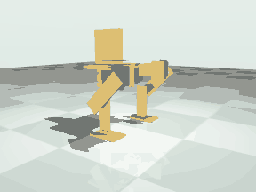
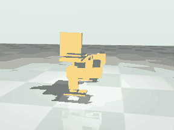
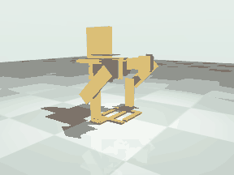
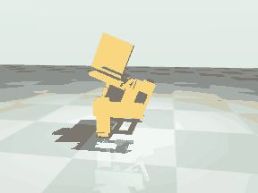

# Motion study: walk, turn, jump, sit

Generated by `scripts/run_motion.py` from `reports/motion.json`. Do not edit by hand.

Status: simulation only. The robot has never been assembled or powered. Nothing here has been tried on a servo.

The owner asked for a robot that walks, jumps and sits down in MuJoCo. This page says what the model does when
the servos, the command path and the floor are kept honest, on the geometry as drawn and on one design variant.
The variant (`comb_feet`) is a proposal of this study. It is not the owner's design and no part exists for it.

## Result

|  | Drawn geometry | Variant: comb feet |
|---|---|---|
| mass (kg) | 0.5016 | 0.5053 |
| stands 10 s | yes | yes |
| stands on one foot (slow lift test) | no | yes |
| truly steps | no | yes |
| forward speed (mm/s) | 11.7 | 38.1 |
| one foot loaded, fraction of time | 0.347 | 0.624 |
| median swing clearance (mm) | 2.53 | 12.97 |
| median swing time (s) | 0.06 | 0.2 |
| standing-foot slip per step (mm) | 5.69 | 3.28 |
| stays up 120 s | yes | yes |
| falls in the 30 perturbed runs | 0 | 0 |
| perturbed runs that still step | 12 | 29 |
| full left and full right turn the right way at every friction | no | yes |
| yaw rate at turn -1 / 0 / +1 (deg/s) | 1.33 / 0.26 / -3.38 | -3.14 / -0.96 / 3.54 |
| walk peak torque / limit | 1.0 | 0.681 |
| jump | hop | hop |
| soles off the floor (mm, s) | 10.1, 0.08 | 11.65, 0.08 |
| centre of mass rise in flight (mm) | 5.02 | 4.65 |
| lands upright | yes | yes |
| sits down | yes | yes |
| rest pose holds with servos off | yes | yes |
| stands up again | yes | yes |
| board or head touched the floor | no | no |

- Drawn geometry: It does not truly step. 44 swings with a sole wholly off the floor in 30 s (74 percent of the steps the gait commands), median clearance 2.53 mm for 0.06 s, the swinging foot moving 3.24 mm while the standing foot slips 5.69 mm. One foot carries the load 35 percent of the time, both 60 percent, neither 5 percent. Forward speed 11.7 mm/s, heading change 10.0 deg over the run. Perturbed runs that pass the step test, by floor friction: 0.3: 0 of 6, 0.45: 0 of 6, 0.6: 0 of 6, 0.8: 6 of 6, 1.0: 6 of 6.
- Variant: comb feet: It truly steps. 73 swings with a sole wholly off the floor in 30 s (100 percent of the steps the gait commands), median clearance 12.97 mm for 0.2 s, the swinging foot moving 16.47 mm while the standing foot slips 3.28 mm. One foot carries the load 62 percent of the time, both 36 percent, neither 1 percent. Forward speed 38.1 mm/s, heading change -19.7 deg over the run. Perturbed runs that pass the step test, by floor friction: 0.3: 5 of 6, 0.45: 6 of 6, 0.6: 6 of 6, 0.8: 6 of 6, 1.0: 6 of 6.

"Truly steps" means: it stayed up, at least 80 percent of the commanded steps happened with the whole sole 1 mm or more
off the floor for 60 ms or more while the other foot carried the load, left and right in turn, and it went forward.

## What the model includes

Published: servo stall torque and no-load speed at 4.8 V (SR431 1.196 N m, 300 deg/s; SR311 0.304 N m, 429 deg/s),
the 5 V 4 A supply, the masses of the servos. Position servos with the soft limits of `robot/joints.json`.
A result obtained by loosening any of this is not shown as a result.

| parameter | value | why |
|---|---|---|
| timestep_s | 0.002 | MuJoCo step; the headline runs are repeated at 0.001 s as a numerical check |
| floor_friction | 0.6 | assumed: printed PLA sole on a table top, as in the first model; sensitivity is reported from 0.3 to 1.0 |
| contact_timeconst_s | 0.005 | assumed: stiff floor contact (MuJoCo solref); the default 0.02 lets a sole sink about 0.3 mm, which is the size of the clearances measured here |
| transport_delay_ms | 20 | assumed: one controller tick for a command line to cross the USB or bridge link and be parsed |
| controller_tick_ms | 20 | the firmware loop (microduck/protocol.py); commands are also rate limited there |
| pwm_latency_ms | 20 | the servo reads one pulse per 50 Hz frame, so a new target is acted on one frame after the controller sets it |
| pulse_resolution_us | 1 | the firmware rounds the pulse width to a whole microsecond, 0.09 degrees |
| deadband_deg | 0.4 | assumed: an 8 microsecond dead band, typical for an analog servo; the maker publishes none |
| backlash_deg | 1.0 | assumed: total gear play at the horn, typical for a plastic or mixed gear train. The feedback potentiometer is on the output shaft, so play adds to the zone in which the servo does not push back: half of it each side |
| full_torque_error_deg | 4.0 | assumed in the first model: the servo reaches stall torque this far outside the dead zone |
| flex_nm_per_rad | {'SR431': 40.0, 'SR311': 12.0} | assumed: series spring between horn and link for the cable-tied case, the plastic horn and the 4 mm plate; about 1.5 degrees at stall torque. Not sensed by the servo |
| flex_damping_nms_per_rad | {'SR431': 0.02, 'SR311': 0.006} | assumed: light damping of that spring |
| supply_current_a | 4.0 | published: the Braccio supply is 5 V 4 A. When the estimated current of the six servos exceeds it all torques are scaled down together. Stall currents are assumed (config/hardware.json) |
| relaxed_friction_nm | 0.02 | assumed in the first model: friction of an unpowered gear train. Rest poses are also checked with zero friction |

The servo is a torque source: zero inside the dead zone (dead band plus half the gear play), then proportional,
saturating at stall torque, with joint damping of stall torque over no-load speed so that speed falls with load.
The firmware's own rate limit is 120.0 deg/s; walking, turning, sitting and standing up stay inside it.
A command sent by the host moves the servo 40 ms later (transport, then one PWM frame). For a motion played open loop that only shifts
the whole motion in time; it will matter to anything that closes a loop through the host, such as a gamepad.
Left and right legs collide with each other; other parts of the robot only collide with the floor, and the soft limits stand in
for the rest. Not modelled: flex of the printed plates beyond the one series spring per joint, supply voltage sag below the
current limit, servo heating, cable drag, and any mounting error of the horns.

Head: a point mass of 0.0 g at [-25.0, 0.0, 78.0] mm in the torso frame is added to the generated torso
(`config/motion.json`). Zero means the torso as generated. Set it and rerun to see the effect of a changed head end.

## Drawn geometry

The published geometry, as generated in robot/microduck.xml.

### Walking

Best gait found: It does not truly step. 44 swings with a sole wholly off the floor in 30 s (74 percent of the steps the gait commands), median clearance 2.53 mm for 0.06 s, the swinging foot moving 3.24 mm while the standing foot slips 5.69 mm. One foot carries the load 35 percent of the time, both 60 percent, neither 5 percent. Forward speed 11.7 mm/s, heading change 10.0 deg over the run.

Gait generator `sway` (`microduck/motions.py`), parameters `{'period_s': 0.96, 'hip_pitch_offset_deg': 10.212, 'knee_offset_deg': 1.567, 'splay_deg': 14.686, 'sway_deg': 4.24, 'abduct_deg': -9.235, 'stride_deg': 1.676, 'knee_follow': 1.005, 'lift_knee_deg': -14.337, 'lift_hip_deg': 2.267, 'swing_phase': 0.537, 'stride_phase': 0.396, 'swing_duty': 0.307}`.
Search: seed 2, 70 generations of 21, 5880 simulated runs of 10.0 s, 521.1 s of wall clock.

| joint | peak torque (N m) | limit (N m) | peak / limit | time at limit | peak speed (deg/s) | limit (deg/s) |
|---|---|---|---|---|---|---|
| left_hip_roll | 0.625 | 1.196 | 0.522 | 0.0 | 123.2 | 300.0 |
| left_hip_pitch | 0.372 | 1.196 | 0.311 | 0.0 | 67.6 | 300.0 |
| left_knee | 0.304 | 0.304 | 1.0 | 0.027 | 217.4 | 428.6 |
| right_hip_roll | 0.612 | 1.196 | 0.511 | 0.0 | 126.7 | 300.0 |
| right_hip_pitch | 0.358 | 1.196 | 0.299 | 0.0 | 96.2 | 300.0 |
| right_knee | 0.304 | 0.304 | 1.0 | 0.029 | 219.5 | 428.6 |

Peak estimated supply current 3.56 A; the 4 A limit was active 0.0 percent of the time.

Long run: stayed up over 120 s, 9.8 mm/s, heading change 21.9 deg.
Numerical check at half the time step: stayed up, 19.4 mm/s, 84 percent of steps, clearance 3.1 mm.

Robustness: 30 runs of 30 s over floor friction 0.3 to 1.0, mass 0.9 to 1.1 times, and two disturbed starts (1.5 deg tilt, 0.03 m/s push). 0 fell; 12 of 30 still stepped by the test above.

| floor friction | runs | fell | still stepping | speed (mm/s) | heading change (deg) |
|---|---|---|---|---|---|
| 0.3 | 6 | 0 | 0 | 13.3 to 20.7 | -1.1 to 7.8 |
| 0.45 | 6 | 0 | 0 | 3.7 to 12.3 | -6.4 to 6.8 |
| 0.6 | 6 | 0 | 0 | 2.5 to 11.2 | -1.6 to 30.8 |
| 0.8 | 6 | 0 | 6 | 14.2 to 19.1 | -4.5 to 18.0 |
| 1.0 | 6 | 0 | 6 | 10.2 to 18.0 | -18.1 to 20.9 |

Head mass:

| case | outcome | speed (mm/s) | heading change (deg) | steps made | clearance (mm) |
|---|---|---|---|---|---|
| as drawn | stayed up | 11.7 | 10.0 | 0.74 | 2.53 |
| 20 g more in the head | stayed up | 11.9 | 11.4 | 0.757 | 2.72 |
| 40 g more in the head | stayed up | 11.2 | 10.0 | 0.622 | 2.5 |
| 20 g, 40 mm further forward | stayed up | 12.3 | -21.9 | 0.622 | 2.59 |
| 20 g, 40 mm further back | stayed up | 11.7 | 3.2 | 0.656 | 2.11 |

### Turning

There is no yaw joint. The turn input shortens one stride and lengthens the other; any turn comes from the soles scrubbing on the floor.

| turn input | yaw rate at friction 0.4 (deg/s) | yaw rate at friction 0.6 (deg/s) | yaw rate at friction 0.9 (deg/s) |
|---|---|---|---|
| -1.0 | -0.62 | 1.33 | 1.47 |
| -0.5 | -0.66 | 0.18 | -1.89 |
| 0.0 | 0.26 | 0.26 | -0.77 |
| 0.5 | -1.06 | 3.54 | -1.46 |
| 1.0 | 1.7 | -3.38 | -3.26 |

The turn input does not steer reliably: full left and full right do not turn the right way at every tested friction.
With the input at zero the heading still drifts 0.26 deg/s at friction 0.6.

Tested envelope (20 points of speed [0.25, 0.5, 0.75, 1.0] by turn [-1.0, -0.5, 0.0, 0.5, 1.0], 20 s each at friction [0.4, 0.6, 0.9]): 14 points stayed up at every friction. Speed range that stayed up at every turn: 0.25 to 0.5. Turn range that stayed up at every speed: 0.0 to 0.0. Forward speed at speed input 0.25: 7.3 mm/s, 0.5: 0.7 mm/s, 0.75: 7.6 mm/s, 1.0: 13.0 mm/s.

### Jump

Crouch, then both hips and knees driven as fast as the servos go (firmware rate limit raised to 430 deg/s). Result: a **hop**. Nothing touches the floor for 0.08 s. In that time the centre of mass rises 5.02 mm (it leaves at 0.207 m/s upward) and the soles reach 10.1 mm, most of which is the legs being pulled up under the body. At the top the centre of mass is 12.8 mm above its standing height (52.57 mm above the crouch). It lands upright, peak tilt 15.64 deg, -46.3 mm forward. By the definition used here a jump needs 0.1 s of flight and the centre of mass rising 10 mm in it; less, with real flight, is a hop.

| joint | peak torque (N m) | limit | time at limit | peak speed (deg/s) | limit | peak / limit |
|---|---|---|---|---|---|---|
| left_hip_pitch | 1.196 | 1.196 | 0.153 | 321.8 | 300.0 | 1.073 |
| left_knee | 0.304 | 0.304 | 0.106 | 297.5 | 428.6 | 0.694 |
| right_hip_pitch | 1.196 | 1.196 | 0.153 | 321.8 | 300.0 | 1.073 |
| right_knee | 0.304 | 0.304 | 0.106 | 297.5 | 428.6 | 0.694 |

The servos ask for 8.71 A at the peak against a 4 A supply; the supply limit was active 20 percent of the push. With the firmware's default 120 deg/s limit the same motion gives: no flight (0.01 mm). Upper bound: the hips can lift the body at 0.431 m/s with no load at all, which is a ballistic rise of 9.5 mm of the centre of mass; under load it is less. Not a result, only to show what limits it: with the supply limit removed the same motion gives 4.56 mm of rise in flight, soles 9.92 mm, 0.08 s.

| floor friction | verdict | rise in flight (mm) | soles off (mm) | flight (s) | lands upright |
|---|---|---|---|---|---|
| 0.3 | hop | 5.03 | 9.58 | 0.08 | yes |
| 0.45 | hop | 4.95 | 9.87 | 0.08 | yes |
| 0.6 | hop | 5.02 | 10.1 | 0.08 | yes |
| 0.8 | hop | 5.3 | 10.27 | 0.08 | yes |
| 1.0 | hop | 5.57 | 10.3 | 0.08 | yes |

| head | verdict | rise in flight (mm) | soles off (mm) | flight (s) | lands upright |
|---|---|---|---|---|---|
| as drawn | hop | 5.02 | 10.1 | 0.08 | yes |
| 20 g more in the head | hop | 5.3 | 9.14 | 0.08 | yes |
| 40 g more in the head | hop | 4.56 | 7.57 | 0.08 | yes |
| 20 g, 40 mm further forward | hop | 5.14 | 9.92 | 0.08 | yes |
| 20 g, 40 mm further back | hop | 4.77 | 7.61 | 0.08 | yes |

At half the time step: hop, rise in flight 4.41 mm, soles 9.47 mm, 0.08 s, lands upright: yes.

### Sit and stand up

Sitting is a squat: hip pitch 90, knee -90 degrees, the thighs level and the shins upright, reached at 40 deg/s. The torso comes down 58.2 mm to 100.8 mm. Both joints are then at the end of the servo travel, so with the pulses stopped the weight rests on the travel stops.

- Lowering: reached the squat upright; peak torque 0.176 of the limit, peak speed 0.122 of the limit.
- Servos relaxed for 5 s: holds (tilt 0.24 deg, largest joint movement 0.0 deg, torso drops 0.0 mm). With no joint friction at all: holds. Shoved at 0.1 m/s forward and back while relaxed: holds, holds.
- Standing up: reached the stand pose upright; peak torque 0.402 of the limit, peak speed 0.132 of the limit.
- Pulses stopped at the stand pose instead: sinks 58.5 mm to hip pitch 90.2, knee -90.4 degrees at up to 0.442 m/s and stays up on sole. With no joint friction: sinks 58.5 mm to hip pitch 90.2, knee -90.4 degrees at up to 0.49 m/s and stays up on sole.
- Parts that touched the floor at any time: sole. Lowest other parts at rest: shin plate 5.0 mm, hip roll servo 54.1 mm, hip cradle 57.7 mm, thigh plate 64.4 mm above the floor.

| joint | lowering peak torque / limit | rising peak torque / limit | rising peak speed / limit |
|---|---|---|---|
| left_hip_pitch | 0.096 | 0.191 | 0.132 |
| left_knee | 0.176 | 0.402 | 0.106 |
| right_hip_pitch | 0.096 | 0.191 | 0.132 |
| right_knee | 0.176 | 0.402 | 0.106 |

Floor friction 0.3: ok, 0.45: ok, 0.6: ok, 0.8: ok, 1.0: ok. Head as drawn: ok, 20 g more in the head: ok, 40 g more in the head: ok, 20 g, 40 mm further forward: ok, 20 g, 40 mm further back: ok.

## Variant: comb feet

Variant: the same robot with new sole plates only. Each sole has a rail under the leg and fingers that reach across the centreline between the fingers of the other sole, so the centre of mass is over either foot alone. Simulation only.

### Walking

Best gait found: It truly steps. 73 swings with a sole wholly off the floor in 30 s (100 percent of the steps the gait commands), median clearance 12.97 mm for 0.2 s, the swinging foot moving 16.47 mm while the standing foot slips 3.28 mm. One foot carries the load 62 percent of the time, both 36 percent, neither 1 percent. Forward speed 38.1 mm/s, heading change -19.7 deg over the run.

Gait generator `crawl` (`microduck/motions.py`), parameters `{'period_s': 0.8, 'stride_mm': 21.135, 'stand_reach_mm': -57.844, 'lift_knee_deg': -29.026, 'lift_hip_deg': 19.364, 'swing_fraction': 0.337, 'right_phase': 0.333, 'roll_gain': 1.403, 'lean_deg': -2.16, 'turn_trim': 0.051, 'roll_trim_deg': 0.223}`.
Search: seed 1, 50 generations of 21, 4200 simulated runs of 10.0 s, 424.4 s of wall clock.

| joint | peak torque (N m) | limit (N m) | peak / limit | time at limit | peak speed (deg/s) | limit (deg/s) |
|---|---|---|---|---|---|---|
| left_hip_roll | 0.76 | 1.196 | 0.635 | 0.0 | 119.3 | 300.0 |
| left_hip_pitch | 0.338 | 1.196 | 0.282 | 0.0 | 124.4 | 300.0 |
| left_knee | 0.207 | 0.304 | 0.681 | 0.0 | 180.9 | 428.6 |
| right_hip_roll | 0.645 | 1.196 | 0.539 | 0.0 | 91.0 | 300.0 |
| right_hip_pitch | 0.377 | 1.196 | 0.315 | 0.0 | 121.8 | 300.0 |
| right_knee | 0.143 | 0.304 | 0.471 | 0.0 | 180.8 | 428.6 |

Peak estimated supply current 4.31 A; the 4 A limit was active 0.4 percent of the time.

Long run: stayed up over 120 s, 36.8 mm/s, heading change -22.2 deg.
Numerical check at half the time step: stayed up, 32.9 mm/s, 100 percent of steps, clearance 13.56 mm.

Robustness: 30 runs of 30 s over floor friction 0.3 to 1.0, mass 0.9 to 1.1 times, and two disturbed starts (1.5 deg tilt, 0.03 m/s push). 0 fell; 29 of 30 still stepped by the test above.

| floor friction | runs | fell | still stepping | speed (mm/s) | heading change (deg) |
|---|---|---|---|---|---|
| 0.3 | 6 | 0 | 5 | 37.5 to 38.6 | 18.1 to 29.0 |
| 0.45 | 6 | 0 | 6 | 37.8 to 39.8 | -32.9 to 11.0 |
| 0.6 | 6 | 0 | 6 | 34.7 to 38.5 | -42.5 to 3.0 |
| 0.8 | 6 | 0 | 6 | 34.8 to 39.6 | -44.7 to 4.0 |
| 1.0 | 6 | 0 | 6 | 37.3 to 38.8 | 3.4 to 21.5 |

Head mass:

| case | outcome | speed (mm/s) | heading change (deg) | steps made | clearance (mm) |
|---|---|---|---|---|---|
| as drawn | stayed up | 38.1 | -19.7 | 1.0 | 12.97 |
| 20 g more in the head | stayed up | 38.3 | -22.7 | 1.0 | 11.58 |
| 40 g more in the head | stayed up | 21.3 | 100.9 | 1.0 | 11.81 |
| 20 g, 40 mm further forward | stayed up | 36.8 | -25.2 | 1.0 | 12.14 |
| 20 g, 40 mm further back | stayed up | 32.1 | 43.8 | 1.0 | 11.98 |

### Turning

There is no yaw joint. The turn input shortens one stride and lengthens the other; any turn comes from the soles scrubbing on the floor.

| turn input | yaw rate at friction 0.4 (deg/s) | yaw rate at friction 0.6 (deg/s) | yaw rate at friction 0.9 (deg/s) |
|---|---|---|---|
| -1.0 | -3.49 | -3.14 | -5.06 |
| -0.5 | -1.45 | -3.96 | -3.87 |
| 0.0 | 0.24 | -0.96 | -0.96 |
| 0.5 | 3.1 | 1.13 | 1.87 |
| 1.0 | 4.86 | 3.54 | 4.79 |

Full left and full right turn the right way at every tested friction; in between the yaw rate is not proportional to the input.
With the input at zero the heading still drifts -0.96 deg/s at friction 0.6.

Tested envelope (20 points of speed [0.25, 0.5, 0.75, 1.0] by turn [-1.0, -0.5, 0.0, 0.5, 1.0], 20 s each at friction [0.4, 0.6, 0.9]): 20 points stayed up at every friction. Speed range that stayed up at every turn: 0.25 to 1.0. Turn range that stayed up at every speed: -1.0 to 1.0. Forward speed at speed input 0.25: 13.2 mm/s, 0.5: 19.4 mm/s, 0.75: 28.6 mm/s, 1.0: 38.5 mm/s.

### Jump

Crouch, then both hips and knees driven as fast as the servos go (firmware rate limit raised to 430 deg/s). Result: a **hop**. Nothing touches the floor for 0.08 s. In that time the centre of mass rises 4.65 mm (it leaves at 0.227 m/s upward) and the soles reach 11.65 mm, most of which is the legs being pulled up under the body. At the top the centre of mass is 0.24 mm above its standing height (32.87 mm above the crouch). It lands upright, peak tilt 28.41 deg, -29.0 mm forward. By the definition used here a jump needs 0.1 s of flight and the centre of mass rising 10 mm in it; less, with real flight, is a hop.

| joint | peak torque (N m) | limit | time at limit | peak speed (deg/s) | limit | peak / limit |
|---|---|---|---|---|---|---|
| left_hip_pitch | 1.196 | 1.196 | 0.071 | 278.6 | 300.0 | 0.929 |
| left_knee | 0.304 | 0.304 | 0.107 | 298.3 | 428.6 | 0.696 |
| right_hip_pitch | 1.196 | 1.196 | 0.071 | 279.2 | 300.0 | 0.931 |
| right_knee | 0.304 | 0.304 | 0.107 | 295.3 | 428.6 | 0.689 |

The servos ask for 8.5 A at the peak against a 4 A supply; the supply limit was active 20 percent of the push. With the firmware's default 120 deg/s limit the same motion gives: no flight (0.0 mm). Upper bound: the hips can lift the body at 0.431 m/s with no load at all, which is a ballistic rise of 9.5 mm of the centre of mass; under load it is less. Not a result, only to show what limits it: with the supply limit removed the same motion gives 3.5 mm of rise in flight, soles 11.51 mm, 0.08 s.

| floor friction | verdict | rise in flight (mm) | soles off (mm) | flight (s) | lands upright |
|---|---|---|---|---|---|
| 0.3 | hop | 3.79 | 9.7 | 0.08 | yes |
| 0.45 | hop | 4.31 | 11.36 | 0.08 | yes |
| 0.6 | hop | 4.65 | 11.65 | 0.08 | yes |
| 0.8 | hop | 3.84 | 10.71 | 0.08 | yes |
| 1.0 | hop | 3.89 | 10.63 | 0.08 | yes |

| head | verdict | rise in flight (mm) | soles off (mm) | flight (s) | lands upright |
|---|---|---|---|---|---|
| as drawn | hop | 4.65 | 11.65 | 0.08 | yes |
| 20 g more in the head | hop | 4.42 | 12.13 | 0.08 | yes |
| 40 g more in the head | hop | 4.79 | 12.57 | 0.08 | yes |
| 20 g, 40 mm further forward | hop | 8.52 | 10.89 | 0.1 | yes |
| 20 g, 40 mm further back | hop | 4.62 | 12.0 | 0.08 | yes |

At half the time step: hop, rise in flight 3.61 mm, soles 10.61 mm, 0.08 s, lands upright: yes.

### Sit and stand up

Sitting is a squat: hip pitch 90, knee -90 degrees, the thighs level and the shins upright, reached at 40 deg/s. The torso comes down 58.1 mm to 100.8 mm. Both joints are then at the end of the servo travel, so with the pulses stopped the weight rests on the travel stops.

- Lowering: reached the squat upright; peak torque 0.177 of the limit, peak speed 0.121 of the limit.
- Servos relaxed for 5 s: holds (tilt 0.25 deg, largest joint movement 0.0 deg, torso drops 0.0 mm). With no joint friction at all: holds. Shoved at 0.1 m/s forward and back while relaxed: holds, holds.
- Standing up: reached the stand pose upright; peak torque 0.402 of the limit, peak speed 0.132 of the limit.
- Pulses stopped at the stand pose instead: sinks 58.5 mm to hip pitch 90.2, knee -90.4 degrees at up to 0.443 m/s and stays up on sole. With no joint friction: sinks 58.5 mm to hip pitch 90.2, knee -90.4 degrees at up to 0.491 m/s and stays up on sole.
- Parts that touched the floor at any time: sole. Lowest other parts at rest: shin plate 5.0 mm, hip roll servo 54.1 mm, hip cradle 57.8 mm, thigh plate 64.4 mm above the floor.

| joint | lowering peak torque / limit | rising peak torque / limit | rising peak speed / limit |
|---|---|---|---|
| left_hip_pitch | 0.095 | 0.191 | 0.132 |
| left_knee | 0.177 | 0.402 | 0.106 |
| right_hip_pitch | 0.095 | 0.192 | 0.132 |
| right_knee | 0.177 | 0.402 | 0.106 |

Floor friction 0.3: ok, 0.45: ok, 0.6: ok, 0.8: ok, 1.0: ok. Head as drawn: ok, 20 g more in the head: ok, 40 g more in the head: ok, 20 g, 40 mm further forward: ok, 20 g, 40 mm further back: ok.

## Design changes and the evidence

Why the drawn robot cannot take a slow step. A foot can only be lifted and held if the centre of mass is over the other foot.
The legs have hip roll, hip pitch and knee pitch. With a sole flat on the floor and no ankle, the leg above it is upright in the
frontal plane, so the hips cannot move sideways over a foot; rolling the stance hip only tilts the torso about an axis that passes
close to the centre of mass. The centre of mass therefore stays midway between soles whose inner edges are 124 mm apart.

- Slow lift test, drawn: left foot lifted: clear of the floor 0 percent of the hold, median clearance -0.0 mm, other foot carries 0.59 of the weight; right foot lifted: clear of the floor 0 percent of the hold, median clearance -0.0 mm, other foot carries 0.59 of the weight.
- So on the drawn geometry a foot leaves the floor only while the robot is falling back onto it. The search found exactly that:
  swings of 0.06 s with the knees at their torque limit 3 percent of the time.

- Curved (rocker) soles moved inboard, tried and rejected: left foot lifted: clear of the floor 0 percent of the hold, median clearance -0.0 mm, other foot carries 0.71 of the weight; right foot lifted: clear of the floor 0 percent of the hold, median clearance -0.0 mm, other foot carries 0.71 of the weight. A body on a rocker of radius R with its centre of mass at height h
  above the floor and offset D from the sole's lowest line comes to rest tilted by D / (R - h) with the contact point R D / (R - h) from that line,
  which is always further than D: the sole would have to reach past the centreline. A rocker smooths a dynamic gait; it does not give a static step.

The smallest change found that gives a real step needs no new actuator and touches one part, the sole plate of each shin:

- Each sole becomes a rail under the leg with fingers that reach across the centreline, between the fingers of the other sole
  (left: two fingers, right: one between them). The centre of mass, which cannot be moved, is then inside the support of either foot alone.
- Slow lift test, comb feet: left foot lifted: clear of the floor 100 percent of the hold, median clearance 4.2 mm, other foot carries 1.0 of the weight; right foot lifted: clear of the floor 100 percent of the hold, median clearance 4.3 mm, other foot carries 1.0 of the weight.
- Mass 0.5053 kg against 0.5016 kg. The joints, their ranges, the hips, the deck and the board are unchanged.
- The gait that goes with it is statically stable: the body glides forward while each foot in turn is lifted toes up, carried one stride and set down.
  The feet stay level by turning the knee against the hip; the hip roll servos level the body when one leg is longer than the other.
- Plausibility as a printed part: fingers 14 mm wide, 5 mm thick, 74 mm long. A finger carrying the whole weight at its tip would see about 6 MPa in bending
  and sag about 1.5 mm in PLA (E 3 GPa); a rib along the top would halve that. Gap between neighbouring fingers 26 mm fore and aft, 10 mm at the tips;
  the simulation collides the two legs with each other and the gait keeps them apart. The soles are checked against the floor and the other leg only.
- What it does not fix: there is still no yaw joint, so turning is by scrubbing; the long fingers put a twisting load on the knee horn and the
  cable-tied servos that the model's single spring per joint only roughly represents; and the swing must be toes up, so the heel end stays short.

Considered and not needed: moving the hips, narrowing the stance, lowering the controller board, a compliant ankle. None of them puts the centre of mass over
one flat foot without also crossing the centreline. An ankle roll servo would, but all six servos are in use.

Jump: no change to the printed parts makes it a jump. The limit is the servos: see the no-load bound in each jump section.
A real jump needs a faster or stronger actuator, or a spring that is loaded slowly and released, which this kit does not have.

## Search budget

`scripts/optimise_motion.py`: 3640 candidates, 14560 simulated runs, 1086.0 s of wall clock on seven worker processes, no GPU. Each search is bounded by a fixed number of generations and a wall-clock limit. Every candidate is run on these copies of the robot and scored on the mean and the worst:

| floor friction | mass scale | start tilt roll, pitch (deg) | start push x, y (m/s) |
|---|---|---|---|
| 0.6 | 1.0 | [0.0, 0.0] | [0.0, 0.0] |
| 0.4 | 1.06 | [0.0, 1.5] | [0.0, 0.0] |
| 0.9 | 0.94 | [1.5, 0.0] | [0.0, 0.03] |
| 0.6 | 1.0 | [-1.0, -1.0] | [0.02, -0.02] |

The gait score rewards staying up, forward distance and steps made with a sole off the floor; it charges for heading change, sideways drift,
tilt over 20 degrees, time at the torque limit and time at the supply limit.

## Sim to real: what to expect

- Nothing here has been run on hardware. Treat every number as a prediction of a model with assumed dead band, backlash, compliance, friction and delays.
- A jump on real servos and printed plates is untested and can strip gears or break parts. It drives four servos at stall torque from a supply
  that cannot feed them, lands on hard plates with no compliance, and needs the firmware speed limit raised. It is not allowed on real hardware by default
  (`trajectories/manifest.json`), and in simulation it is only a hop of a few millimetres.
- The drawn geometry's gait is a stomp at the torque limit of the knees. Expect it to be worse on the robot than in the model: it depends on floor friction,
  it wanders in heading, and it loads the knee gears hard on every beat.
- The comb-feet gait is slow and statically stable, which is the kind of motion that transfers best. Its risks are mechanical: finger stiffness, play in the
  cable-tied servos letting a foot droop, and the horn zero positions, which have never been set on hardware (`config/calibration.json`).
- The sit pose rests on the servo travel stops. Where the real stops are, and whether they take the weight, has not been checked; if a stop is a few degrees
  beyond 90 the robot settles that much further when the pulses stop. Lower it under power first and watch before trusting it as a power-off pose.
- Start with the slowest motions: stand, sit, stand up, then single slow steps with the robot held, then the walk at a low speed input.

## Files

- `config/motion.json`: every parameter of the model. `config/presets.json`: the robot presets. `config/gaits.json`: the searched motions.
- `trajectories/manifest.json`: every motion file, what it does, its limits, and whether it is allowed on real hardware by default.
  The jumps are in `trajectories/restricted/` because they need the firmware speed limit raised.
- `trajectories/gait_params.json`: gait parameters and the tested speed and turn envelope per preset.
- `docs/generator-changes.md`: the change to the part generator that the variant needs.
- `reports/motion.json`: all numbers on this page and the rows behind them.

