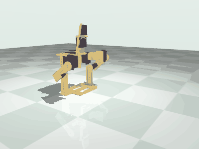
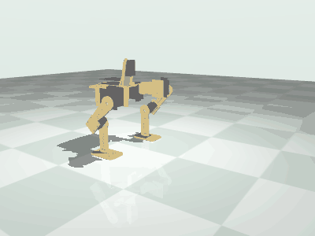
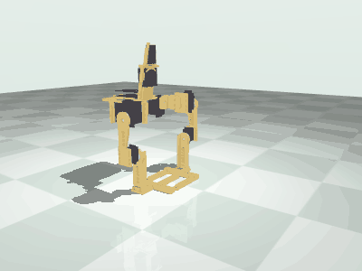

# Simulation results

Generated by `scripts/run_sim.py` with MuJoCo from `robot/microduck.xml`. Do not edit by hand.
The numbers are also in `reports/sim.json`.

Status: simulation only. The robot has never been assembled or powered.

## What happened

- Stands for the whole 10.0 s run at the stand pose; peak tilt 0.29 deg.
- With the legs straight down it falls backward at 0.46 s, as the assembly test predicted.
- The default gait stays up for 12.0 s and moves 236 mm forward (21.5 mm/s). The feet leave the floor in turn: the highest a whole sole comes off the floor is 27.09 mm, and both feet stay loaded 21 percent of the time.
- Best of 54 parameter sets that stay inside the speed limit as written: 238 mm in 12.0 s (21.6 mm/s). 13 sets fell; 26 ask for more than the speed limit and are slowed by the controller.

## How the servos are modelled

Each joint is a position actuator with the stall torque the maker gives at 4.8 V as its force limit and a joint
damping of stall torque over no-load speed, which gives the published speed with no load and less under load.
Commands pass through the same controller the firmware runs: soft limits, 120.0 deg/s speed limit, watchdog,
20 ms tick. Floor friction 0.6 (assumed). Only the floor is a contact surface; parts of the robot
do not collide with each other in the simulation, the joint limits from the assembly test stand in for that.
No backlash, no cable-tie compliance, no flex in the printed parts.

## Standing

Stands for the whole 10.0 s run at the stand pose; peak tilt 0.29 deg.

| joint | mean (N m) | peak (N m) | limit (N m) | peak / limit | time at the limit |
|---|---|---|---|---|---|
| left_hip_roll | 0.0074 | 0.0074 | 1.1964 | 0.006 | 0.0 |
| left_hip_pitch | 0.0935 | 0.0935 | 1.1964 | 0.078 | 0.0 |
| left_knee | 0.0446 | 0.0446 | 0.304 | 0.147 | 0.0 |
| right_hip_roll | 0.0072 | 0.0073 | 1.1964 | 0.006 | 0.0 |
| right_hip_pitch | 0.0937 | 0.0938 | 1.1964 | 0.078 | 0.0 |
| right_knee | 0.0447 | 0.0447 | 0.304 | 0.147 | 0.0 |

Estimated supply current while standing: 0.63 A (stall current scaled by torque; stall currents are assumed, see docs/power.md).

## Legs straight down

With the legs straight down it falls backward at 0.46 s, as the assembly test predicted.

## Servos relaxed

With the pulses stopped at the stand pose the robot stays up in the simulation, held by the assumed gear friction.

## Watchdog

Commands stopped at 4.0 s in mid gait. Controller afterwards: `STAT mode=HOLD age_ms=6000 wd=500 q=0.0,44.0,-44.0,0.0,60.0,-60.0`. Fell: False.

## Open-loop gait

The default gait stays up for 12.0 s and moves 236 mm forward (21.5 mm/s). The feet leave the floor in turn: the highest a whole sole comes off the floor is 27.09 mm, and both feet stay loaded 21 percent of the time.

Parameters: `{"period_s": 1.0, "roll_amplitude_deg": 8.0, "step_amplitude_deg": 8.0, "lift_deg": 6.0, "step_phase_deg": 90.0, "lead_in_s": 1.0}`

| joint | mean (N m) | peak (N m) | limit (N m) | peak / limit | time at the limit |
|---|---|---|---|---|---|
| left_hip_roll | 0.2025 | 0.5977 | 1.1964 | 0.5 | 0.0 |
| left_hip_pitch | 0.1236 | 0.4056 | 1.1964 | 0.339 | 0.0 |
| left_knee | 0.0638 | 0.2966 | 0.304 | 0.976 | 0.0 |
| right_hip_roll | 0.2096 | 0.5916 | 1.1964 | 0.494 | 0.0 |
| right_hip_pitch | 0.1249 | 0.415 | 1.1964 | 0.347 | 0.0 |
| right_knee | 0.055 | 0.2115 | 0.304 | 0.696 | 0.0 |

Feet: both loaded 0.21, one loaded 0.79, neither 0.0 of the time; highest lift of a whole sole {'left': 27.09, 'right': 24.06} mm.

## Parameter sweep

Best of 54 parameter sets that stay inside the speed limit as written: 238 mm in 12.0 s (21.6 mm/s). 13 sets fell; 26 ask for more than the speed limit and are slowed by the controller.

| period (s) | roll (deg) | step (deg) | lift (deg) | inside speed limit | fell | forward (mm) | left (mm) | max tilt (deg) | one-foot time | sole lift (mm) | peak torque / limit |
|---|---|---|---|---|---|---|---|---|---|---|---|
| 0.6 | 4.0 | 0.0 | 0.0 | yes | no | 3 | 0 | 3.03 | 0.593 | 5.02 | 0.387 |
| 0.6 | 4.0 | 0.0 | 8.0 | no | no | 83 | 6 | 3.49 | 0.782 | 12.41 | 0.533 |
| 0.6 | 4.0 | 6.0 | 0.0 | yes | no | 28 | -30 | 17.49 | 0.79 | 51.94 | 0.97 |
| 0.6 | 4.0 | 6.0 | 8.0 | no | backward at 3.14 s | -54 | -67 | 47.0 | 0.548 | 29.59 | 1.0 |
| 0.6 | 4.0 | 12.0 | 0.0 | no | backward at 3.74 s | -123 | -15 | 46.33 | 0.642 | 59.99 | 1.0 |
| 0.6 | 4.0 | 12.0 | 8.0 | no | forward at 2.44 s | 190 | -50 | 49.76 | 0.484 | 64.37 | 1.0 |
| 0.6 | 8.0 | 0.0 | 0.0 | yes | no | 3 | 1 | 7.59 | 0.773 | 13.92 | 0.472 |
| 0.6 | 8.0 | 0.0 | 8.0 | no | no | 83 | 1 | 7.46 | 0.843 | 20.27 | 0.523 |
| 0.6 | 8.0 | 6.0 | 0.0 | yes | no | 238 | -18 | 7.7 | 0.777 | 19.18 | 0.757 |
| 0.6 | 8.0 | 6.0 | 8.0 | no | forward at 2.94 s | 202 | 24 | 47.36 | 0.558 | 93.21 | 1.0 |
| 0.6 | 8.0 | 12.0 | 0.0 | no | backward at 4.64 s | -51 | 45 | 45.61 | 0.72 | 81.7 | 1.0 |
| 0.6 | 8.0 | 12.0 | 8.0 | no | forward at 2.34 s | 200 | 7 | 45.7 | 0.513 | 90.59 | 1.0 |
| 0.6 | 14.0 | 0.0 | 0.0 | no | no | 16 | 16 | 14.47 | 0.827 | 27.86 | 0.668 |
| 0.6 | 14.0 | 0.0 | 8.0 | no | no | 103 | 6 | 14.32 | 0.85 | 34.05 | 0.693 |
| 0.6 | 14.0 | 6.0 | 0.0 | no | no | 275 | 6 | 13.78 | 0.857 | 27.57 | 0.713 |
| 0.6 | 14.0 | 6.0 | 8.0 | no | forward at 3.52 s | 231 | 43 | 46.74 | 0.642 | 101.21 | 1.0 |
| 0.6 | 14.0 | 12.0 | 0.0 | no | to the left at 7.7 s | 320 | 85 | 45.55 | 0.829 | 106.58 | 1.0 |
| 0.6 | 14.0 | 12.0 | 8.0 | no | forward at 2.54 s | 206 | -26 | 46.76 | 0.528 | 87.18 | 1.0 |
| 1.0 | 4.0 | 0.0 | 0.0 | yes | no | 1 | 5 | 2.79 | 0.575 | 4.63 | 0.372 |
| 1.0 | 4.0 | 0.0 | 8.0 | yes | no | 1 | 5 | 2.82 | 0.782 | 10.93 | 0.435 |
| 1.0 | 4.0 | 6.0 | 0.0 | yes | no | 103 | -1 | 4.38 | 0.735 | 12.42 | 0.415 |
| 1.0 | 4.0 | 6.0 | 8.0 | yes | no | 215 | -1 | 7.45 | 0.738 | 20.63 | 1.0 |
| 1.0 | 4.0 | 12.0 | 0.0 | no | no | 84 | -16 | 7.77 | 0.808 | 23.97 | 0.932 |
| 1.0 | 4.0 | 12.0 | 8.0 | no | forward at 3.76 s | 170 | 62 | 47.53 | 0.633 | 66.42 | 1.0 |
| 1.0 | 8.0 | 0.0 | 0.0 | yes | no | 1 | 4 | 6.82 | 0.748 | 12.68 | 0.44 |
| 1.0 | 8.0 | 0.0 | 8.0 | yes | no | 2 | 4 | 6.84 | 0.795 | 18.95 | 0.476 |
| 1.0 | 8.0 | 6.0 | 0.0 | yes | no | 150 | -9 | 6.97 | 0.78 | 17.62 | 0.47 |
| 1.0 | 8.0 | 6.0 | 8.0 | yes | no | 189 | 4 | 7.24 | 0.79 | 25.03 | 1.0 |
| 1.0 | 8.0 | 12.0 | 0.0 | no | to the left at 3.98 s | 99 | 143 | 47.69 | 0.643 | 118.75 | 0.829 |
| 1.0 | 8.0 | 12.0 | 8.0 | no | forward at 4.72 s | 221 | 60 | 47.47 | 0.686 | 60.72 | 1.0 |
| 1.0 | 14.0 | 0.0 | 0.0 | yes | no | 2 | 2 | 12.91 | 0.828 | 24.67 | 0.522 |
| 1.0 | 14.0 | 0.0 | 8.0 | yes | no | -3 | 3 | 13.01 | 0.868 | 31.15 | 0.557 |
| 1.0 | 14.0 | 6.0 | 0.0 | yes | no | 186 | -3 | 13.05 | 0.827 | 28.17 | 0.554 |
| 1.0 | 14.0 | 6.0 | 8.0 | yes | no | 228 | 11 | 13.02 | 0.852 | 34.34 | 0.783 |
| 1.0 | 14.0 | 12.0 | 0.0 | no | backward at 3.92 s | -69 | 67 | 45.93 | 0.663 | 36.17 | 0.863 |
| 1.0 | 14.0 | 12.0 | 8.0 | no | no | 371 | 16 | 13.48 | 0.873 | 38.13 | 1.0 |
| 1.6 | 4.0 | 0.0 | 0.0 | yes | no | 2 | 4 | 2.81 | 0.57 | 4.69 | 0.348 |
| 1.6 | 4.0 | 0.0 | 8.0 | yes | no | -1 | 2 | 2.81 | 0.737 | 10.85 | 0.384 |
| 1.6 | 4.0 | 6.0 | 0.0 | yes | no | 65 | 1 | 4.03 | 0.717 | 12.26 | 0.386 |
| 1.6 | 4.0 | 6.0 | 8.0 | yes | no | 109 | 1 | 5.79 | 0.735 | 17.44 | 0.889 |
| 1.6 | 4.0 | 12.0 | 0.0 | no | no | 66 | -1 | 5.69 | 0.785 | 22.98 | 0.455 |
| 1.6 | 4.0 | 12.0 | 8.0 | no | no | 157 | -2 | 11.27 | 0.765 | 25.38 | 1.0 |
| 1.6 | 8.0 | 0.0 | 0.0 | yes | no | 1 | 4 | 6.82 | 0.74 | 12.64 | 0.405 |
| 1.6 | 8.0 | 0.0 | 8.0 | yes | no | 1 | 3 | 6.82 | 0.798 | 18.88 | 0.435 |
| 1.6 | 8.0 | 6.0 | 0.0 | yes | no | 100 | 1 | 6.83 | 0.762 | 17.65 | 0.434 |
| 1.6 | 8.0 | 6.0 | 8.0 | yes | no | 116 | 1 | 6.86 | 0.803 | 23.19 | 0.869 |
| 1.6 | 8.0 | 12.0 | 0.0 | no | no | 122 | -6 | 8.13 | 0.812 | 28.12 | 0.437 |
| 1.6 | 8.0 | 12.0 | 8.0 | no | no | 182 | 16 | 10.38 | 0.81 | 26.68 | 1.0 |
| 1.6 | 14.0 | 0.0 | 0.0 | yes | no | 0 | 2 | 12.87 | 0.808 | 24.54 | 0.458 |
| 1.6 | 14.0 | 0.0 | 8.0 | yes | no | 4 | 0 | 12.87 | 0.828 | 30.75 | 0.462 |
| 1.6 | 14.0 | 6.0 | 0.0 | yes | no | 115 | 0 | 12.88 | 0.817 | 27.65 | 0.459 |
| 1.6 | 14.0 | 6.0 | 8.0 | yes | no | 123 | 1 | 12.89 | 0.832 | 33.96 | 0.835 |
| 1.6 | 14.0 | 12.0 | 0.0 | no | no | 180 | -1 | 13.18 | 0.833 | 35.53 | 0.668 |
| 1.6 | 14.0 | 12.0 | 8.0 | no | no | 221 | 8 | 12.99 | 0.835 | 36.86 | 1.0 |

## Best set and floor friction

| floor friction | fell | forward (mm) | speed (mm/s) |
|---|---|---|---|
| 0.3 | False | 214 | 19.4 |
| 0.6 | False | 238 | 21.6 |
| 1.0 | False | 243 | 22.1 |

## Recordings

## What the simulation suggests changing

Suggestions only; none of this has been done.

- Move the hips back under the body. The hip pitch axis is 89 mm ahead of the torso origin, so with straight legs the centre of mass is behind the heels and the robot only stands with the thighs swung 52 degrees back.
- The comb soles put the centre of mass 32 mm inside either sole alone, so a foot can be lifted. The gait here is the one written for the flat soles, with its parameters unchanged: it was not tuned for these feet. A gait study on this geometry is the next step.
- Stiffness is not in the simulation. Standing on one foot bends the fingers, the shin plate and the servo mounts; the design README gives a hand calculation for the printed parts only.
- Add hip yaw or accept that the robot cannot turn by joint motion alone: with roll and pitch only, heading changes come from slipping.
- Check the soles on the real floor. The contact model is the least certain part of the simulation.
