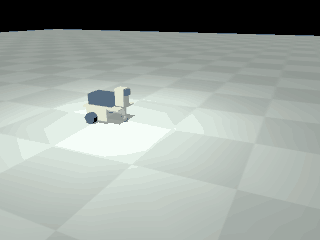
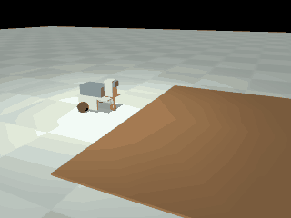

# Wheeled variants of every controller base

Generated by `python -m walkers.wheeled_report` from `reports/wheeled/`. Edit the generator, not this file.

> **Status: analysed and simulated only.** Nothing here has been printed, assembled or powered. The TT motor and servo cradles are drawn from typical dimensions, not from a maker's drawing. Assumed values are marked.

Each controller base gets a wheeled build on the walker chassis: two driven wheels on the rear axle line (x = -16 mm) and a third support hanging from the two shelf holes at x = 92 mm, a wheelbase of 108 mm. **Wheels at the back** drives toward the support, the head's usual way round. **Wheels at the front** is the same build with the head pinned on facing the other way (its two holes are symmetric) and the drive reversed. The third support is a post with a tip: a drag skid, a ball in a printed cup, or a small printed idler.

## Bases and drives

| Base | Wheel drive | Feedback | Default wheel | Power | Signals |
|---|---|---|---|---|---|
| LEGO EV3 brick | EV3 large motor: inside the panels, output hub on the wheel axle, body pointing toward the support | encoder, 1 degree: closed-loop speed | LEGO tyre 44309 on rim 56145 (EV3 31313) | the brick's own cells | motor ports B and C |
| Raspberry Pi Zero 2 W with Build HAT | 51515 medium angular motor: inside the panels, output on the wheel axle, body pointing toward the support | absolute encoder, 360 counts: closed-loop speed | LEGO wheel 39367, 56 x 14 (Robot Inventor 51515) | a 7.2 to 8.5 V battery on the Build HAT's barrel jack (it also powers the Pi), or the 8 V adapter on a tether | Build HAT ports A and B |
| LEGO 51515 hub | 51515 medium angular motor: inside the panels, output on the wheel axle, body pointing toward the support | absolute encoder, 360 counts: closed-loop speed | LEGO wheel 39367, 56 x 14 (Robot Inventor 51515) | the hub's own 7.3 V battery | hub ports A and B |
| M5Stack Core with BaseX | EV3 large motor: inside the panels, output hub on the wheel axle, body pointing toward the support | encoder, 1 degree: closed-loop speed | LEGO tyre 44309 on rim 56145 (EV3 31313) | BaseX needs 9 to 12 V on its jack for the motors; its own 950 mAh cell runs the logic | BaseX motor ports 1 and 2 for EV3 motors, or its two servo outputs for the 360-degree servos. Its documentation says nothing about bare DC motors on the motor ports, so the TT motor is not offered here. |
| M5Stack Core with BaseX | M5Stack 360-degree servo (9 g, as in BALA-C and the Servo Kit 360): printed servo_cradle on the outside of each panel, wheel screwed to the servo's own horn | none: open-loop speed | Printed solid wheel, horn face, 50 x 3 O-ring | BaseX needs 9 to 12 V on its jack for the motors; its own 950 mAh cell runs the logic | BaseX motor ports 1 and 2 for EV3 motors, or its two servo outputs for the 360-degree servos. Its documentation says nothing about bare DC motors on the motor ports, so the TT motor is not offered here. |
| Arduino UNO Q | M5Stack 360-degree servo (9 g, as in BALA-C and the Servo Kit 360): printed servo_cradle on the outside of each panel, wheel screwed to the servo's own horn | none: open-loop speed | Printed solid wheel, horn face, 50 x 3 O-ring | a 5 V 3 A source for the board and a separate 4.8 to 6 V pack for the wheel drives | one servo pulse output per wheel |
| Arduino UNO Q | Yellow TT gear motor, 1:48: printed tt_cradle on the outside of each panel, wheel on the outer shaft | none: open-loop speed (an encoder version exists) | Stock TT wheel, 65 mm | a 5 V 3 A source for the board and a separate 4.8 to 6 V pack for the wheel drives | an H-bridge channel per wheel: one PWM and one or two direction lines |
| Raspberry Pi without a LEGO HAT | M5Stack 360-degree servo (9 g, as in BALA-C and the Servo Kit 360): printed servo_cradle on the outside of each panel, wheel screwed to the servo's own horn | none: open-loop speed | Printed solid wheel, horn face, 50 x 3 O-ring | a 5 V source for the Pi and a separate 4.8 to 6 V pack for the wheel drives | one servo pulse output per wheel |
| Raspberry Pi without a LEGO HAT | Yellow TT gear motor, 1:48: printed tt_cradle on the outside of each panel, wheel on the outer shaft | none: open-loop speed (an encoder version exists) | Stock TT wheel, 65 mm | a 5 V source for the Pi and a separate 4.8 to 6 V pack for the wheel drives | an H-bridge channel per wheel: one PWM and one or two direction lines |

Every base has a sensible build from parts the owner has. Limits found on the way:

- The six Braccio servos are position servos and cannot turn a wheel. The UNO Q and the plain Raspberry Pi use the 360-degree servos or TT motors instead.
- The M5Stack servo kit's own 24 mm wheels would put the side panels on the floor (the panel bottom is 12 mm below the axle). A printed 56 mm wheel on the servo horn is used.
- BaseX's documentation describes its four ports as LEGO motor ports and says nothing about a bare DC motor, so no TT build is offered for it; its two servo outputs can run the 360-degree servos.
- The EV3 31313 set has no ball caster. Its three 16.5 mm balls fit the printed cup. The 51515 set has neither a caster nor a ball: use the skid or a 12.7 mm steel ball.

### The two non-LEGO drives

| | 360-degree servo | TT gear motor |
|---|---|---|
| Stall torque | 0.157 N m at 4.8 V | 0.078 N m at 6 V |
| No-load speed | 83 rpm | 200 rpm (vendors: 160 to 250) |
| Wheel | printed, 57.0 mm | stock, 65.0 mm |
| Push at stall, both wheels | 11.02 N | 4.8 N |
| Top speed, no load | 0.248 m/s | 0.681 m/s |
| Speed in simulation | 0.234 m/s | 0.593 m/s |
| Stall current, both | 1.5 A | 3.0 A (up to 5.6 A with some vendors) |
| Mass, each | 9.0 g | 30.6 g (to 45 g) |
| Robot mass, UNO Q | 456.8 g | 556.1 g |
| Control signals | one pulse output per wheel, no driver board | an H-bridge board; one PWM and one or two direction lines per wheel |
| Speed control | open loop; the stop point must be trimmed | open loop; an encoder version of the motor exists |
| Steepest slope, wheels back / front (skid) | 28 / 14 degrees | 28 / 12 degrees |
| Highest step, wheels back / front (skid) | 4 / 4 mm | 8 / 8 mm |

The servo has twice the torque and the TT motor more than twice the speed. Both have torque to spare on the level; slopes are limited by grip and by tipping, not by either motor. The TT wheel is larger, so it takes the higher step. The servo needs no driver board and two pins; the TT motor needs a driver and four to seven pins. M5Stack's page: The page says LEGO compatible without saying how. No Technic axle fit is documented, so the wheel screws to the horn. In the BALA-C itself the two servos are driven by an L9110S H-bridge, which suggests motors without servo electronics: check which kind the owner's are.

Sources for the figures: `walkers/config/wheeled.json`. The TT motor has no single maker; Adafruit's figures are used and the spread between vendors is gear ratio 1:48 to 1:120, 160 to 250 rpm at 6 V, stall current 1.5 to 2.8 A, mass 30.6 to 45 g. Encoder option: DFRobot FIT0450: 1:120, 960 pulses per output turn, 50 g.

## Mass, balance and limits by calculation

Level floor. `COM / wheelbase` is how far the centre of mass sits from the axle toward the support. The static margin is the distance from the centre of mass to the nearest edge of the triangle of the two wheels and the support. Skid, wheels at the back, default wheel:

| Base and drive | Mass (g) | COM height (mm) | COM / wheelbase | Static margin (mm) | Sideways tilt to tip (deg) | Clearance (mm) | Top speed (m/s) | Torque on the level / stall | Push at stall (N) |
|---|---|---|---|---|---|---|---|---|---|
| LEGO EV3 brick, EV3 large motor | 748.9 | 74.5 | 0.346 | 37.3 | 26.6 | 9.6 | 0.373 | 0.023 | 37.04 |
| Raspberry Pi Zero 2 W with Build HAT, 51515 medium angular motor | 502.0 | 50.4 | 0.402 | 34.4 | 34.4 | 12.0 | 0.542 | 0.051 | 12.86 |
| LEGO 51515 hub, 51515 medium angular motor | 412.0 | 60.0 | 0.265 | 28.6 | 25.5 | 12.0 | 0.542 | 0.03 | 12.86 |
| M5Stack Core with BaseX, EV3 large motor | 522.9 | 50.9 | 0.376 | 37.4 | 36.3 | 9.6 | 0.373 | 0.017 | 37.04 |
| M5Stack Core with BaseX, M5Stack 360-degree servo (9 g, as in BALA-C and the Servo Kit 360) | 395.3 | 62.8 | 0.314 | 33.9 | 28.4 | 16.5 | 0.248 | 0.038 | 11.02 |
| Arduino UNO Q, M5Stack 360-degree servo (9 g, as in BALA-C and the Servo Kit 360) | 456.8 | 52.4 | 0.345 | 37.3 | 35.4 | 16.5 | 0.248 | 0.047 | 11.02 |
| Arduino UNO Q, Yellow TT gear motor, 1:48 | 556.1 | 53.0 | 0.304 | 32.8 | 31.8 | 20.5 | 0.681 | 0.119 | 4.8 |
| Raspberry Pi without a LEGO HAT, M5Stack 360-degree servo (9 g, as in BALA-C and the Servo Kit 360) | 443.7 | 51.8 | 0.352 | 38.0 | 36.3 | 16.5 | 0.248 | 0.047 | 11.02 |
| Raspberry Pi without a LEGO HAT, Yellow TT gear motor, 1:48 | 543.1 | 52.4 | 0.308 | 33.3 | 32.4 | 20.5 | 0.681 | 0.118 | 4.8 |

The centre of mass is 0.261 to 0.405 of the way from the axle to the support, so 60 to 74 percent of the weight is on the driven wheels. In 28 of the 36 default builds the nearest edge of the triangle is the axle line: the robot is closest to tipping backward over its wheels.

### Which end the wheels should be at

Accelerating moves load to the trailing end and braking to the leading end. The table gives the acceleration at which the support leaves the floor, against what the tyres and the motors can deliver (m/s2).

| Base and drive | Wheels at | Tyres allow (accel) | Motors allow | Tyres allow (braking) | Support lifts when | at (m/s2) | Can it get there | Slope limit: torque / grip / tipping (deg) |
|---|---|---|---|---|---|---|---|---|
| LEGO EV3 brick, EV3 large motor | back | 11.46 | 48.31 | 4.57 | accelerating | 4.91 | yes | 26.6 / 26.6 / 26.6 |
| LEGO EV3 brick, EV3 large motor | front | 2.46 | 48.36 | 11.81 | braking | 4.63 | yes | 44.3 / 14.0 / 44.3 |
| Raspberry Pi Zero 2 W with Build HAT, 51515 medium angular motor | back | 7.21 | 24.31 | 4.77 | accelerating | 8.45 | no | 40.7 / 36.3 / 40.7 |
| Raspberry Pi Zero 2 W with Build HAT, 51515 medium angular motor | front | 2.35 | 24.32 | 7.69 | braking | 8.38 | no | 52.2 / 13.4 / 52.2 |
| LEGO 51515 hub, 51515 medium angular motor | back | 10.38 | 30.28 | 5.13 | accelerating | 4.67 | yes | 25.4 / 25.4 / 25.5 |
| LEGO 51515 hub, 51515 medium angular motor | front | 3.13 | 30.29 | 10.44 | braking | 4.6 | yes | 53.0 / 17.6 / 53.1 |
| M5Stack Core with BaseX, EV3 large motor | back | 7.86 | 69.61 | 4.86 | accelerating | 7.83 | yes | 38.5 / 38.5 / 38.6 |
| M5Stack Core with BaseX, EV3 large motor | front | 2.52 | 69.61 | 7.9 | braking | 7.76 | yes | 53.0 / 14.3 / 53.0 |
| M5Stack Core with BaseX, M5Stack 360-degree servo (9 g, as in BALA-C and the Servo Kit 360) | back | 10.07 | 26.81 | 4.89 | accelerating | 5.3 | yes | 28.3 / 28.3 / 28.4 |
| M5Stack Core with BaseX, M5Stack 360-degree servo (9 g, as in BALA-C and the Servo Kit 360) | front | 2.75 | 26.83 | 10.13 | braking | 5.23 | yes | 49.8 / 15.6 / 49.9 |
| Arduino UNO Q, M5Stack 360-degree servo (9 g, as in BALA-C and the Servo Kit 360) | back | 8.4 | 22.98 | 4.95 | accelerating | 6.98 | yes | 35.4 / 35.4 / 35.4 |
| Arduino UNO Q, M5Stack 360-degree servo (9 g, as in BALA-C and the Servo Kit 360) | front | 2.71 | 22.99 | 8.44 | braking | 6.91 | yes | 53.5 / 15.4 / 53.6 |
| Arduino UNO Q, Yellow TT gear motor, 1:48 | back | 5.74 | 7.6 | 4.35 | accelerating | 6.07 | no | 31.7 / 30.3 / 31.8 |
| Arduino UNO Q, Yellow TT gear motor, 1:48 | front | 2.24 | 7.61 | 5.86 | braking | 6.02 | no | 45.1 / 12.8 / 54.9 |
| Raspberry Pi without a LEGO HAT, M5Stack 360-degree servo (9 g, as in BALA-C and the Servo Kit 360) | back | 8.25 | 23.67 | 4.94 | accelerating | 7.2 | yes | 36.2 / 36.2 / 36.3 |
| Raspberry Pi without a LEGO HAT, M5Stack 360-degree servo (9 g, as in BALA-C and the Servo Kit 360) | front | 2.68 | 23.68 | 8.31 | braking | 7.11 | yes | 53.6 / 15.2 / 53.7 |
| Raspberry Pi without a LEGO HAT, Yellow TT gear motor, 1:48 | back | 5.62 | 7.8 | 4.35 | accelerating | 6.22 | no | 32.3 / 29.8 / 32.4 |
| Raspberry Pi without a LEGO HAT, Yellow TT gear motor, 1:48 | front | 2.23 | 7.81 | 5.84 | braking | 6.16 | no | 46.8 / 12.7 / 55.1 |

- **Wheels at the back** puts the weight on the wheels when it matters: accelerating and climbing press them down. In simulation these builds climb 26.7 degrees on average against 15.8 with the wheels at the front. The price is the wheelie: a hard start lifts the support (pitch up to 10.0 degrees in simulation), and a climb ends by tipping backward over the axle.
- **Wheels at the front** cannot wheelie, but accelerating and climbing unload the wheels, so grip sets the limit, and hard braking lifts the support instead (pitch up to 13.1 degrees when stopping from full speed in simulation). The wheels meet a step before the support does.
- **Recommendation: wheels at the back**, with the drive ramped up over about a second, which is how the slope runs were made. Moving the batteries toward the support raises the tipping limit and costs grip.

### Skid against roller

Assumed: a printed skid slides at a coefficient of 0.3 (0.2 to 0.4). A ball in a plain printed cup does not roll freely: it slides in the cup, so its drag is the cup's friction, 0.15 (0.1 to 0.3). The printed idler rolls at about 0.02 but scrubs sideways in turns; it is analysed for drag only. Mean drag on the level over the default builds: 0.57 N with the skid, 0.32 N with the ball, against 4.8 to 37.04 N of push at stall. In simulation the ball builds climb 22.3 degrees on average against 20.1 with the skid, take steps of 5.2 mm against 5.6 mm, and turn on the spot at 0.91 of the ideal rate against 0.88. The ball helps most where grip is short: wheels at the front on a slope.

## Simulation

One MuJoCo model per variant in `robot/lego/wheeled/`, generated by `python -m walkers.wheeled`: the chassis with everything fixed to it as one body, two wheels on hinges, and either a fixed dome (skid) or a ball on a ball joint whose friction torque is the cup friction at the ball radius. Motors: the LEGO motors run under a speed controller at 80 percent of no-load speed inside the stall-to-no-load torque line; the servos and TT motors are open loop, torque falling linearly with speed. Full drive in every run. Slopes and steps start with the drive ramped up.

| Variant | Speed (m/s) | Of no-load | Spin (deg/s) | Arc radius (m) | Stop (m) | Pitch starting / stopping (deg) | Slope (deg) | fails by | Step (mm) | fails by |
|---|---|---|---|---|---|---|---|---|---|---|
| `ev3-ev3large-lego43-skid-back` | 0.303 | 0.81 | 216.9 | 0.229 | 0.01 | 3.43 / 0.12 | 24 | tips | 4 | the trailing part stops at the step |
| `ev3-ev3large-lego43-skid-front` | 0.284 | 0.76 | 217.0 | 0.213 | -0.002 | 0.11 / 4.49 | 14 | stalls or spins | 4 | the leading part stops at the step |
| `ev3-ev3large-lego43-ball-back` | 0.298 | 0.8 | 227.6 | 0.222 | 0.013 | 3.28 / 0.13 | 24 | tips | 8 | the leading part stops at the step |
| `ev3-ev3large-lego43-ball-front` | 0.298 | 0.8 | 228.1 | 0.215 | -0.003 | 0.15 / 4.04 | 18 | stalls or spins | 6 | the leading part stops at the step |
| `pibuildhat-angular-lego56-skid-back` | 0.432 | 0.8 | 334.7 | 0.228 | 0.02 | 0.31 / 0.08 | 28 | tips | 8 | the leading part stops at the step |
| `pibuildhat-angular-lego56-skid-front` | 0.431 | 0.8 | 336.2 | 0.185 | 0.011 | 0.19 / 0.15 | 12 | stalls or spins | 6 | the leading part stops at the step |
| `pibuildhat-angular-lego56-ball-back` | 0.434 | 0.8 | 353.8 | 0.209 | 0.028 | 0.07 / 0.22 | 28 | tips | 4 | the leading part stops at the step |
| `pibuildhat-angular-lego56-ball-front` | 0.434 | 0.8 | 353.8 | 0.204 | 0.012 | 0.15 / 0.21 | 16 | stalls or spins | 6 | the trailing part stops at the step |
| `hub51515-angular-lego56-skid-back` | 0.436 | 0.8 | 347.0 | 0.24 | 0.02 | 10.0 / 0.26 | 22 | tips | 8 | the trailing part stops at the step |
| `hub51515-angular-lego56-skid-front` | 0.429 | 0.79 | 346.9 | 0.183 | -0.003 | 0.18 / 13.12 | 16 | stalls or spins | 6 | the leading part stops at the step |
| `hub51515-angular-lego56-ball-back` | 0.434 | 0.8 | 354.9 | 0.208 | 0.024 | 8.67 / 0.22 | 22 | tips | 8 | the leading part stops at the step |
| `hub51515-angular-lego56-ball-front` | 0.434 | 0.8 | 355.1 | 0.204 | -0.004 | 0.14 / 10.08 | 20 | stalls or spins | 6 | the leading part stops at the step |
| `m5basex-ev3large-lego43-skid-back` | 0.301 | 0.81 | 222.9 | 0.224 | 0.009 | 0.29 / 0.11 | 28 | tips | 4 | the trailing part stops at the step |
| `m5basex-ev3large-lego43-skid-front` | 0.292 | 0.78 | 223.8 | 0.214 | 0.003 | 0.14 / 1.05 | 14 | stalls or spins | 4 | the leading part stops at the step |
| `m5basex-ev3large-lego43-ball-back` | 0.298 | 0.8 | 232.0 | 0.218 | 0.012 | 0.07 / 0.1 | 28 | tips | 4 | the leading part stops at the step |
| `m5basex-ev3large-lego43-ball-front` | 0.298 | 0.8 | 231.4 | 0.215 | 0.005 | 0.16 / 0.04 | 20 | slides back | 4 | the leading part stops at the step |
| `m5basex-servo360-solidhornd56-skid-back` | 0.236 | 0.95 | 136.0 | 0.299 | 0.006 | 1.04 / 0.03 | 26 | tips | 4 | the trailing part stops at the step |
| `m5basex-servo360-solidhornd56-skid-front` | 0.236 | 0.95 | 135.4 | 0.299 | 0.003 | 0.04 / 1.74 | 14 | stalls or spins | 4 | the leading part stops at the step |
| `m5basex-servo360-solidhornd56-ball-back` | 0.239 | 0.97 | 138.9 | 0.307 | 0.008 | 0.91 / 0.05 | 28 | tips | 4 | the trailing part stops at the step |
| `m5basex-servo360-solidhornd56-ball-front` | 0.24 | 0.97 | 139.0 | 0.288 | 0.003 | 0.1 / 1.32 | 20 | slides back | 4 | the leading part stops at the step |
| `unoq-servo360-solidhornd56-skid-back` | 0.234 | 0.94 | 133.5 | 0.301 | 0.006 | 0.42 / 0.04 | 28 | tips | 4 | the trailing part stops at the step |
| `unoq-servo360-solidhornd56-skid-front` | 0.234 | 0.94 | 134.2 | 0.302 | 0.004 | 0.08 / 0.86 | 14 | stalls or spins | 4 | the leading part stops at the step |
| `unoq-servo360-solidhornd56-ball-back` | 0.238 | 0.96 | 138.3 | 0.307 | 0.008 | 0.2 / 0.05 | 28 | tips | 4 | the leading part stops at the step |
| `unoq-servo360-solidhornd56-ball-front` | 0.238 | 0.96 | 138.1 | 0.291 | 0.004 | 0.09 / 0.44 | 20 | slides back | 4 | the leading part stops at the step |
| `unoq-tt-tt65-skid-back` | 0.593 | 0.87 | 290.9 | 0.415 | 0.044 | 0.44 / 0.06 | 28 | tips | 8 | the leading part stops at the step |
| `unoq-tt-tt65-skid-front` | 0.593 | 0.87 | 291.3 | 0.356 | 0.044 | 0.23 / 0.21 | 12 | stalls or spins | 8 | the leading part stops at the step |
| `unoq-tt-tt65-ball-back` | 0.614 | 0.9 | 310.0 | 0.441 | 0.062 | 0.09 / 0.05 | 28 | tips | 4 | the leading part stops at the step |
| `unoq-tt-tt65-ball-front` | 0.615 | 0.9 | 310.4 | 0.324 | 0.047 | 0.11 / 0.03 | 14 | stalls or spins | 8 | the trailing part stops at the step |
| `pi-servo360-solidhornd56-skid-back` | 0.234 | 0.94 | 133.3 | 0.299 | 0.006 | 0.33 / 0.05 | 28 | tips | 4 | the trailing part stops at the step |
| `pi-servo360-solidhornd56-skid-front` | 0.234 | 0.94 | 134.0 | 0.299 | 0.004 | 0.09 / 0.24 | 14 | stalls or spins | 4 | the leading part stops at the step |
| `pi-servo360-solidhornd56-ball-back` | 0.238 | 0.96 | 137.9 | 0.306 | 0.008 | 0.13 / 0.04 | 28 | tips | 4 | the leading part stops at the step |
| `pi-servo360-solidhornd56-ball-front` | 0.238 | 0.96 | 138.3 | 0.293 | 0.004 | 0.09 / 0.26 | 20 | slides back | 4 | the leading part stops at the step |
| `pi-tt-tt65-skid-back` | 0.593 | 0.87 | 291.7 | 0.411 | 0.044 | 0.14 / 0.3 | 28 | tips | 8 | the leading part stops at the step |
| `pi-tt-tt65-skid-front` | 0.594 | 0.87 | 292.4 | 0.349 | 0.043 | 0.23 / 0.34 | 12 | stalls or spins | 8 | the leading part stops at the step |
| `pi-tt-tt65-ball-back` | 0.615 | 0.9 | 310.7 | 0.455 | 0.062 | 0.1 / 0.07 | 26 | stalls or spins | 4 | the leading part stops at the step |
| `pi-tt-tt65-ball-front` | 0.615 | 0.9 | 311.0 | 0.324 | 0.046 | 0.12 / 0.02 | 14 | stalls or spins | 8 | the trailing part stops at the step |

The arc is one wheel at full drive and the other at half; the ideal radius is three half-tracks (0.2 to 0.3 m). Slopes are tried in 2 degree steps and steps in 2 mm steps.

## Wheels and tyres

| Wheel | Kind | Rolling diameter (mm) | Width (mm) | Bore | Tread friction assumed |
|---|---|---|---|---|---|
| LEGO tyre 44309 on rim 56145 (EV3 31313) | LEGO | 43.2 | 22.0 | cross | 0.8 (0.6 to 1.0) |
| LEGO wheel 39367, 56 x 14 (Robot Inventor 51515) | LEGO | 56.0 | 14.0 | cross | 0.8 (0.6 to 1.0) |
| Stock TT wheel, 65 mm | TT stock | 65.0 | 26.0 | tt | 0.6 (0.4 to 0.8) |
| Printed solid wheel, cross-axle bore, 38 x 3 O-ring | printed solid with O-ring or band | 44.76 | 14.0 | cross | 0.8 (0.6 to 0.9) |
| Printed solid wheel, cross-axle bore, 50 x 3 O-ring | printed solid with O-ring or band | 57.0 | 14.0 | cross | 0.8 (0.6 to 0.9) |
| Printed solid wheel, horn face, 50 x 3 O-ring | printed solid with O-ring or band | 57.0 | 14.0 | horn | 0.8 (0.6 to 0.9) |
| Printed solid wheel, TT shaft bore, two 58 x 3 O-rings | printed solid with O-ring or band | 65.16 | 18.0 | tt | 0.8 (0.6 to 0.9) |
| Printed hub with TPU tyre, cross-axle bore | printed hub with TPU tyre | 43.2 | 14.0 | cross | 0.7 (0.6 to 0.8) |
| Printed hub with TPU tyre, cross-axle bore | printed hub with TPU tyre | 56.0 | 14.0 | cross | 0.7 (0.6 to 0.8) |
| Printed hub with TPU tyre, horn face | printed hub with TPU tyre | 56.0 | 14.0 | horn | 0.7 (0.6 to 0.8) |
| Printed hub with TPU tyre, TT shaft bore | printed hub with TPU tyre | 65.0 | 18.0 | tt | 0.7 (0.6 to 0.8) |

No measured friction for these materials on laminate, tile or vinyl was found. Every coefficient is assumed from generic tables: rubber and O-rings 0.8, TPU 95A 0.7, the stock TT tyre 0.6, bare printed plastic 0.3.

**A bare printed wheel slips on a smooth floor. Fit an O-ring, a rubber band or the TPU tyre.** The same robot on each wheel option, skid, wheels at the back:

| Variant | Tread | Friction | Wheel mass (g) | Speed (m/s) | Spin, of ideal | Slope (deg) | fails by | Step (mm) |
|---|---|---|---|---|---|---|---|---|
| `ev3-ev3large-lego43-skid-back` | rubber | 0.8 | 14.0 | 0.303 | 0.91 | 24 | tips | 4 |
| `ev3-ev3large-solidd43-skid-back` | o ring | 0.8 | 9.8 | 0.314 | 0.93 | 22 | tips | 6 |
| `ev3-ev3large-solidd43-bare-skid-back` | pla | 0.3 | 8.2 | 0.302 | 0.36 | 8 | stalls or spins | 2 |
| `ev3-ev3large-tpud43-skid-back` | tpu | 0.7 | 11.2 | 0.303 | 0.93 | 24 | tips | 6 |
| `unoq-tt-tt65-skid-back` | tt tyre | 0.6 | 38.0 | 0.593 | 0.75 | 28 | tips | 8 |
| `unoq-tt-solidttd65-skid-back` | o ring | 0.8 | 21.1 | 0.594 | 0.74 | 28 | tips | 8 |
| `unoq-tt-solidttd65-bare-skid-back` | pla | 0.3 | 16.4 | 0.579 | 0.73 | 8 | stalls or spins | 4 |
| `unoq-tt-tputtd65-skid-back` | tpu | 0.7 | 26.7 | 0.593 | 0.75 | 28 | tips | 8 |
| `unoq-servo360-solidhornd56-skid-back` | o ring | 0.8 | 15.3 | 0.234 | 0.88 | 28 | tips | 4 |
| `unoq-servo360-solidhornd56-bare-skid-back` | pla | 0.3 | 13.3 | 0.225 | 0.86 | 6 | stalls or spins | 2 |
| `unoq-servo360-tpuhornd56-skid-back` | tpu | 0.7 | 18.1 | 0.23 | 0.89 | 28 | tips | 4 |

With a ring or a TPU tyre the printed wheels climb 22 to 28 degrees, the same as the LEGO and stock wheels to within one 2 degree step. Bare, they climb 6 to 8 degrees and the step limit drops as well. Between rubber, O-ring and TPU the assumed differences are too small to change a limit by more than one step.

### Printed solid wheel (the default printed option)

One piece in PLA or PETG, printed flat face down without supports. O-ring sections: Metric sections 1, 1.5, 2, 2.5, 3 and 5 mm; ISO 3601 and DIN 3771 use 1.80, 2.65, 3.55, 5.30 and 7.00 mm (https://o-ring.info/en/o-ring/technical%20handbook/16%20-%20eriks%20nv%20-%20o-ring%20technical%20handbook%20-%20o-ring%20size%20chart.pdf). Installed stretch of 1 to 5 percent on the inner diameter, 2 percent ideal; the grooves use 2 percent (https://www.applerubber.com/seal-design-guide/oring-basics/dimensional-considerations/).

- Groove: 3.4 mm wide, 2.0 mm deep, ring 1.0 mm proud; the ring sets the rolling diameter: 44.8, 57.0 and 65.2 mm.
- Rings: 38 x 3 for the 43 mm class, 50 x 3 for the 56 mm class, 58 x 3 (two) for the 65 mm class.
- Rubber band version (`wheel_band_*`): 7.0 mm wide, 0.5 mm deep: one rubber band up to 6 mm wide (size 64) or two 3 mm bands (size 33) side by side. The band is taken as 1 mm thick and brings the wheel to the nominal diameter.
- Groove count, ring section, stretch and wheel diameter are parameters (`ORING`, `BAND`, `WHEELS` in the design's build.py), so the nearest ring to hand can be used.

### Hub with a TPU tyre

For those who have flexible filament. Hardness: 95A assumed; Ultimaker's TPU 95A data sheet gives 96 Shore A. Design: tyre 4 mm thick, bore 2 percent under the hub (stretch), eight keys against slipping round, a 1 mm lip each side against walking off, plain extrusion so it prints without supports. Print slowly: a maker of softer filament gives 15 to 35 mm/s. Direct-drive extruders cope better. Retraction settings vary by machine and are not given here. Softer TPU needs more stretch than 2 percent.

### Bores

- `cross`: Technic cross axle, the profile the walkers' fit coupon tests. For LEGO motors.
- `tt`: the TT motor's shaft, 5.4 mm with two flats 3.7 mm apart (assumed), in a 9 mm pocket with a 2.6 mm hole for the retaining screw. Mounting: two 3 mm holes 17.5 mm apart, 20.3 mm behind the shaft (assumed).
- `horn`: a plain face with a 7.5 mm centre hole. The servo's spline is not documented well enough to print, so the wheel screws to the servo's own horn, using the horn as the drilling jig, as the biped's parts do.
- One fit piece per bore, and one each for the TT and servo cradles: print them first.

## Control signals and power

- **UNO Q.** D3, D5, D6, D9, D10 and D11 are the pins the datasheet marks as PWM; all 3.3 V logic (https://docs.arduino.cc/resources/datasheets/ABX00162-datasheet.pdf). The Braccio shield uses exactly those six for its servos, and D12 for soft start. With the shield fitted the free pins are D2, D4, D7, D8, D13, D20, D21 and A0 to A5. None is marked PWM. D2, D7, D8, D13, D20 and D21 do carry timer channels in the datasheet's pin map (TIM2_CH2, TIM8_CH4N, TIM3_CH1, TIM1_CH1N, TIM2_CH4, TIM2_CH3), which matches the list reported for this project, but whether the Zephyr core gives PWM on them is not verified.
- **UNO Q with servos.** A wheeled UNO Q does not use the Braccio servos, so the simplest wiring is the shield itself: plug the two 360-degree servos into two of its servo headers (D11 and D10) and let its 5 V supply feed them. Without the shield, use two of the marked PWM pins and the separate pack.
- **UNO Q with TT motors.** TB6612FNG without the shield: PWMA D5, PWMB D6, AIN1 D2, AIN2 D4, BIN1 D7, BIN2 D8, STBY tied high. DRV8833: IN1 to IN4 on D5, D6, D9, D10.
- **Raspberry Pi.** Two hardware PWM channels: PWM0 on GPIO12 or GPIO18, PWM1 on GPIO13 or GPIO19 (https://raw.githubusercontent.com/raspberrypi/firmware/master/boot/overlays/README). Two servos fit the two hardware channels (GPIO12 and GPIO13). Software PWM from RPi.GPIO jitters; the pigpio daemon times pulses by DMA. A PCA9685 board (16 channels, 12 bit, I2C) is the alternative. TB6612FNG: PWMA GPIO12, PWMB GPIO13, AIN1 GPIO5, AIN2 GPIO6, BIN1 GPIO20, BIN2 GPIO21, STBY GPIO16.
- **BaseX.** Four LEGO motor ports with encoder registers (2 A in total), two servo outputs taking an angle or a 500 to 2500 pulse, I2C address 0x22, 9 to 12 V for motor power (https://docs.m5stack.com/en/base/basex).

| Driver board | Motor supply | Current | Pins | For the TT motor |
|---|---|---|---|---|
| TB6612FNG | 4.5 to 13.5 V | 1 A continuous, 3 A peak per channel | PWM, IN1, IN2 per motor and a shared STBY | fits the TT motor at 6 V; its 1.5 A stall is inside the peak rating |
| DRV8833 | 2.7 to 10.8 V | 1.2 A continuous, 2 A peak per channel | two inputs per motor, PWM on either | fits; fewest pins if four PWM outputs are free |
| L298N module | up to 46 V | 2 A per channel | IN1, IN2 and EN (PWM) per motor | drops 1.8 V typically and up to 3.2 V at 1 A: from 6 V the TT motor sees about 4 V. Avoid. |

The driver sits on `driver_plate.stl`, a generic slotted plate, because boards vary.

Controller sketches, syntax-checked and never run on hardware, in `walkers/controllers/`: `ev3_drive.py` (Pybricks, ports B and C), `hub51515_drive.py` (Pybricks, ports A and B), `buildhat_drive.py` (ports A and B), `pi_servo_drive.py` (GPIO12 and GPIO13) and `pi_tt_drive.py` (TB6612FNG). Each sets two wheel speeds. The servo and TT sketches are open loop: equal commands do not give a straight line. No sketch is given for the UNO Q or for BaseX: an Arduino sketch cannot be checked here, and BaseX's motor registers were not verified.

## Unverified

- Everything physical: no part printed, no motor in a cradle, no ring in a groove, no tyre on a hub.
- The TT motor's hole pattern and shaft flats, the servo's case size, and what kind of servo the owner's BALA-C ones are.
- Every friction coefficient. The limits that depend on grip (bare wheels, wheels at the front) move with them.
- All assumed masses: batteries, power banks, the hub's battery, wheels, the brick.
- The ball in its printed cup: snap fit, and the drag assumed for it.
- The TPU stretch and lip for any filament other than a 95A one, and the O-ring groove for rings off nominal size.
- PWM on the UNO Q pins the datasheet does not mark as PWM.
- Step results are from a rigid wheel on a square edge; a real tyre deforms.
- The motor models: straight torque lines from published stall and no-load figures.

LEGO, Mindstorms and Technic are trademarks of the LEGO Group, which does not sponsor or endorse this. Raspberry Pi is a trademark of Raspberry Pi Ltd. Arduino and UNO Q are trademarks of Arduino. M5Stack is a trademark of M5Stack Technology.
